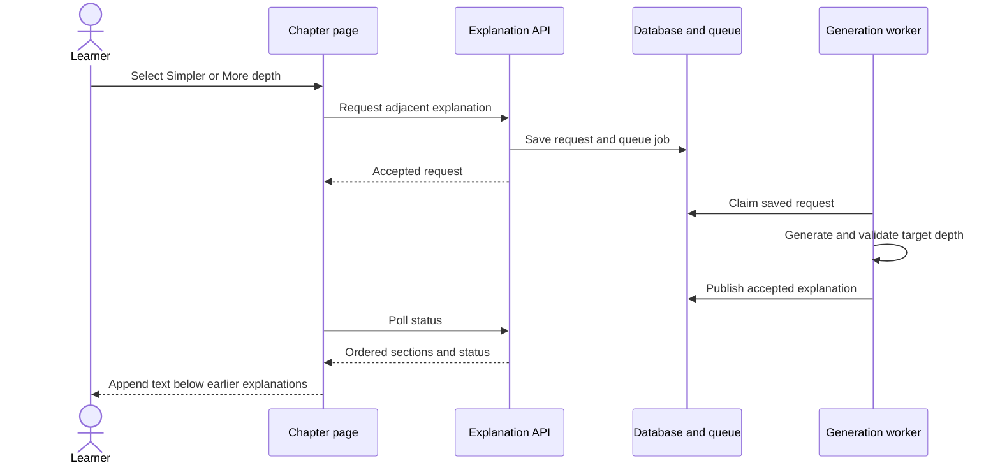

# Chapter explanation levels

## Summary

<!-- Format: State the outcome, scope, and measurable reason for doing this. -->

Add Simpler and More depth controls to every generated chapter. Each successful request appends a complete explanation while all earlier explanations remain visible. Use six explicit depth levels. New original explanations start at Guided (2 of 6). Explanation changes preserve assessment and learner progress.

## Problem

<!-- Format: Describe the current behavior, observed failure/opportunity, affected users, and evidence. -->

The current working tree has Too easy and Too hard below the quiz action. These controls record directional feedback, rather than an absolute level. They retain versions but regenerate canonical chapter fields, invalidate quizzes and change the content version used by Socratic practice. Learners need predictable depth changes and an expanding chapter. The user discussion and repository findings are the evidence; this feature makes no claim of proven learning effectiveness.

## Goals and Non-Goals

<!-- Format: Use two labeled lists: Goals and Non-goals. Keep each item testable or explicitly bounded. -->

### Goals

- Append explanations in chronological order and retain them across reloads.
- Put Simpler and More depth immediately above Check your understanding.
- Move exactly one level from the latest accepted explanation.
- Use ELI5 wording for the easiest level, with accuracy and coverage safeguards.
- Preserve assessments, completed progress and ongoing Socratic practice.

### Non-goals

- A direct level picker or global learner depth preference.
- Changes to grading, course planning or chapter unlocking.
- Streaming partial drafts or adding research retrieval.
- Replacing text, collapsing history or redesigning the reading page.
- Changing export formats. Existing exports continue using canonical chapter content.
- Redefining explicit Regenerate chapter beyond concurrency protection and retaining accepted explanation records.

## Users and Scenarios

<!-- Format: List actors and numbered scenarios. Include the expected result for each scenario. -->

### Actors

- Learner reading an open or passed chapter.
- Application API and durable generation worker.

### Scenarios

1. A learner selects Simpler from a Guided original. An Intuitive explanation appears below it.
2. A learner selects More depth repeatedly. Each accepted explanation advances one level up to Research.
3. A learner reverses direction. A fresh explanation appears at the adjacent level, even if that level was shown earlier.
4. A learner returns after leaving during generation. Accepted text and request status are restored.
5. Generation fails. All accepted text remains readable and the learner can retry explicitly.
6. An existing course has unknown depth. Its saved history remains visible without invented level labels.

## Requirements

<!-- Format: Use stable IDs such as REQ-001. For each requirement state the behavior, inputs/outputs, and priority. -->

- REQ-001 (Must): Render every accepted explanation once in persisted order. Append only after successful validation and applicable review. Never modify accepted text through the depth controls.
- REQ-002 (Must): Place the shared Simpler and More depth controls after the expanded text and existing pretest, immediately above Check your understanding. Keep that quiz link available during generation.
- REQ-003 (Must): Use 1 Intuitive, 2 Guided, 3 Applied, 4 Technical, 5 Advanced and 6 Research. The latest accepted explanation for the current canonical version sets the baseline. Failed and pending requests do not advance it.
- REQ-004 (Must): Generate new originals explicitly at Guided. Label them Original explanation · Guided. Original describes history, not a separate level. Label additions with their target level.
- REQ-005 (Must): Show Current explanation: [label] ([level] of 6). For legacy text, show Depth not recorded; adjustments start from Guided. Use 2 as its navigation baseline only, not as a measured content label.
- REQ-006 (Must): Compute adjacent targets server-side. Disable Simpler at 1 and More depth at 6 with visible boundary text. Reject forged out-of-range moves.
- REQ-007 (Must): Generate a fresh alternative for each new accepted request, including repeated visits to a level. Transport retries and worker retries of one logical request must not add duplicates.
- REQ-008 (Must): Apply the level-specific prompts below. Preserve essential objectives, correctness and prerequisite boundaries. Simpler may mean longer; deeper must not introduce unexplained later-course concepts.
- REQ-009 (Must): Each explanation is self-contained and at most 600 words. Retain current Markdown, math, Mermaid and verified-image rules. The complete expanded chapter has no 600-word limit. Follow the course quality policy and include the target level in review context.
- REQ-010 (Must): Alternative requests must not change canonical content, pretest, summary, content version, quiz state/questions, attempts, completion or Socratic session identity/state. Original generation and explicit regeneration remain separate.
- REQ-011 (Must): Allow one pending/generating alternative per chapter across tabs. Reject explanation requests during canonical generation and reject explicit regeneration while an alternative is active.
- REQ-012 (Must): Persist requests and statuses. Retain accepted text during loading, read errors and generation failure. Announce status accessibly and preserve focus and scroll position.
- REQ-013 (Must): Provide explicit retry for a failed alternative at its saved target, subject to source/baseline checks. Do not automatically retry POST mutations. Existing bounded worker retries remain allowed.
- REQ-014 (Must): Preserve existing accepted histories, unknown levels and access checks. Passed chapters remain eligible without resetting progress. Add no dependencies.

## User/System Flows

<!-- Format: Use numbered steps. Name the actor, system action, state change, and failure branch at each relevant step. -->

1. The learner opens a chapter. Existing chapter reads supply canonical state; the explanation read supplies accepted sections, baseline and any active or actionable failed request.
2. Canonical original publication saves an original timeline snapshot atomically. New originals target Guided. A read does not request an alternative.
3. The learner selects a direction. The client sends a request ID, displayed canonical version and latest accepted explanation ID. Both depth buttons disable while the request is active.
4. The API checks access, idempotency, source, baseline, bounds and active work. It inserts a pending request and enqueues a job in one transaction. Invalid requests leave text and level unchanged.
5. The worker generates at the saved absolute target using objectives, learner context, canonical text and the latest accepted explanation as reference. It validates and applies course-policy review.
6. The worker verifies ownership and freshness, then publishes content and ready status atomically. It neither invalidates a chapter nor queues a quiz.
7. The page polls active work. On success it appends one section and updates the level and valid controls. It does not move focus or automatically scroll.
8. On terminal failure it retains all accepted sections and displays Retry explanation. An explicit retry reuses the failed section request with a new job attempt version. A failed request whose baseline was superseded cannot be retried.
9. Reloads restore text and status. A transport replay with the same request ID returns the existing request rather than creating another.

## Technical Design

<!-- Format: Describe components, interfaces, data, dependencies, compatibility, security, and operational concerns. -->

### Solution Description

Give appended explanations their own persistence and generation lifecycle. Reuse the durable worker with an explicit explanation branch. This separates presentation depth from canonical chapter and assessment versions.

### Current State

- components/chapter-page.tsx sends easy/hard feedback to the chapter route and renders chapterVersions.
- lib/chapter.ts regenerates content, pretest and summary together. lib/generation.ts also invalidates quizzes.
- lib/generation-worker.ts treats non-course/non-chapter jobs as quizzes and queues quizzes after chapter jobs. Recovery helpers also need an explicit explanation branch.
- lib/quality.ts checks requested learner depth. lib/schemas.ts enforces a 600-word content limit. Socratic sessions depend on canonical content version.

### Proposed Design

- Centralize numeric levels (1 Intuitive through 6 Research), labels, Guided default, adjacent-level calculation, legacy navigation baseline, and level-specific prompt contracts in lib/explanation-levels.ts. The content-only explanationSchema in lib/schemas.ts is strict and enforces nonempty content up to 600 words.
- Add transactional persistence/request logic in lib/chapter-explanations.ts and generation in lib/explanation.ts. Use the existing chapter provider task with a content-only schema based on chapterSchema.shape.content. Do not generate replacement pretests or summaries.
- Save original snapshots during canonical publication. Render the timeline once, rather than repeating chapter.html beside it. A later explicit regeneration adds a new original snapshot; older accepted sections remain visible and distinguishable.
- Derive requests from the latest ready section for the current canonical version. Save source chapter and course preparation versions. Reject stale publication. Include canonical content and the latest explanation as quoted reference data, rather than concatenating the growing chapter into the prompt.

### Architecture / Components

- ChapterPage renders ordered sections, labels and status. MermaidContent retains the established rendering behavior.
- Explanation API handles access, validation, concurrency and idempotency through lib/chapter-explanations.ts and the explanation read/submit/retry routes. It captures source version, preparation version and baseline in a single transaction with a pending explanation job. Accepted sections remain readable while canonical generation is pending or failed. Preserve the canonical chapter GET response for existing consumers.
- Durable queue manages explanation leases, execution, bounded retries and recovery using explanation row IDs and job versions. Worker start, failure, currentness and status reads update the explanation row. Source-stale jobs fail the existing request. Explanation work never schedules quiz generation, including after lease recovery. Explicit canonical regeneration checks for active explanation work transactionally and returns 409.
- Existing provider, verified-image filtering, math validation and applicable quality review process the content-only result in lib/explanation.ts. The prompt includes only the canonical text and latest accepted explanation as quoted references; the level contract is included in generation and review context. Canonical publication writes its Guided original snapshot and originalExplanationLevel in the same transaction as chapter content.

### Data Model / API Changes

- Add chapter_explanations: id, chapterId, ordinal, kind (original/alternative/legacy), sourceContentVersion, sourcePreparationVersion, importKey, parentExplanationId, requestId, direction, level (nullable for legacy), content (nullable until ready), status (pending/generating/ready/failed), error, jobVersion, lastRetryRequestId, createdAt and generatedAt. Chapter deletion cascades. Ready content is immutable.
- Add unique (chapterId, ordinal), unique non-null (chapterId, requestId), unique non-null (chapterId, importKey), and a partial unique chapterId index for pending/generating rows. Allocate ordinal and active requests transactionally. Failed ordinal gaps are valid.
- Add nullable originalExplanationLevel to chapters. New canonical publication writes 2; legacy content stays null. Old directional depthHint is not an absolute level.
- Migration 0010 adds the timeline and imports saved chapter_versions plus current ready content in content-version order. Imported rows have kind legacy and null level. Current content with the established pending/version-1/generatedAt legacy-ready signature is also imported. Assessment and canonical fields remain untouched.
- Extend GenerationArtifact and generation_jobs artifactType with explanation. Its targetId is the explanation row ID; generationVersion is that row's jobVersion. Extend currentness, start, outcome, status, lease recovery, observability and worker dispatch explicitly.
- GET /api/chapters/[id]/explanations returns accepted sections in ordinal order, canonical version, baselineExplanationId, effectiveLevel, legacyBaseline and active/latest actionable failed request. Return 200 for readable history even if an alternative failed.
- POST /api/chapters/[id]/explanations accepts direction (simpler/deeper), requestId (UUID), expectedContentVersion and baselineExplanationId. Return 202 with explanation ID, target level and status. An identical request-ID replay returns the existing request: 200 if terminal, 202 if active. Conflicting reuse returns 409. Check idempotency before freshness for exact transport replays.
- POST /api/chapters/[id]/explanations/[explanationId]/retry accepts retry requestId and expectedJobVersion. Require terminal failure, current source and unchanged baseline. Increment jobVersion and persist lastRetryRequestId atomically; deduplicate the latest retry ID before checking expected version. A replay of an older retry after a later attempt returns conflict, never another generation. Return 202 for an accepted retry.
- Errors follow the existing error object with code, message and retryable. Use 400 for invalid input/depth boundary, 403 locked, 404 missing, and 409 for active generation, stale source/baseline or request conflict. Infrastructure errors retain existing 5xx conventions.
- Route old chapter POST difficulty through the append service for compatibility: easy maps to deeper; hard to simpler. It must not invalidate canonical generation. Support optional request IDs; legacy callers without one get a fresh logical request and no transport-idempotency guarantee. A missing live baseline is backfilled as an unknown-depth legacy section for compatibility with pre-migration records.
- Migration imports saved chapterVersions and current ready content in original generation order, once per source version, preserving exact Markdown. Keep old generationVersion in importKey. Associate imported sections with the current canonical source baseline for navigation while marking their levels unknown. Do not overwrite canonical fields or assessment data. Ready legacy content includes the existing pending/version-1/generatedAt convention. Terminally failed newer drafts are not imported as accepted content.

### Technical Decisions

- New originals start at Guided (2). Depth is chapter-local. There is no direct picker in this change.
- Intuitive: “Explain like I am 5.” Use everyday words, concrete analogies and small steps. Avoid baby talk. Define unavoidable terms and explain analogy limits.
- Guided: explain to a curious beginner; define terms when introduced and include a fully worked example.
- Applied: explain to someone who knows the basics and wants to use the idea; show realistic problems and why steps work.
- Technical: explain formal mechanisms with precise terms and relevant notation; introduce symbols before use.
- Advanced: explain relevant derivations, assumptions, trade-offs and edge cases.
- Research: explain to a specialist examining evidence, limitations and competing approaches within chapter scope. Do not invent findings or sources. This label does not promise a literature review.
- Give the target style precedence over generic accessible-language guidance, without weakening accuracy, objectives or rendering rules. Keep relevant course depth and prerequisite limits.
- Revisited levels produce fresh alternatives; request and job replay deduplication apply to one logical request only.
- Poll every 2 seconds while active; stop on terminal status/unmount. Read failure retains cached sections and allows read retry, never automatic generation.

### Trade-offs

- A separate timeline and job branch add integration work but protect assessment and Socratic semantics.
- Fresh alternatives cost more than a per-level cache and match the expanding-chapter behavior.
- All-visible history creates long pages. Keep each addition focused and preserve reading position rather than collapsing previous text.
- Unknown legacy text needs a disclosed navigation baseline instead of an invented reading-level classification.

### Failure Handling

- Insert request and job atomically. A database error leaves neither duplicate work nor a stranded active request.
- Check source versions, access and job ownership at publication. Handle lost leases, deleted/locked chapters and changed plans without partial output or duplicate acceptance.
- Reuse bounded worker retry and repair budgets. A terminal failure leaves the accepted level unchanged.
- Explicit regeneration rejects active explanation work. Its new source version invalidates stale failed retries but retains accepted explanation records.

### Testing Strategy

- Unit tests cover target arithmetic, bounds, Guided default, six prompts and ELI5 guardrails.
- Database/API tests cover migration preservation, repeated-level alternatives, idempotency, two-tab races, stale inputs and retry attempt versions.
- Worker tests cover explanation dispatch, quality/validation rejection, leases and recovery without quiz scheduling or canonical mutation.
- UI tests cover labels/order, history retention, reload, boundaries, pending/error/retry and unchanged quiz/Socratic state.
- One browser flow covers Guided → Intuitive → Guided → Applied with all sections retained and keyboard access at a narrow viewport.

## Decisions and Constraints

<!-- Format: Separate Confirmed decisions, Assumptions, Constraints, and Open questions. Do not hide unresolved choices. -->

### Confirmed decisions

- Labels are Simpler and More depth.
- Append new explanations while every earlier explanation stays visible.
- Put these controls above Check your understanding.
- Use ELI5 phrasing in the easiest prompt. The user responded positively to the proposed ladder and starting point, then invoked specification.

### Assumptions

- Adopt the six discussed levels with Guided as the new-original default.
- Generate a fresh alternative when returning to a previously shown level.
- Preserve quizzes, mastery requirements, completed progress and Socratic practice.
- Use a chapter-local level; keep existing canonical-content export behavior.
- Two optional clarification questions about repeated levels and quizzes received no answer before this draft. These defaults are explicit review assumptions, not separately confirmed answers.

### Constraints

- Integrate with pre-existing uncommitted version-history work. Do not revert unrelated edits or reuse an occupied migration number.
- Use current providers, SQLite/Drizzle, durable queue and course quality policy. Add no dependencies.
- The installed Next.js route-handler guide was read at node_modules/next/dist/docs/01-app/01-getting-started/15-route-handlers.md. Recheck relevant installed guides before implementation.
- Preserve Markdown/math/image validation. Depth labels describe requested presentation, not measured skill or guaranteed reading ages.
- Rollout must stop old workers and drain legacy adjustment jobs to terminal state before migration, with a database backup. Old and new adjustment code must not publish concurrently.

### Open questions

- No implementation blocker under the stated defaults. Update this specification first if the user changes a default.

## Edge Cases and Failure Handling

<!-- Format: Use a case/action table or bullets with trigger, expected behavior, recovery, and user-visible error. -->

- Boundary: disable the unavailable direction, explain it in text and reject forged moves without inserting a request.
- Rapid clicks/two tabs: active-request uniqueness and baseline checks accept one request; the other refetches after conflict.
- Lost POST response: an explicit transport retry reuses its request ID and returns the same logical request.
- Previously shown target level: append a fresh alternative rather than jump to old text.
- Unknown legacy depth: retain original text, disclose the Guided navigation baseline and label only explicit new target levels.
- Empty/unready/locked chapter: reject until canonical content is ready and access is allowed. Passed chapters remain eligible.
- Invalid draft or review rejection: publish no partial text; preserve accepted sections and allow explicit retry.
- Superseded failed request: reject retry if a newer success or source regeneration changed its baseline.
- Worker restart/expired lease: resume or fail the existing logical request without extra accepted sections or quizzes.
- Explicit regeneration: reject while alternative generation runs; preserve accepted explanation records when a new original is accepted.
- Migration duplicates: deduplicate by source/import key, not by text equality. Preserve distinct source versions with identical text. Verify ready, legacy-ready and terminal-failure fixtures.
- Polling failure/long history: preserve cached text, scroll and focus. A read retry must not create work.

## Acceptance Criteria

<!-- Format: Use stable IDs such as AC-001. Make each criterion observable and state how it will be verified. -->

- AC-001: A new original targets Guided, shows Guided (2 of 6), and renders once. Verify prompt and page tests.
- AC-002: Guided → Intuitive → Guided → Applied yields four ordered visible sections whose earlier Markdown remains unchanged after reload. Verify database/API and browser tests.
- AC-003: Exact labels and DOM order place both controls immediately above the quiz action after expanded text/pretest. Verify desktop/mobile keyboard access.
- AC-004: Intuitive includes ELI5 plus accuracy/analogy safeguards; all levels have distinct contracts and common objective/prerequisite rules. Verify prompt tests and representative output inspection.
- AC-005: Boundary moves, stale inputs and two-tab races cannot create invalid additions. Replayed requests yield one logical result. Verify API/database tests.
- AC-006: Pending, failed and retried requests retain all text. Only acceptance advances the level; retries append once. Verify worker/UI tests.
- AC-007: Canonical fields, quiz/questions, attempts, completion and Socratic session identity/revision are unchanged before and after alternative work, including recovery. Verify stored snapshots and queue contents.
- AC-008: Migration preserves existing history and assessment data, retains unknown depth honestly and exposes the navigation baseline. Verify migration fixtures.
- AC-009: Every published addition meets its 600-word, rendering and applicable review rules; rejected content is absent. Verify generator/worker tests.
- AC-010: Reload and lease recovery complete or fail existing work without duplicate sections or quizzes. Verify worker/page tests.
- AC-011: Typecheck, lint, affected tests and the targeted browser flow pass. Identify any unrelated baseline failures separately.

## Explanation and Output Artifacts

<!-- Format: Use labeled fields: Audience, Writing profile, Primary artifact, Supporting artifacts, and Accessibility. Prefer an 80% ASD-STE100 controlled-language style for explanatory prose unless strict ASD-STE100 or plain language is required. Choose the clearest medium: prose, diagram, interactive HTML, or narrated explainer video. State the topic, purpose, interaction or narration needs, delivery location, and acceptance evidence for each requested artifact. -->

- Audience: Learners need clear depth labels and retained explanations. Maintainers need the flow and evidence that assessment state stays stable.
- Writing profile: Use an 80%-ASD-STE100 style for explanatory prose: short sentences, direct verbs and consistent names. Generated chapters retain conversational teaching and level-specific contracts.
- Primary artifact: Prose specification at specs/chapter-explanation-levels/spec.md describes behavior and implementation. Acceptance-criteria results in build notes provide completion evidence.
- Supporting artifacts: The sequence diagram explains the request flow. CLI-generated task.md lists executable work. Build notes record verification and representative output checks. No interactive HTML or narrated video is needed.
- Accessibility: Use meaningful section headings, native controls, visible focus and polite progress messages. Explain boundaries/errors with text. Preserve focus and scroll; do not rely on color.

## Implementation Plan

<!-- Format: Use ordered, independently verifiable tasks. Include dependencies and the files or boundaries affected. -->

1. Define shared levels, target calculation and prompt contracts in lib/explanation-levels.ts and a content-only schema in lib/schemas.ts. Test bounds, ELI5, Guided originals and legacy baselines. No dependencies.
2. Add timeline persistence, original-level metadata, indexes and the next available additive Drizzle migration. Test preservation of existing histories and assessment data on fresh and upgraded temporary databases. Depends on step 1.
3. Implement transactional request/read/retry services and explanation API routes; adapt legacy feedback without canonical invalidation. Test request IDs, concurrent work, stale baselines and retry versions. Depends on step 2.
4. Implement alternative generation in lib/explanation.ts using existing provider, normalization and applicable review. Add Guided original prompts and atomic original snapshots to lib/chapter.ts. Test source guards and invalid drafts. Depends on steps 1–3.
5. Integrate explanation jobs into generation types, worker dispatch, status, retries, recovery and observability. Protect explicit regeneration from overlap. Verify no assessment/Socratic mutation or quiz scheduling. Depends on steps 3–4.
6. Update components/chapter-page.tsx and response types to render the timeline and exact controls/statuses above the quiz action. Preserve text, focus and scroll; poll active work and offer explicit retry. Update existing adjustment tests without reverting unrelated work. Depends on steps 3–5.
7. Add the append/reload browser scenario and regression coverage for repeat levels, migrated/passed chapters, stable assessments and interrupted work. Depends on steps 2–6.
8. Verify typecheck, lint, affected Vitest tests and the targeted Playwright flow; inspect representative outputs and record rollout checks and deviations. Depends on step 7.

## Verification and Implementation Notes

<!-- Format: List commands/tests, expected evidence, rollout checks, and a place to record deviations. -->

- Record exact test files and results against acceptance criteria during build, using mocked providers for automated tests.
- Run npm run typecheck and npm run lint. Run npm test -- <affected test paths>, including updated app/chapter-versions.test.ts and components/chapter-page-adjustments.test.tsx. Run npm run test:e2e -- <targeted scenario file>.
- Verify migrations on temporary fresh and existing-history databases. Do not run verification migrations against the active user database. Use the next free migration number.
- Verify no explanation job changes canonical version or quiz/Socratic/progress state, including retries, duplicate completion and expired leases.
- Record one representative output check per level for objective coverage, target depth, word count and rendering. Mark manual output checks pending if no live provider is available.
- Document the rollout procedure: back up the database, stop the old worker, drain legacy adjustment jobs, apply the migration, check history order and verify one append. Validate the procedure on a temporary database; production deployment is outside this build unless separately requested.
- Record deviations and changes to default assumptions before building affected tasks. Keep the specification and task list synchronized.
- Evidence: `npm test -- lib/explanation-levels.test.ts lib/schemas.test.ts` passed (2 files, 8 tests); `npm run typecheck` passed for T1. The content-only schema is strict because Zod otherwise accepts and strips unknown fields.
- Evidence: `npm test -- lib/db/migrations.test.ts` passed (fresh and upgraded temporary SQLite fixtures, 2 tests); `npm test -- app/chapter-versions.test.ts` passed (5 tests, full migration chain); `npm run typecheck` passed for T2. Migration 0010 imports ordered legacy explanations and preserves existing chapter, history, and question rows.
- Evidence: `npm test -- app/chapter-versions.test.ts lib/chapter-explanations.test.ts` passed (2 files, 10 tests); `npm run typecheck` passed for T3. Tests cover request replay/conflict, active work, stale source/baseline, depth bounds, retry job versions, unknown legacy levels, and passed/locked chapters. The job artifact type now includes explanation; worker dispatch/recovery remains T5.
- Evidence: `npm test -- lib/explanation.test.ts lib/chapter.test.ts` passed (2 files, 14 tests); `npm run typecheck` passed for T4. Tests cover content-only generation, target-level review context, math repair, stale-source rejection, stable canonical/quiz state, Guided publication metadata, and retained originals on regeneration.
- Evidence: `npm test -- lib/explanation-worker.test.ts lib/generation-worker.test.ts lib/generation.test.ts app/chapter-versions.test.ts` passed (4 files, 19 tests); `npm run typecheck` passed for T5. Tests cover dispatch, bounded retries, source-stale failure, published-job recovery without quizzes, stable chapter fields, and explicit-regeneration conflict.
- Evidence: `npm test -- components/chapter-page-adjustments.test.tsx components/chapter-page-loading.test.tsx components/chapter-page.test.tsx` passed (3 files, 19 tests); `npm run typecheck` passed for T6. UI coverage verifies ordered append-only sections, control placement, level boundaries, legacy-depth disclosure, focus retention, active polling/status, explicit retry, stable quiz cache, and cached text during status-read failure. Explanation timeline reads are enabled only after chapter content is ready; retry requests do not auto-retry.
- Evidence: `npx playwright test --config=/tmp/playwright.chapter-explanation.config.ts e2e/chapter-explanation-levels.spec.ts` passed (1 browser test, existing dev server at port 3000). `npm test -- components/chapter-page-adjustments.test.tsx components/chapter-page.test.tsx` passed (2 files, 8 tests); `npm run typecheck` passed. Browser coverage exercises a migrated/passed chapter, explicit recovery from interrupted work, repeat level append, reload persistence, stable quiz navigation, and no assessment request. Fixed current-level display to follow the latest retained section at the effective level. Normal project Playwright config targets port 3100; an existing dev server occupied port 3000, so this run used a temporary external config against that server without changing project config.
- Evidence: T8 verification: `npm run lint` and `npm run typecheck` passed with no lint warnings; all 13 affected Vitest files passed (68 tests); targeted Playwright passed (1 test). `npm test -- --reporter=dot` ran 51 files/416 tests and reported 10 failures in 3 files (course preparation rejection state, layout CSS contract, and course-page loading/accessibility expectations among the failures); these failures were outside the affected test selection, and their baseline status is unconfirmed. The explanation-related 13-file suite passes independently. No active-user database migration was run; migration validation remains in temporary SQLite fixtures. The 6-level sample output inspection is recorded separately under T13.

- Evidence: T9 acceptance mapping: AC-001 through AC-010 are covered by the exact test commands and outcomes recorded above for T1–T12. AC-011 lint, typecheck, 13 affected Vitest files (68 tests), and targeted Playwright passed; full suite had 10 failures in 3 files outside the affected test selection, with baseline status unconfirmed. AC-003 mobile browser verification remains pending. Automated generation tests use mocked providers.
- Evidence: T13 prompt-contract checks cover Intuitive (ELI5, accuracy, analogy limits), Guided (terms and steps), Applied (practical examples), Technical (precise mechanisms/equations), Advanced (assumptions and edge cases), and Research (supported formal framing and limitations). No live provider output was generated; objective coverage, target-depth quality, actual word counts, and rendered output remain pending for all six levels.
- Evidence: T16 rollout procedure documented: back up and verify the SQLite database; stop the old worker; drain legacy adjustment jobs; deploy and apply migration 0010; inspect ordered history and unknown legacy depth; append one alternative and verify stable canonical, assessment, and Socratic state; resume and monitor the worker. Temporary SQLite migration fixtures and service/worker tests validate fresh/upgraded history, append order, and state stability. Production state was not changed.
- Evidence: T17 deviations: no product assumptions changed. The Playwright run used a temporary `/tmp` config against the existing port 3000 server because the standard 3100 server could not acquire the shared Next dev lock; project config stayed unchanged. Browser testing led the current-level indicator to follow the newest retained section at the effective level. The full-suite failures and pending live output/mobile checks are recorded above; no production migration, worker stop, or deployment occurred.
