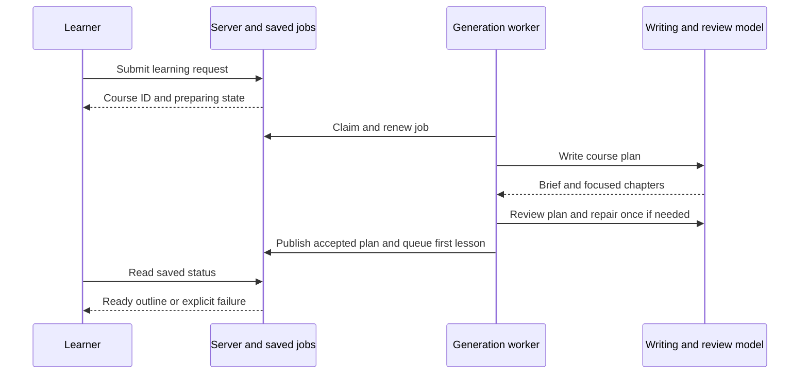

# Course generation quality

## Summary

<!-- Format: State the outcome, scope, and measurable reason for doing this. -->

Improve all new courses through a durable, reviewed teaching plan, short focused lessons, and lesson-grounded quizzes. Preserve the one-field creation flow and all existing courses. New course planning, chapters, and quizzes must pass structural checks and a separate semantic review before publication.

## Problem

<!-- Format: Describe the current behavior, observed failure/opportunity, affected users, and evidence. -->

The saved Operating Systems example repeats elementary resource/process explanations for an experienced engineer and has self-dependent chapters. The current system drops the original request, gives chapter writers no full outline, and gives quiz writers no lesson text. Generation shape validation cannot detect weak pedagogy or impossible dependency graphs. Review adds latency that exceeds the current 120-second job lease.

## Goals and Non-Goals

<!-- Format: Use two labeled lists: Goals and Non-goals. Keep each item testable or explicitly bounded. -->

### Goals

- Preserve request intent and calibrate instruction to relevant background.
- Give every chapter a distinct capability and teaching boundary.
- Review plans, lessons, and quizzes with one bounded repair.
- Prepare courses durably with real status and explicit retry.
- Keep lessons within 600 words and preserve established assessment rules.

### Non-goals

- Upgrade, replan, or repair existing courses automatically.
- Prove prior knowledge, factual correctness, or learning effectiveness.
- Add providers, research browsing, new visual engines, new assessment types, or an onboarding questionnaire.
- Change existing mastery thresholds, attempts, or completed progress.

## Users and Scenarios

<!-- Format: List actors and numbered scenarios. Include the expected result for each scenario. -->

### Actors

- Learner creating or studying a course.
- Server generation worker and configured Codex or Claude CLI.
- Maintainer reviewing generation quality and operational evidence.

### Scenarios

1. An experienced engineer requests OS and receives focused mechanisms and applications rather than repeated computer-literacy lessons.
2. A beginner or learner entering an unfamiliar domain receives the necessary foundation without inferred unrelated expertise.
3. A learner returns after restarting the server and sees preparation resume or an actionable failure.
4. A lesson or quiz fails review; it is repaired once and reviewed again, or remains unavailable with explicit retry.
5. An existing course remains readable with its original content, progress, and generation policy.

## Requirements

<!-- Format: Use stable IDs such as REQ-001. For each requirement state the behavior, inputs/outputs, and priority. -->

- REQ-001 (P0): New creation persists the original request, selected agent, quality policy version 1, and pending preparation state and enqueues one course job atomically; return 202 with courseId without waiting for the model.
- REQ-002 (P0): Generate a course brief and 1–24 chapters together. Brief fields: outcome, assumedKnowledge, likelyGaps, and depthGuidance. Chapter teaching fields: capability, introduces, assumes, and application. Use current learner context without claiming demonstrated mastery; explicit request scope takes precedence.
- REQ-003 (P0): Require unique, strictly earlier prerequisite indexes and distinct normalized titles. Validate the entire resulting graph on creation and pre-study edits. Never silently delete invalid edges.
- REQ-004 (P0): Review each new-policy plan, chapter, and quiz separately with blocking issues and warnings tied to concrete artifact evidence. Accept only zero blocking issues. Allow at most two drafts and two reviews per attempt; structural failures use the same two-draft budget. Persistent quality failure is terminal until explicit retry.
- REQ-005 (P0): Chapters use the preserved request, accepted brief, full outline/teaching boundaries, previous summaries, current profile, depth feedback, and missed concepts. Keep 600 words including image attribution. Use concrete applications and appropriate supported visuals.
- REQ-006 (P0): New-policy quizzes use the accepted lesson, intended outcomes, brief, and outline. Preserve ten four-option MCQs, one correct answer, balanced positions, local grading, and up to two due review items.
- REQ-007 (P0): Renew job leases every 30 seconds while owned. Verify live lease ownership and generation version inside publication transactions. Transient CLI failures retain the existing maximum of three job attempts; failed semantic review must not trigger automatic whole-job retries.
- REQ-008 (P0): Persist and expose preparation status, actual stage, version, safe error, and retry state. Terminal states stop polling; explicit retries coalesce while pending/running. No unreviewed draft or previous-version content may be served as current ready content.
- REQ-009 (P0): Legacy courses retain their generation behavior and cached content. New metadata is nullable/default-compatible. Profile edits affect future artifacts without mutating accepted goals, course graphs, or saved progress.
- REQ-010 (P1): Log stage duration, issue counts, repair counts, and artifact identifiers without raw requests, learner background, or lesson text. Use existing UI geometry and accessible status/error controls.

## User/System Flows

<!-- Format: Use numbered steps. Name the actor, system action, state change, and failure branch at each relevant step. -->

1. Learner submits a request. Server validates it, chooses an installed agent, saves the pending course and course job in one transaction, and returns its ID. The client navigates to the course page.
2. Worker claims the course job, renews its lease, and captures the latest profile once for the attempt. It generates and reviews a brief plus syllabus; one repair is allowed. Only an accepted plan is atomically persisted as ready, with chapter 0 open and its warm-up job queued.
3. Course page polls the saved preparation state every two seconds while pending/generating. It shows the real stage, survives reload, and shows an explicit retry action on failure. Retry restarts preparation for the same course and cannot duplicate a running job.
4. Worker generates a lesson from the accepted plan and current context, filters images, validates, reviews, and optionally repairs/reviews. Only accepted content becomes ready. Its quiz is queued afterward.
5. Quiz generation uses the accepted lesson, reviews the question set, repairs once when needed, balances options, and publishes atomically. Normal practice, grading, and progression then proceed unchanged.
6. For new-policy course edits before study, merge the requested metadata with the full saved outline, validate and review the resulting plan, and commit only if study has not started and the plan version is unchanged. Invalidate pending artifact versions and warm chapter 0 against the revised plan. Legacy edit behavior gains graph validation but no semantic review.
7. A transient process failure is retried within the bounded job budget. Exhausted failures and persistent review failures show a safe error; explicit learner action is needed to retry. Existing content is never relabeled as the new ready version.

## Technical Design

<!-- Format: Describe components, interfaces, data, dependencies, compatibility, security, and operational concerns. -->

### Solution Description

Extend the existing SQLite generation queue with a course artifact and lease renewal. Add shared pure contracts and a reviewed-generation helper. Reuse both CLI adapters and existing Markdown features. New-policy artifacts pass validation and review before transactional publication; legacy generation follows its current path.

### Current State

Syllabuses are generated synchronously. Jobs cover chapters and quizzes with fixed leases. Course metadata has no preserved request or accepted teaching plan. Quiz prompts are not grounded in lessons.

### Proposed Design

Use a shared `generateReviewedObject` helper: write -> validate/normalize -> review -> accept or repair once -> validate/normalize -> review -> accept/fail. Review output is a bounded list of issues containing severity (blocking/warning), category, location, evidence, and repair guidance. Categories cover learner fit, coverage, repetition, prerequisite order, unsupported concepts, application, alignment, ambiguity, and correctness concerns. Reject malformed review output as a generation failure, never treat it as approval. Reviews use the separate review task on the same selected agent, with optional existing-style per-task model environment overrides. There is no additional agent orchestration service. Inspection found that the Claude adapter previously omitted the schema from its prompt. Include the complete JSON Schema in Claude prompts so writing and review contracts work with both providers.

The helper revalidates normalized content before review and publication, so reviewers see the exact lesson that will be stored, including image filtering. Capture profile context once per job attempt. The existing course outcome and graph remain fixed when profiles change.

Use course preparation stages `planning`, `reviewing`, and `repairing`; chapter/quiz jobs continue their existing statuses. New-policy HTTP reads enqueue missing jobs and return 202 rather than awaiting multi-call work. Poll pending artifacts and show terminal failures distinctly. Explicit chapter retry uses the existing regeneration action; quiz retry uses a new explicit retry endpoint and preserves attempted question history. Read requests do not silently restart terminal new-policy failures.

### Architecture / Components

- Shared contracts/quality module owns course briefs, teaching plans, graph validation, review schemas, and bounded generation.
- Course planner owns accepted plan persistence and draft review. Existing generation coordinator/worker owns course jobs, heartbeats, lease fencing, status, and retries.
- Existing chapter and quiz modules receive expanded context and invoke review only for quality-policy courses. API and UI modules expose preparation/recovery states.

### Data Model / API Changes

- Add nullable course `learningRequest`, JSON `brief`, `qualityPolicyVersion`, and `generationAgent`. Add preparation status (default ready for legacy), stage, safe error, updated timestamp, and preparation version (default 1).
- Add nullable chapter JSON `teachingPlan`. Extend job artifact types with `course`; course jobs use the course ID and preparation version. Keep job uniqueness by artifact/target/version.
- POST /api/courses returns 202 `{ courseId, status: pending }` for new submissions. Course GET/list include preparation metadata; detail still includes chapters/progress and returns 200 for readable saved status. No draft plan is returned before acceptance.
- POST /api/courses/:id/retry requeues a failed new-policy preparation, returning 202, and coalesces pending/running work. Ready/legacy courses return 409.
- New-policy chapter/quiz reads return 202 while pending/generating and 503 with a retryable safe error when terminally failed; retryable means explicit user recovery is possible. POST /api/chapters/:id/quiz/retry requeues failed or missing quiz work after accepted current lesson readiness.
- Preserve existing legacy API success shapes. Export of a preparing/failed new course returns 409; accepted new courses export saved content only.

### Technical Decisions

- Quality policy version 1 selects the new pipeline; null selects legacy behavior.
- Chapter count is 1–24: permit narrow refreshers and sufficient subdivisions while bounding planning/context size. Keep 600-word lessons and ten-question assessments.
- One repair per artifact attempt. `QualityError` is terminal for automatic retries; transient CLI errors may retry up to three job attempts. Each successful reviewed attempt uses two calls; a repaired attempt uses at most four calls.
- Heartbeats renew the existing 120-second lease every 30 seconds. Lost lease or stale version prevents commits. A process restart recovers expired work through the existing queue. Expired leases that have exhausted three attempts become failed instead of being retried indefinitely. If publication succeeded before the worker crashed, recovery recognizes the ready artifact, completes the job without rewriting it, and restores a missing quiz follow-up job. Per-call timeout stays 60 seconds.
- Store the selected agent on new courses for durable work after cookies disappear. Use the latest profile when an attempt starts. Do not log this context.
- Keep draft artifacts in memory; a crash restarts the bounded attempt, not a partial publication. No transaction spans an LLM call.
- Legacy courses are not upgraded. New pre-study edits are reviewed against merged outline/teaching metadata; inconsistent edits may be rejected with a safe review error. Commit rechecks startedAt/version and invalidates old warm-up versions atomically.

### Trade-offs

Review adds model latency and can make subjective mistakes. Background status prevents long HTTP waits; short focused rubrics and one repair bound normal cost. Source-backed factual verification and diagnostic placement remain outside scope.

### Failure Handling

Use safe classified errors and owned-lease checks. Quality rejection is terminal until explicit retry. Transient call failure follows existing retry backoff. A stale/lost attempt never publishes content, status, or follow-up jobs. Stage transitions, job acknowledgement, follow-up enqueueing, and failure transitions check ownership/version within SQLite transactions, alongside artifact publication.

### Testing Strategy

Use pure contract tests, mocked writer/reviewer calls, migrated in-memory SQLite route/worker tests, heartbeat/lost-lease tests, legacy regression tests, and browser status/retry/mobile checks. A small persona evaluation rubric checks learner fit, distinct progression, prerequisite support, and assessment alignment. Run a live new-course smoke through available CLI if practical and record limitations honestly.

## Decisions and Constraints

<!-- Format: Separate Confirmed decisions, Assumptions, Constraints, and Open questions. Do not hide unresolved choices. -->

### Confirmed Decisions

- The user approved building according to the recommendations: review syllabuses, lessons, and quizzes; one repair attempt; 600-word focused lessons; durable background preparation with visible state/retry; preserve existing courses.
- Use the existing Codex/Claude adapters and product design.

### Assumptions

- A bounded 1–24 chapter range suits both narrow refreshers and broader subjects.
- Separate review calls can initially use the same agent/model configuration as writing.
- Updated profile context changes future explanations without silently replanning the course.

### Constraints

- Keep one-field onboarding, current mastery policy, answer balancing, attempted-question history, and explicit regeneration.
- Do not perform LLM calls inside SQLite transactions or expose draft/invalid output.
- The installed MSDD CLI derives tasks from all prose in verification notes, including Evidence records. Store Evidence records in HTML comments in that section so they remain in the source without creating spurious tasks.
- Read the installed Next.js guides before implementation of relevant framework code.

### Open Questions

- None block this implementation. Record any material discovery immediately in this living specification.

## Edge Cases and Failure Handling

<!-- Format: Use a case/action table or bullets with trigger, expected behavior, recovery, and user-visible error. -->

- Empty/invalid request: reject before database writes.
- Missing installed agent: return the existing 503 configuration error; do not save a pending course that cannot run.
- Self/forward/missing/duplicate prerequisite: reject the draft, use one repair, and publish no invalid graph.
- Reviewer blocking issue persists or output is malformed: fail preparation without publishing the draft; allow explicit retry.
- CLI timeout/offline: retry within the job attempt budget; show pending state and final safe failure.
- Lease stolen/expired or generation superseded: discard results and follow-up jobs; another owner can finish.
- Restart during review: recover expired job and repeat a bounded attempt; no duplicate chapters or question sets.
- Profile changes mid-attempt: finish using captured context; future attempts use latest profile.
- Edit races with first-lesson warm-up: recheck startedAt/version inside the commit transaction; return 409 if study has begun, otherwise invalidate old versions.
- Failed regeneration retains older stored text: never serve it as accepted current-version content.
- Preparing course has no chapters: show preparation state, not an empty-course error or completion.
- Legacy rows lack new metadata: use existing generation/render/export behavior; preserve their content and evidence.

## Acceptance Criteria

<!-- Format: Use stable IDs such as AC-001. Make each criterion observable and state how it will be verified. -->

- AC-001: New creation returns 202 promptly and atomically saves the request, policy, agent, and one durable course job; invalid input saves nothing.
- AC-002: Plans accept 1–24 chapters and only valid backward dependency graphs. Invalid drafts can repair once; persistent failures publish no chapters.
- AC-003: Every accepted new-policy artifact has a completed separate review of exactly the normalized stored output; unaccepted drafts never become ready.
- AC-004: New lesson prompts contain preserved intent, brief, full outline, teaching boundary, and captured learner context; quiz prompts contain the accepted lesson and objectives.
- AC-005: Fake-time tests prove lease renewal and lost-lease/version fencing prevent stale commits and duplicate follow-up jobs.
- AC-006: Browser checks prove pending/reviewing/failed/retry/ready course states, reload recovery, and desktop/mobile layout without new onboarding questions.
- AC-007: New-policy artifact reads do not restart terminal failures or serve older-version content. Explicit retries coalesce and preserve historical questions/attempts.
- AC-008: Legacy courses retain content, progress, export, profile-personalization behavior, and existing MCQ invariants.
- AC-009: Pre-study edits validate/review the full resulting plan and cannot commit after warm-up starts study or against a changed revision.
- AC-010: Focused tests, typecheck, lint, and browser checks pass; full-suite results and persona/live-smoke limitations are recorded.

## Explanation and Output Artifacts

<!-- Format: Use labeled fields: Audience, Writing profile, Primary artifact, Supporting artifacts, and Accessibility. Prefer an 80% ASD-STE100 controlled-language style for explanatory prose unless strict ASD-STE100 or plain language is required. Choose the clearest medium: prose, diagram, interactive HTML, or narrated explainer video. State the topic, purpose, interaction or narration needs, delivery location, and acceptance evidence for each requested artifact. -->

- Audience: Maintainers implementing/reviewing the change and learners using preparation/retry states.
- Writing profile: 80% ASD-STE100; use short direct explanations and familiar UI wording.
- Primary artifact: This specification with one sequence diagram explaining the background writing/review/publication flow; no interactive HTML or narrated video is needed.
- Supporting artifacts: Generated task.md, focused automated-test evidence, browser preparation/retry evidence, and a concise persona evaluation rubric/results in implementation notes.
- Accessibility: Status and errors use text and accessible controls; no reliance on color or animation. Diagram meaning is also described in prose.

## Implementation Plan

<!-- Format: Use ordered, independently verifiable tasks. Include dependencies and the files or boundaries affected. -->

1. Add course-quality contracts, backward-graph validation, review contracts, compatible persistence fields, and a migration; verify pure schemas and legacy migration defaults.
2. Implement bounded reviewed generation and durable reviewed course preparation, including owned lease renewal/publication, API creation/status/retry, and worker integration; verify with in-memory tests.
3. Integrate reviewed chapter and lesson-grounded quiz generation, current-version serving and explicit retry, and safe pre-study plan edits; verify context, rejection, and compatibility.
4. Implement real course preparation and artifact recovery UI with polling, status, retry, reload support, and legacy fallbacks; verify component behavior and desktop/mobile browser flows.
5. Run integrated regression checks, exercise representative persona/live generation where practical, update user-facing documentation and this specification with evidence, and reconcile the completed task list.

## Verification and Implementation Notes

<!-- Format: List commands/tests, expected evidence, rollout checks, and a place to record deviations. -->

- Verify contracts and publication with focused Vitest suites after each implementation task; run typecheck for interface changes.
- Verify final behavior with npm run lint, npm run typecheck, npm test, and focused Playwright flows; record any pre-existing failures separately.
- Verify the migration on an isolated database first and check legacy rows retain ready/default behavior; use the app migration command for the development server only when ready for live checks.
- Verify representative persona cases and a new-course preparation smoke when an installed CLI is available; do not claim semantic quality from mocked output alone.

<!-- Evidence: Specification created from the saved exploration and the user's approval of the recommended defaults. -->

<!-- Evidence: T1 added bounded course/review contracts and nullable teaching metadata. Migration 0006 uses additive columns only; existing courses default to ready and keep null quality-policy metadata. Focused contract/schema tests and typecheck passed. -->

<!-- Evidence: T2 implemented two-draft reviewed generation, durable course preparation, 30-second heartbeats, lease-fenced publication, atomic creation and retry APIs, and safe failure logging. Thirteen focused quality/coordinator/preparation tests passed, including a simulated 150-second review and stolen lease. Course creation now returns 202 and stores the full request plus the selected agent. -->

<!-- Evidence: T3 added full-outline teaching context, reviewed normalized lessons, lesson-grounded reviewed quizzes, nonblocking current-policy reads, explicit retry, and complete-graph reviewed edits with revision/start fencing. Focused new/legacy generation and profile tests validate the new paths. -->

<!-- Evidence: T4 component checks passed (51 tests across preparation, creation, chapter adjustments/loading, and quiz loading). Creation no longer advances simulated review progress. New-policy pending reads poll every two seconds with a visible exit; terminal quality failures require explicit POST recovery. Legacy retry behavior is preserved. -->

<!-- Evidence: T4 browser checks passed at 390px and 1440px: planning, review, reload, terminal failure polling stop, one explicit retry, and ready navigation. Existing chapter-image layout also passed. A selector initially matched both overview Continue links; the browser assertion now targets the chapter-row link explicitly. The application migration command applied additive migration 0006 successfully. -->

<!-- Evidence: T5 full regression passed: npm test -- --silent reported 36 files and 258 tests passing. npm run typecheck and npm run lint passed. npm run build produced a successful production build with all new retry routes. After tightening transactional fencing and adding redacted writer-stage/category telemetry, 20 focused quality/coordinator/preparation/learning tests and typecheck/lint passed again. -->

<!-- Evidence: Live Codex evaluation used data/quality-smoke.db, separate from learner data. Course 82a4ef0f-b763-4855-a050-6b8d4631e3e7 produced three ordered lessons: Address Spaces and Memory Protection; User and Kernel Privilege; System Calls Across the Isolation Boundary. The plan completed writing/review in 48.1 seconds. Chapter zero completed in 54.4 seconds and has 518 words, a worked virtual-address trace, a mapping table, protection faults, and deliberate sharing. Its quiz reviewer found one blocking issue, repair used the single allowed attempt, and the second review accepted the ten-question set. Quiz preparation took 90.8 seconds. No initial quiz draft was published. -->

<!-- Evidence: Manual rubric inspection of that experienced-engineer case found distinct lesson capabilities, backward prerequisites, relevant assumed knowledge, a concrete mechanism trace, and application questions supported by the accepted lesson. Additional live planning checks below cover beginner and unrelated-domain calibration; only the experienced-engineer case exercised generated lessons and quizzes end to end. These checks do not establish universal semantic quality. This evaluation does not establish factual accuracy or learning effectiveness. Live smoke initially selected a locked chapter because a harness query lacked ordering; the harness was corrected to select index zero and resumed the same accepted course without rewriting its plan. -->

<!-- Evidence: Migration 0006 was checked on an isolated migrated database and applied to the development database. The saved Operating Systems course remains legacy-policy/null and ready, with 3 of 12 chapters passed. Two idle project app processes on ports 3000 and 3100 were restarted to activate the new queue format; no active generation jobs were interrupted. -->

<!-- Evidence: The real generated course was also served from the isolated database on port 3102. A browser opened its actual outline, 518-word lesson, and accepted quiz at 390px and 1440px, verified four visible choices and ten persisted questions, and found no horizontal overflow. No answers were submitted. Screenshots are /tmp/mastery-quality-live-390.png and /tmp/mastery-quality-live-1440.png. -->

<!-- Evidence: T6 is satisfied by per-task focused suites and interface typechecks recorded above, including normalized review, graph rejection, real publication, lost leases, 150-second renewal, profile updates, stale serving, safe edits, and legacy behavior. -->

<!-- Evidence: T7 final checks passed after all code changes: 36 Vitest files / 258 tests, lint, typecheck, production build, and git diff --check. Browser preparation/recovery checks and real-model read-through evidence are recorded above. No automated test failures remain. -->

<!-- Evidence: T8 migration verification is complete: additive migration/defaults passed in migrated in-memory SQLite before applying to the app; both restarted app processes applied migration 0006 successfully, and a read-only request confirmed the original OS course remains ready with legacy policy and 3/12 progress. No legacy course rewrite was performed. -->

<!-- Evidence: T9 additional live Codex planning checks passed without repair: (1) no-profile beginner OS request produced six distinct lessons and an empty assumedKnowledge list, progressing from running programs to scheduling, allocation/protection, paging, file abstractions, and reliable storage; (2) experienced engineer requesting photosynthesis from scratch produced two introductory lessons and explicitly assumed no biology knowledge. Manual inspection found appropriate vocabulary guidance, distinct capabilities, and backward prerequisite graphs. The second case reused engineering-style input/output reasoning without treating programming experience as biology expertise. Reports are /tmp/mastery-course-quality-personas.json and /tmp/mastery-course-quality-smoke.json; all generated test records remain in the separate quality-smoke database. -->
