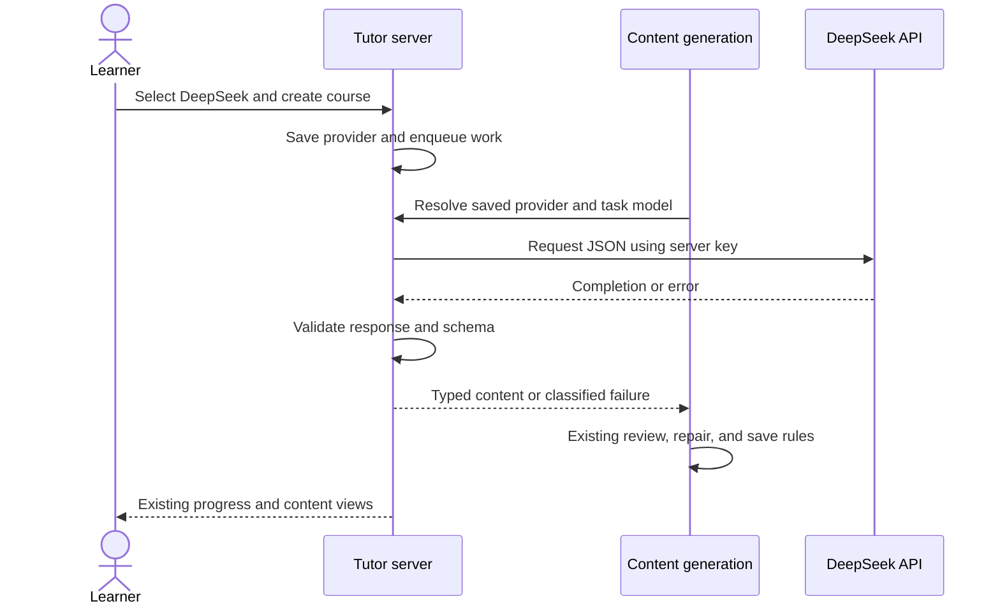

# DeepSeek API

## Summary

<!-- Format: State the outcome, scope, and measurable reason for doing this. -->

Add DeepSeek API as a third selectable learning provider beside Codex CLI and Claude CLI. A server with DEEPSEEK_API_KEY in its root .env must generate and validate learning content without either CLI installed. Keep existing course generation, quality review, and saved provider behavior.

## Problem

<!-- Format: Describe the current behavior, observed failure/opportunity, affected users, and evidence. -->

The current provider enum, discovery, dispatcher, database typing, and home form support only two CLI providers. Users who have a DeepSeek API key cannot use it for course planning, lessons, quizzes, review, grading, or Socratic practice. The exploration identifies these integration points in specs/deepseek-api/explore.md. Existing response schemas and generation jobs provide a suitable shared path.

## Goals and Non-Goals

<!-- Format: Use two labeled lists: Goals and Non-goals. Keep each item testable or explicitly bounded. -->

### Goals

- Support DeepSeek for every task accepted by runAgentObject.
- Read the key on the server through Next.js environment loading.
- Let users select DeepSeek and retain their selection using the existing cookie.
- Keep saved course jobs on their selected provider and preserve quality validation.
- Deliver deterministic automated verification with mocked HTTP.

### Non-goals

- Browser-side API keys, key entry forms, account provisioning, or balance management.
- Replacing either CLI or adding a general provider framework or SDK.
- Token streaming, tools, web search, reasoning display, or custom API gateways.
- Automatic provider switching after a request fails.
- Changing curriculum policy, assessment rules, or existing generation retry limits.
- Creating or editing a real .env file, or making paid calls during specification.

## Users and Scenarios

<!-- Format: List actors and numbered scenarios. Include the expected result for each scenario. -->

### Actors

- Learner: selects a provider and uses the existing learning workflow.
- Server operator: supplies the API key and optional model/timeout settings.
- Generation worker: resumes persisted work with the course provider.

### Scenarios

1. With only a DeepSeek key configured, a learner can create a course and use all current learning features.
2. With multiple providers configured, the learner sees only available choices and can retain DeepSeek across reloads.
3. Without a key, DeepSeek is absent from discovery; either installed CLI remains usable.
4. A saved DeepSeek job resumes after restart. If the key was removed, it fails with a configuration message and does not invoke a CLI.
5. Invalid structured output follows existing validation/repair rules; it is never accepted as learning content.

## Requirements

<!-- Format: Use stable IDs such as REQ-001. For each requirement state the behavior, inputs/outputs, and priority. -->

- REQ-001 (Must): Extend the provider ID set to codex, claude, and deepseek. Discover DeepSeek when process.env.DEEPSEEK_API_KEY has a nonempty trimmed value; do not contact DeepSeek during discovery.
- REQ-002 (Must): Keep provider discovery order codex, claude, deepseek and the current no-preference default order. Existing valid cookies take precedence over defaults. A stale unavailable cookie may resolve to the first configured provider before a new operation. An explicit unavailable provider in a course creation request must fail instead of silently selecting another provider.
- REQ-003 (Must): GET /api/agents retains {available, selected}; POST accepts deepseek and preserves existing 400/503 validation behavior and cookie attributes. Never return the key or a claim that a configured key has been authenticated.
- REQ-004 (Must): Add a server-only runDeepSeekObject adapter using native fetch, POST https://api.deepseek.com/chat/completions, Bearer authentication, JSON request content, stream:false, and response_format:{type:"json_object"}. Dispatch all six current tasks through it when deepseek is selected.
- REQ-005 (Must): Include explicit JSON instructions, the supplied Zod schema converted to JSON Schema, and a brief JSON-format example clearly marked illustrative; instruct the model that the supplied schema determines the actual fields. Return only schema.parse(JSON.parse(choices[0].message.content)). Require a nonempty string, a well-formed completion envelope, and finish_reason:"stop". Never use reasoning_content as learning output.
- REQ-006 (Must): Resolve DEEPSEEK_MODEL_<TASK>, then DEEPSEEK_MODEL, then deepseek-flash. For socratic, try DEEPSEEK_MODEL_SOCRATIC, DEEPSEEK_MODEL_CHAPTER, DEEPSEEK_MODEL, then the default. Trim override values and treat blank values as absent. Forward other nonblank model IDs without hardcoded rejection; invalid models produce a sanitized configuration/request failure.
- REQ-007 (Must): Initially set thinking:{type:"disabled"} explicitly. Use max_tokens:16384 for syllabus, chapter, quiz, grading, and review; use 4096 for socratic. These are chosen integration defaults, not measured quality or latency guarantees. Do not add implicit thinking or token-budget overrides in this change.
- REQ-008 (Must): Extend agentTimeoutMs to deepseek; default to 180000 ms and retain the existing positive safe integer and signed 32-bit timer bounds. DEEPSEEK_TIMEOUT_MS overrides the default. Abort the HTTP request and response-body read on deadline; clean up timers after all outcomes.
- REQ-009 (Must): Translate every adapter failure to the existing CodexError contract, with DeepSeek-specific safe messages, appropriate code, and retryability. Preserve invalid_output identity for existing quality repair logic. Make exactly one HTTP attempt per adapter invocation; leave retries and repairs to existing callers.
- REQ-010 (Must): Persist deepseek in courses.generationAgent and retain it for worker execution. Missing configuration or a failed paid call must not switch that saved provider. Preserve existing course data and nullable legacy provider behavior.
- REQ-011 (Must): Render only discovered provider options. Use the label DeepSeek API in selector, single-provider state, and generation overlay. The empty state explains CLI installation or server-side DEEPSEEK_API_KEY configuration. Keep existing labels, disabled/submitting behavior, and accessible form controls.
- REQ-012 (Must): Keep the key out of browser bundles, cookies, database rows, response objects, error details, and logs. Do not log authorization headers or raw upstream request/response bodies. Retain existing content observability without passing raw DeepSeek errors or schema values into diagnostic messages.
- REQ-013 (Must): Document root .env configuration, model override precedence, defaults, restart after configuration changes, paid API usage, and configured-versus-authenticated availability in README.md and .env.example. Do not add a provider dependency or edit real credentials.

## User/System Flows

<!-- Format: Use numbered steps. Name the actor, system action, state change, and failure branch at each relevant step. -->

1. Operator adds DEEPSEEK_API_KEY to root .env and restarts the Next.js server. Next.js loads it into process.env using normal precedence; the adapter does not read the file directly.
2. Learner opens the home page. The server lists configured providers without a paid probe. The form renders available choices and restores a valid preference; no providers results in a setup message and disabled creation.
3. Learner selects DeepSeek. POST /api/agents validates availability and sets the existing preference cookie. If preference saving fails, the form shows a useful error and restores the previous selection rather than claiming it was saved.
4. Learner submits a course. The server validates the explicit provider, saves generationAgent:"deepseek", and enqueues the course job. If the requested provider is now unavailable, return a safe nonretryable configuration error with HTTP 503 before saving the course.
5. The worker uses the stored provider. runAgentObject resolves the task model and calls the DeepSeek adapter. The adapter applies timeout, authenticates, sends JSON instructions, validates the completion, and returns a typed object.
6. Existing course/lesson/quiz quality stages review and repair through the same selected provider. Only accepted output reaches existing persistence operations. Interactive grading and Socratic flows use the same dispatcher and their existing response contracts.
7. On failure, the adapter returns a classified safe error. The worker follows its existing bounded retries, or marks nonretryable work failed. Interactive routes keep their existing error response/status mappings and retry flags. Recovery requires fixing configuration or using the existing retry action; it does not trigger provider failover.

## Technical Design

<!-- Format: Describe components, interfaces, data, dependencies, compatibility, security, and operational concerns. -->

### Solution Description

Add one HTTP adapter behind the current provider dispatcher. The main flow is selection, saved provider, task dispatch, DeepSeek completion, and local schema validation. Retain the existing generation jobs and quality pipeline; a valid JSON document is accepted only after application validation.

### Current State

lib/agent.ts owns discovery, preference, and dispatch. lib/codex.ts owns modelFor and CodexTask. lib/agent-timeout.ts centralizes per-call timeouts. lib/quality.ts recognizes CodexError.invalid_output for limited repairs. The worker retries eligible jobs at most three times. The home form hardcodes two providers and labels. SQLite generation_agent is unrestricted text, while Drizzle narrows it to two IDs.

### Proposed Design

Introduce lib/deepseek.ts with runDeepSeekObject<T>(prompt, schema, options), where options include model, timeoutMs, and maxTokens. Use global fetch so tests can mock it, and an AbortController whose timer remains active through body consumption. Read the key at call time and reject missing configuration before fetch. Use redirect:"error" so credentials are not sent through redirects. The dispatcher supplies the task token limit; the adapter applies the fixed disabled thinking setting.

Build a system message containing JSON instructions, illustrative format, and JSON.stringify(z.toJSONSchema(schema)); put the existing task prompt in a user message. Do not execute tools or request reasoning. Validate the envelope and finish reason before parsing the final answer. Use static validation messages or schema issue paths/codes without raw offending values. If a timer fired, classify the failure as timeout; other network failures are failed/retryable.

### Architecture / Components

- lib/deepseek.ts: key access, HTTP request, timeout, response parsing, and sanitized error mapping.
- lib/agent.ts: third ID, configured availability, explicit requested-provider validation, DeepSeek dispatch, and updated no-provider message. Restrict commandAvailable to CLI IDs so no executable probe is made for DeepSeek.
- lib/codex.ts and lib/agent-timeout.ts: extend existing model and timeout resolution without changing CLI options or introducing runtime import cycles.
- lib/db/schema.ts: expand generationAgent typing. Keep generation-worker.ts behavior; only adjust integration where needed to retain the selected provider and surface classified errors.
- app/api/agents/route.ts and app/api/courses/route.ts: retain public response shapes, accept the third ID, and reject an unavailable explicit request before persistence.
- components/new-course-form.tsx: add a browser-safe label mapping and provider union, filter options, update status/setup copy, and handle preference-save failures. Do not import a server-only module into the component.
- README.md and .env.example: operator setup and bounded configuration contract.

### Data Model / API Changes

Add deepseek to the provider union, cookie validation, course input validation, and Drizzle generationAgent enum. No new columns or API endpoints. No SQL data migration is expected because generation_agent has no database CHECK constraint; confirm the current schema and avoid an unrelated migration. Existing {available, selected}, course creation 202, and learning-content responses retain their shapes. An unavailable explicit provider uses the existing not_found error code, retryable:false, and HTTP 503. POST /api/agents keeps its existing error response shape.

### Technical Decisions

- Use Node fetch; add no SDK dependency.
- Use the official fixed HTTPS endpoint, server-only environment access, and non-streaming JSON output.
- Reuse CodexError without a broad rename so existing quality repair and route mappings continue to work.
- Preserve Codex-first default ordering; user choice enables paid DeepSeek calls. Do not retry inside the adapter or fail over after a selected operation starts.
- Default to deepseek-flash, disable thinking, and set explicit output budgets. These defaults are assumptions chosen for the initial integration and can be revised by the user before build.
- Official reference checked on 2026-10-22: [Chat Completions](https://api-docs.deepseek.com/api/create-chat-completion/) supports the selected endpoint, model, thinking control, and JSON mode. [JSON Output](https://api-docs.deepseek.com/guides/json_mode/) calls for JSON instructions and warns about empty/truncated content. Application validation remains required. Read the installed Next.js environment guide before implementation; process.env and more specific environment files can override root .env.

### Trade-offs

Native fetch keeps the change small but requires explicit envelope/error handling. JSON mode reduces formatting failures but does not enforce the Zod contract. Disabled thinking and fixed output budgets bound initial behavior without proving teaching quality or predictable response times. Configuration-only discovery avoids network cost but cannot verify the key or balance. Reusing CodexError retains a historical name while avoiding unrelated error-contract changes.

### Failure Handling

Use the case table below as the adapter error contract. Do not forward upstream body messages. Maintain one request per adapter call and existing caller-level retry/repair limits. Map non-stop completion reasons to invalid_output, including length, missing finish reason, or refusal/filter results. A timed-out request may still have incurred upstream cost; never promise that cancellation prevents billing.

### Testing Strategy

Mock fetch, timers, CLI discovery, and environment values. Verify HTTP inputs, positive schema validation, all classified failures, abort during response-body reading, and no secret-bearing diagnostics. Test dispatch for all six tasks, model precedence, discovery combinations, preference APIs, saved-provider recovery, and failure before course persistence. Use existing component tests plus one mocked browser selection smoke test. Run relevant existing CLI and quality suites to show backward compatibility.

## Decisions and Constraints

<!-- Format: Separate Confirmed decisions, Assumptions, Constraints, and Open questions. Do not hide unresolved choices. -->

### Confirmed decisions

- The user requested DeepSeek API alongside Claude CLI and Codex CLI.
- The API key must come from .env through the server environment.
- The user invoked msdd-spec after the saved exploration, authorizing this specification and generated task list.

### Assumptions

- DeepSeek is a peer provider for every current task, including review and Socratic practice.
- Keep existing default ordering and cookie behavior, except explicit unavailable requests now fail to prevent an unintended provider choice.
- Use deepseek-flash with thinking disabled, 16384 output tokens for non-Socratic tasks, and 4096 for Socratic calls. The optional preference question has no answer at specification time; these are proposed defaults, not user-confirmed choices.
- Treat global/task model overrides as operator-controlled IDs; upstream validation handles unsupported IDs.

### Constraints

- Only specification artifacts change in this phase. Implementation starts through msdd-build.
- Preserve all pre-existing local edits, including CLI isolation, timeout, schema, and Socratic work; inspect the current workspace again before build.
- Do not require a CLI for DeepSeek-only use, expose the key, or add network calls to provider discovery.
- Live DeepSeek credentials and account access have not been verified. The exploration found no root .env or .env.local.
- Keep retry/quality policy and learner-content APIs compatible.

### Open questions

- No blocking architecture choice remains. The learner may revise the proposed thinking/model defaults before build.
- Live output quality, latency, and account access remain unmeasured; report this limitation if no live smoke check is performed.

## Edge Cases and Failure Handling

<!-- Format: Use a case/action table or bullets with trigger, expected behavior, recovery, and user-visible error. -->

### Cases and recovery

| Trigger | Expected action and visible result | Recovery |
| --- | --- | --- |
| Missing or whitespace key | Hide DeepSeek in discovery; adapter throws not_found/nonretryable with a DeepSeek setup message | Add key and restart server |
| Key removed after selection or job save | Reject explicit new request before persistence; saved job fails without provider switching | Restore key and use existing retry |
| Invalid key, HTTP 401/403 | failed/nonretryable; static DeepSeek authentication message | Correct key and retry manually |
| HTTP 402 | failed/nonretryable; static insufficient-balance message | Restore balance and retry manually |
| HTTP 400/404/422 or other nontransient 4xx | failed/nonretryable; static model/request configuration message | Correct configuration |
| HTTP 408/429 or 5xx | failed/retryable; static temporary DeepSeek failure message | Existing bounded job retries or user retry |
| Network error | failed/retryable, with no raw transport details | Existing retry path |
| Deadline before headers or during body read | Abort; timeout/retryable; clear timer | Existing retry path |
| Redirect | Reject without following; failed/nonretryable | Check official endpoint/service configuration |
| Invalid envelope, non-stop finish reason, null/empty content, malformed JSON, schema mismatch | invalid_output/retryable with static safe validation detail; do not persist content | Existing bounded schema repair where applicable |
| Unavailable or malformed cookie | Ignore invalid cookie or use configured default before a new operation | Select an available provider |
| Preference POST fails | Display error and restore the previous selection | Retry selection |
| All providers unavailable | Empty available list, selected:null, helpful setup text, disabled creation | Configure a provider |
| Existing saved Codex/Claude or null provider | Preserve existing execution and legacy default resolution | Existing recovery behavior |
| Key appears in malicious upstream error content | Ignore raw body for messages/logs; redact exact configured key from generated diagnostic details if any | Safe static errors only |

Availability is configuration, not authentication. Do not retry nonretryable errors through the generation worker, and do not add an independent adapter retry loop.

## Acceptance Criteria

<!-- Format: Use stable IDs such as AC-001. Make each criterion observable and state how it will be verified. -->

- AC-001 (REQ-001–003): Mocked discovery tests cover all eight CLI/key combinations and whitespace keys; no fetch occurs. Unknown selections return 400, unavailable selections return 503, and deepseek preferences persist with existing cookie attributes.
- AC-002 (REQ-004–007): Adapter tests assert endpoint, redirect policy, headers, JSON mode, disabled thinking, model precedence, all task token budgets, and typed output. No CLI process is launched for DeepSeek tasks.
- AC-003 (REQ-005,009): Table-driven tests cover malformed envelopes, empty/null content, length/missing/other finish reasons, invalid JSON, schema failure, and all HTTP/network classes. Invalid content never reaches learning-artifact persistence.
- AC-004 (REQ-008): Fake-timer tests prove deadline cancellation before headers and during body reading, and cleanup after success/failure; invalid timeout values retain the existing default.
- AC-005 (REQ-009,010): Worker/quality integration tests retain deepseek across a resumed job, use existing review/repair behavior, and honor retryable:false on key/authentication/balance failure. Explicit unavailable course creation returns 503 without a saved course or job.
- AC-006 (REQ-011): Component tests cover DeepSeek-only and mixed availability, filtered options, label/overlay text, empty state, cookie-restored choice, and rollback on failed preference saving. A mocked Playwright smoke test can select DeepSeek, reload, and submit a course without a real API call.
- AC-007 (REQ-012): Tests use a sentinel key and hostile upstream error body and assert that logs, returned errors, provider responses, cookies, and saved course metadata contain no sentinel. Code review confirms server-only credential access.
- AC-008 (REQ-013): README and .env.example document all supported variables, defaults, setup/restart, API cost, and configuration-only discovery with no real key committed.
- AC-009 (All): Typecheck, lint, build, relevant CLI/provider/quality tests, and the mocked browser smoke pass, or any pre-existing unrelated failure is separately evidenced. No unrelated local edit is reverted.

## Explanation and Output Artifacts

<!-- Format: Use labeled fields: Audience, Writing profile, Primary artifact, Supporting artifacts, and Accessibility. Prefer an 80% ASD-STE100 controlled-language style for explanatory prose unless strict ASD-STE100 or plain language is required. Choose the clearest medium: prose, diagram, interactive HTML, or narrated explainer video. State the topic, purpose, interaction or narration needs, delivery location, and acceptance evidence for each requested artifact. -->

- Audience: Learners choosing a learning provider and operators configuring the local server.
- Writing profile: Use an 80%-ASD-STE100 profile for explanatory prose: short sentences, familiar terms, direct instructions, and exact configuration names when needed.
- Primary artifact: README prose explaining how to enable and select DeepSeek, the model/timeout settings, and the meaning of availability. Deliver in the repository README; acceptance evidence is an operator setup review against the documented configuration.
- Supporting artifacts: A placeholder-only .env.example configuration block and the minimal sequence diagram in this specification. Their purpose is to explain server configuration and the request flow. No interactive HTML or narrated video is needed; neither artifact has interaction or narration requirements. Deliver code/test evidence through task.md completion notes or Verification notes when building.
- Accessibility: Preserve a labeled native provider selector, readable status/error text, existing focus behavior, and text equivalents for the diagram. Setup guidance must work without relying on color or images.

## Implementation Plan

<!-- Format: Use ordered, independently verifiable tasks. Include dependencies and the files or boundaries affected. -->

1. Extend provider contracts and configuration in lib/agent.ts, lib/codex.ts, lib/agent-timeout.ts, and lib/db/schema.ts, preserving CLI behavior and stored data. Add focused tests for availability combinations, model precedence, timeout bounds, and schema typing. Verify no SQL data migration is needed. Depends on no prior task.
2. Add lib/deepseek.ts and lib/deepseek.test.ts for the server-only HTTP adapter, full-call cancellation, JSON/schema validation, static error mapping, and credential-safe diagnostics. Verify success, failure table, and body-read timeout using mocked fetch. Depends on step 1.
3. Integrate DeepSeek dispatch and provider selection across lib/agent.ts, agent/course APIs, worker/quality pathways, and their tests. Reject explicit unavailable requests before persistence, retain saved providers, and verify every task reaches DeepSeek without CLI execution or failover. Depends on steps 1–2.
4. Update components/new-course-form.tsx and its tests for discovered options, DeepSeek labels, setup state, and failed-preference rollback; add a mocked e2e/provider-selection.spec.ts for selecting/restoring DeepSeek and course submission. Preserve existing form/focus behavior. Depends on step 3.
5. Document DEEPSEEK_API_KEY, global/task model overrides, DEEPSEEK_TIMEOUT_MS, defaults, startup, costs, and discovery limits in README.md and .env.example; keep real environment files and existing unrelated edits untouched. Depends on steps 1–4.

## Verification and Implementation Notes

<!-- Format: List commands/tests, expected evidence, rollout checks, and a place to record deviations. -->

- Verify the feature after steps 1–5 with npm run typecheck, npm run lint, npm run build, and npm test -- lib/deepseek.test.ts lib/agent.test.ts lib/agent-timeout.test.ts lib/codex.test.ts lib/claude.test.ts lib/quality.test.ts app/agents-route.test.ts app/courses-route.test.ts app/course-preparation.test.ts app/socratic-route.test.ts components/new-course-form.test.tsx; add the named missing feature tests during implementation. Run npx playwright test e2e/provider-selection.spec.ts with mocked service responses and an isolated test database. Expected evidence is passing feature checks plus unchanged CLI behavior; investigate and separately document pre-existing unrelated failures without reverting other work.
- Record implementation evidence and deviations in this section: commands/results, provider/model compatibility changes, database migration conclusion, and any changed task boundaries. Before implementation, re-read the installed Next.js guide for the affected APIs and verify current official DeepSeek model/parameter support. Keep automated tests independent of live credentials; if a live smoke test is performed during a later build, document the model and outcome without key/prompt disclosure. A live test is optional and not required for the mocked acceptance suite.
