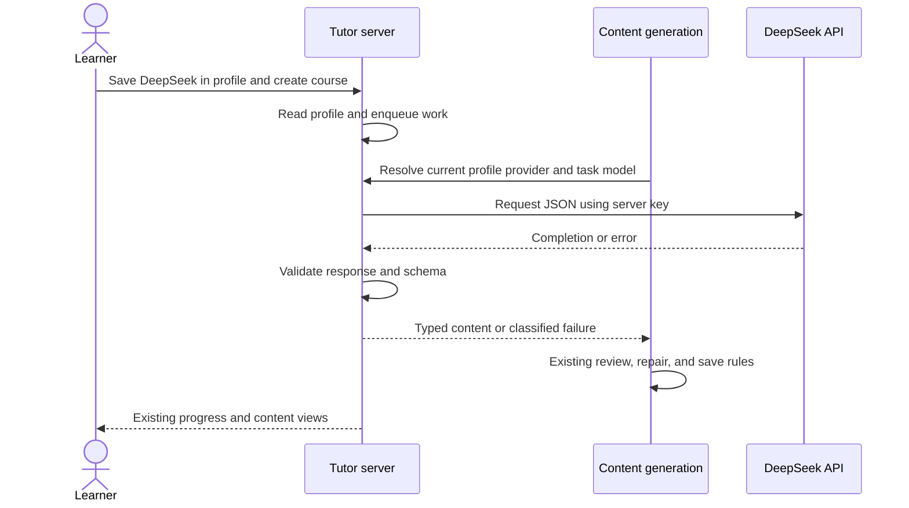

# DeepSeek API

## Summary

<!-- Format: State the outcome, scope, and measurable reason for doing this. -->

Add DeepSeek API as a third selectable learning provider beside Codex CLI and Claude CLI. A server with DEEPSEEK_API_KEY in its root .env must generate and validate learning content without either CLI installed. Keep existing course generation and quality review. The follow-up profile setting is the single provider choice for future work across all courses.

## Problem

<!-- Format: Describe the current behavior, observed failure/opportunity, affected users, and evidence. -->

The current provider enum, discovery, dispatcher, database typing, and home form support only two CLI providers. Users who have a DeepSeek API key cannot use it for course planning, lessons, quizzes, review, grading, or Socratic practice. The exploration identifies these integration points in specs/deepseek-api/explore.md. Existing response schemas and generation jobs provide a suitable shared path.

## Goals and Non-Goals

<!-- Format: Use two labeled lists: Goals and Non-goals. Keep each item testable or explicitly bounded. -->

### Goals

- Support DeepSeek for every task accepted by runAgentObject.
- Read the key on the server through Next.js environment loading.
- Let users select DeepSeek in Profile settings and retain it in SQLite across browsers.
- Use one saved profile provider consistently for future AI operations and preserve quality validation.
- Deliver deterministic automated verification with mocked HTTP.

### Non-goals

- Browser-side API keys, key entry forms, account provisioning, or balance management.
- Replacing either CLI or adding a general provider framework or SDK.
- Token streaming, tools, web search, reasoning display, or custom API gateways.
- Automatic provider switching after a request fails.
- Changing curriculum policy, assessment rules, or existing generation retry limits.
- Creating or editing a real .env file, or making paid calls during specification.

## Users and Scenarios

<!-- Format: List actors and numbered scenarios. Include the expected result for each scenario. -->

### Actors

- Learner: selects a provider and uses the existing learning workflow.
- Server operator: supplies the API key and optional model/timeout settings.
- Generation worker: resumes persisted work with the course provider.

### Scenarios

1. With only a DeepSeek key configured, a learner can create a course and use all current learning features.
2. With multiple providers configured, the learner sees only available choices and can retain DeepSeek across reloads.
3. Without a key, DeepSeek is absent from discovery; either installed CLI remains usable.
4. A job resumes after restart with the current profile agent. If that agent is DeepSeek and its key was removed, it fails with a configuration message and does not invoke a CLI.
5. Invalid structured output follows existing validation/repair rules; it is never accepted as learning content.

## Requirements

<!-- Format: Use stable IDs such as REQ-001. For each requirement state the behavior, inputs/outputs, and priority. -->

- REQ-001 (Must): Extend the provider ID set to codex, claude, and deepseek. Discover DeepSeek when process.env.DEEPSEEK_API_KEY has a nonempty trimmed value; do not contact DeepSeek during discovery.
- REQ-002 (Must, updated by the profile-settings follow-up): Store the chosen learning agent on learner_profile.learning_agent. Use it for all future AI work across every course, including generation, review, grading, and Socratic practice. Ignore old browser cookies and per-course provider routing. Before the first save, choose the first configured provider in codex/claude/deepseek order. Never replace an unavailable saved choice automatically.
- REQ-003 (Must, updated): GET /api/agents retains {available, selected}, where selected is the saved profile agent even if unavailable. POST remains a compatibility endpoint that saves to the profile rather than a cookie. GET/PUT /api/profile include learningAgent. Validate a changed provider against availability and save background and provider atomically; omitted learningAgent preserves the current value. A same unavailable agent may be retained while saving background.
- REQ-004 (Must): Add a server-only runDeepSeekObject adapter using native fetch, POST https://api.deepseek.com/chat/completions, Bearer authentication, JSON request content, stream:false, and response_format:{type:"json_object"}. Dispatch all six current tasks through it when deepseek is selected.
- REQ-005 (Must): Include explicit JSON instructions, the supplied Zod schema converted to JSON Schema, and a brief JSON-format example clearly marked illustrative; instruct the model that the supplied schema determines the actual fields. Return only schema.parse(JSON.parse(choices[0].message.content)). Require a nonempty string, a well-formed completion envelope, and finish_reason:"stop". Never use reasoning_content as learning output.
- REQ-006 (Must): Resolve DEEPSEEK_MODEL_<TASK>, then DEEPSEEK_MODEL, then deepseek-flash. For socratic, try DEEPSEEK_MODEL_SOCRATIC, DEEPSEEK_MODEL_CHAPTER, DEEPSEEK_MODEL, then the default. Trim override values and treat blank values as absent. Forward other nonblank model IDs without hardcoded rejection; invalid models produce a sanitized configuration/request failure.
- REQ-007 (Must): Initially set thinking:{type:"disabled"} explicitly. Use max_tokens:16384 for syllabus, chapter, quiz, grading, and review; use 4096 for socratic. These are chosen integration defaults, not measured quality or latency guarantees. Do not add implicit thinking or token-budget overrides in this change.
- REQ-008 (Must): Extend agentTimeoutMs to deepseek; default to 180000 ms and retain the existing positive safe integer and signed 32-bit timer bounds. DEEPSEEK_TIMEOUT_MS overrides the default. Abort the HTTP request and response-body read on deadline; clean up timers after all outcomes.
- REQ-009 (Must): Translate every adapter failure to the existing CodexError contract, with DeepSeek-specific safe messages, appropriate code, and retryability. Preserve invalid_output identity for existing quality repair logic. Make exactly one HTTP attempt per adapter invocation; leave retries and repairs to existing callers.
- REQ-010 (Must, updated): Retain courses.generationAgent as a historical creation-time selection. Resolve the current saved profile agent when starting each subsequent job or interactive operation. Already-running operations retain their starting provider. Profile changes do not rewrite saved content or progress; cached reading needs no available provider.
- REQ-011 (Must, updated): Move the selector to Profile settings with Save profile. Show the saved/current agent and unavailable state in the site header and read-only home status. Share a client query that refreshes on mount, window focus, profile save, and every 30 seconds. Render available choices plus any saved unavailable choice; preserve drafts and the active label after failed saves. Disable new generation for an unavailable selected agent.
- REQ-012 (Must): Keep the key out of browser bundles, cookies, database rows, response objects, error details, and logs. Do not log authorization headers or raw upstream request/response bodies. Retain existing content observability without passing raw DeepSeek errors or schema values into diagnostic messages.
- REQ-013 (Must): Document root .env configuration, model override precedence, defaults, restart after configuration changes, paid API usage, and configured-versus-authenticated availability in README.md and .env.example. Do not add a provider dependency or edit real credentials.

## User/System Flows

<!-- Format: Use numbered steps. Name the actor, system action, state change, and failure branch at each relevant step. -->

1. Operator configures a provider and starts the server, applying the additive profile migration.
2. Learner opens Profile settings, chooses a learning agent, and saves it together with their background. A failed save preserves both drafts and the previous active agent.
3. The header and home status show the current profile agent. The browser query refreshes after saving, on focus/navigation, and every 30 seconds. The home form has no selector.
4. Course creation reads the profile rather than a browser cookie or course-request agent field. New course metadata records the original provider for historical reference.
5. Each generation job or interactive operation resolves the current saved profile agent once. Quality review/repair within that operation retains its starting agent. Later operations use any newly saved preference.
6. An unavailable saved provider produces an explicit error and never triggers fallback. Existing generated content and progress remain readable and unchanged.

## Technical Design

<!-- Format: Describe components, interfaces, data, dependencies, compatibility, security, and operational concerns. -->

### Solution Description

Add one HTTP adapter behind the current provider dispatcher. The main flow is selection, saved provider, task dispatch, DeepSeek completion, and local schema validation. Retain the existing generation jobs and quality pipeline; a valid JSON document is accepted only after application validation.

### Current State

lib/agent.ts owns discovery, preference, and dispatch. lib/codex.ts owns modelFor and CodexTask. lib/agent-timeout.ts centralizes per-call timeouts. lib/quality.ts recognizes CodexError.invalid_output for limited repairs. The worker retries eligible jobs at most three times. The home form hardcodes two providers and labels. SQLite generation_agent is unrestricted text, while Drizzle narrows it to two IDs.

### Proposed Design

Introduce lib/deepseek.ts with runDeepSeekObject<T>(prompt, schema, options), where options include model, timeoutMs, and maxTokens. Use global fetch so tests can mock it, and an AbortController whose timer remains active through body consumption. Read the key at call time and reject missing configuration before fetch. Use redirect:"manual" and reject 3xx responses so credentials are not sent through redirects and redirects can be classified as nonretryable. The dispatcher supplies the task token limit; the adapter applies the fixed disabled thinking setting.

Build a system message containing JSON instructions, illustrative format, and JSON.stringify(z.toJSONSchema(schema)); put the existing task prompt in a user message. Do not execute tools or request reasoning. Validate the envelope and finish reason before parsing the final answer. Use static validation messages or schema issue paths/codes without raw offending values. If a timer fired, classify the failure as timeout; other network failures are failed/retryable.

### Architecture / Components

- lib/deepseek.ts: key access, HTTP request, timeout, response parsing, and sanitized error mapping.
- lib/agent.ts: third ID, configured availability, explicit requested-provider validation, DeepSeek dispatch, and updated no-provider message. Restrict commandAvailable to CLI IDs so no executable probe is made for DeepSeek.
- lib/codex.ts and lib/agent-timeout.ts: extend existing model and timeout resolution without changing CLI options or introducing runtime import cycles.
- lib/db/schema.ts: expand generationAgent typing and add learnerProfile.learningAgent. generation-worker.ts resolves the profile at job start; the course tag remains historical.
- app/api/agents/route.ts and app/api/courses/route.ts: retain public response shapes, accept the third ID, and reject an unavailable explicit request before persistence.
- components/profile-form.tsx owns the selector and profile save. components/new-course-form.tsx shows read-only status and a settings link. lib/agent-contracts.ts shares browser-safe IDs/labels; lib/use-learning-agent.ts shares current-agent state with the header. No client component imports server-only modules.
- README.md and .env.example: operator setup and bounded configuration contract.

### Data Model / API Changes

Follow-up (2026-10-22): migration 0008_profile_learning_agent adds nullable learner_profile.learning_agent. GET/PUT /api/profile now include learningAgent; omitted values preserve the setting. Shared browser-safe contracts live in lib/agent-contracts.ts. Profile, dispatcher, job worker, syllabus review, header, and home status now use the saved profile choice; courses.generationAgent is provenance only. This supersedes the original cookie/course-binding design below.

The provider union and Drizzle generationAgent enum include deepseek. Migration 0008 adds learner_profile.learning_agent; generation_agent itself remains unrestricted SQLite text. Existing {available, selected}, course creation 202, and learning-content response shapes remain compatible. Profile GET/PUT include learningAgent. Course creation ignores agent overrides and uses the profile. An unavailable saved provider produces not_found/retryable:false with HTTP 503 at course creation. POST /api/agents retains its response shape but persists the profile choice.

### Technical Decisions

- Use Node fetch; add no SDK dependency.
- Use the official fixed HTTPS endpoint, server-only environment access, and non-streaming JSON output.
- Reuse CodexError without a broad rename so existing quality repair and route mappings continue to work.
- Preserve Codex-first default ordering; user choice enables paid DeepSeek calls. Do not retry inside the adapter or fail over after a selected operation starts.
- Default to deepseek-flash, disable thinking, and set explicit output budgets. These defaults are assumptions chosen for the initial integration and can be revised by the user before build.
- Official reference checked on 2026-10-22: [Chat Completions](https://api-docs.deepseek.com/api/create-chat-completion/) supports the selected endpoint, model, thinking control, and JSON mode. [JSON Output](https://api-docs.deepseek.com/guides/json_mode/) calls for JSON instructions and warns about empty/truncated content. Application validation remains required. Read the installed Next.js environment guide before implementation; process.env and more specific environment files can override root .env.

### Trade-offs

Native fetch keeps the change small but requires explicit envelope/error handling. JSON mode reduces formatting failures but does not enforce the Zod contract. Disabled thinking and fixed output budgets bound initial behavior without proving teaching quality or predictable response times. Configuration-only discovery avoids network cost but cannot verify the key or balance. Reusing CodexError retains a historical name while avoiding unrelated error-contract changes.

### Failure Handling

Use the case table below as the adapter error contract. Do not forward upstream body messages. Maintain one request per adapter call and existing caller-level retry/repair limits. Map non-stop completion reasons to invalid_output, including length, missing finish reason, or refusal/filter results. A timed-out request may still have incurred upstream cost; never promise that cancellation prevents billing.

### Testing Strategy

Mock fetch, timers, CLI discovery, and environment values. Verify HTTP inputs, positive schema validation, all classified failures, abort during response-body reading, and no secret-bearing diagnostics. Test dispatch for all six tasks, model precedence, discovery combinations, preference APIs, saved-provider recovery, and failure before course persistence. Use existing component tests plus one mocked browser selection smoke test. Run relevant existing CLI and quality suites to show backward compatibility.

## Decisions and Constraints

<!-- Format: Separate Confirmed decisions, Assumptions, Constraints, and Open questions. Do not hide unresolved choices. -->

### Confirmed decisions

- Follow-up request: move agent selection into Profile settings and persist it. With no response to the optional scope question, apply the stated recommended scope to future AI work in all courses; retain running operations and saved content.

- The user requested DeepSeek API alongside Claude CLI and Codex CLI.
- The API key must come from .env through the server environment.
- The user invoked msdd-spec after the saved exploration, then msdd-build to authorize implementation of the specification and its defaults.

### Assumptions

- DeepSeek is a peer provider for every current task, including review and Socratic practice.
- Keep default ordering before the first profile save. Ignore browser cookies and use the saved profile choice thereafter.
- Use deepseek-flash with thinking disabled, 16384 output tokens for non-Socratic tasks, and 4096 for Socratic calls. These defaults were proposed at specification time and implemented after the user invoked msdd-build.
- Treat global/task model overrides as operator-controlled IDs; upstream validation handles unsupported IDs.

### Constraints

- Implementation is authorized through msdd-build; changes remain within this provider integration.
- Preserve all pre-existing local edits, including CLI isolation, timeout, schema, and Socratic work; inspect the current workspace again before build.
- Do not require a CLI for DeepSeek-only use, expose the key, or add network calls to provider discovery.
- Live DeepSeek credentials and account access have not been verified. A root .env now exists with DEEPSEEK_API_KEY and DEEPSEEK_MODEL; only variable names were inspected and the real file was not edited. Running application discovery confirms DeepSeek is configured.
- Keep retry/quality policy and learner-content APIs compatible.

### Open questions

- No blocking architecture choice remains. The specified default settings are implemented; global/task model environment overrides remain available.
- Live output quality, latency, and account access remain unmeasured; report this limitation if no live smoke check is performed.

## Edge Cases and Failure Handling

<!-- Format: Use a case/action table or bullets with trigger, expected behavior, recovery, and user-visible error. -->

### Cases and recovery

| Trigger | Expected action and visible result | Recovery |
| --- | --- | --- |
| Missing or whitespace key | Hide DeepSeek in discovery; adapter throws not_found/nonretryable with a DeepSeek setup message | Add key and restart server |
| Key removed after selection or job save | Reject explicit new request before persistence; saved job fails without provider switching | Restore key and use existing retry |
| Invalid key, HTTP 401/403 | failed/nonretryable; static DeepSeek authentication message | Correct key and retry manually |
| HTTP 402 | failed/nonretryable; static insufficient-balance message | Restore balance and retry manually |
| HTTP 400/404/422 or other nontransient 4xx | failed/nonretryable; static model/request configuration message | Correct configuration |
| HTTP 408/429 or 5xx | failed/retryable; static temporary DeepSeek failure message | Existing bounded job retries or user retry |
| Network error | failed/retryable, with no raw transport details | Existing retry path |
| Deadline before headers or during body read | Abort; timeout/retryable; clear timer | Existing retry path |
| Redirect | Reject without following; failed/nonretryable | Check official endpoint/service configuration |
| Invalid envelope, non-stop finish reason, null/empty content, malformed JSON, schema mismatch | invalid_output/retryable with static safe validation detail; do not persist content | Existing bounded schema repair where applicable |
| Old browser preference cookie | Ignore it; use the profile, or the configured default before the first save | Select and save an agent in Profile settings |
| Preference POST fails | Display error and restore the previous selection | Retry selection |
| All providers unavailable | Empty available list, selected:null, helpful setup text, disabled creation | Configure a provider |
| Existing saved Codex/Claude or null provider | Preserve existing execution and legacy default resolution | Existing recovery behavior |
| Key appears in malicious upstream error content | Ignore raw body for messages/logs; redact exact configured key from generated diagnostic details if any | Safe static errors only |

Availability is configuration, not authentication. Do not retry nonretryable errors through the generation worker, and do not add an independent adapter retry loop.

## Acceptance Criteria

<!-- Format: Use stable IDs such as AC-001. Make each criterion observable and state how it will be verified. -->

- AC-001 (REQ-001–003, updated): Discovery covers all availability combinations; the profile choice persists across requests, without cookies or a paid probe. Invalid selections fail and unavailable changed choices leave both profile fields unchanged. Old cookies and course-request agent fields do not override the profile.
- AC-002 (REQ-004–007): Adapter tests assert endpoint, manual redirect rejection, headers, JSON mode, disabled thinking, model precedence, all task token budgets, and typed output. No CLI process is launched for DeepSeek tasks.
- AC-003 (REQ-005,009): Table-driven tests cover malformed envelopes, empty/null content, length/missing/other finish reasons, invalid JSON, schema failure, and all HTTP/network classes. Invalid content never reaches learning-artifact persistence.
- AC-004 (REQ-008): Fake-timer tests prove deadline cancellation before headers and during body reading, and cleanup after success/failure; invalid timeout values retain the existing default.
- AC-005 (REQ-009,010, updated): Worker tests use the current profile despite a different course generationAgent, retain existing quality repair, and fail without fallback when that saved profile agent becomes unavailable. Cached lesson reading succeeds without resolving an AI provider.
- AC-006 (REQ-011, updated): Component/browser checks save the profile agent, preserve unsaved fields after failure, restore it on reload, remove the home selector, refresh the header, show unavailable choices, and submit course intent without an agent override. Check a 375px viewport for overflow.
- AC-007 (REQ-012): Tests use a sentinel key and hostile upstream error body and assert that logs, returned errors, provider responses, cookies, and saved course metadata contain no sentinel. Code review confirms server-only credential access.
- AC-008 (REQ-013): README and .env.example document all supported variables, defaults, setup/restart, API cost, and configuration-only discovery with no real key committed.
- AC-009 (All): Typecheck, lint, build, relevant CLI/provider/quality tests, and the mocked browser smoke pass, or any pre-existing unrelated failure is separately evidenced. No unrelated local edit is reverted.

## Explanation and Output Artifacts

<!-- Format: Use labeled fields: Audience, Writing profile, Primary artifact, Supporting artifacts, and Accessibility. Prefer an 80% ASD-STE100 controlled-language style for explanatory prose unless strict ASD-STE100 or plain language is required. Choose the clearest medium: prose, diagram, interactive HTML, or narrated explainer video. State the topic, purpose, interaction or narration needs, delivery location, and acceptance evidence for each requested artifact. -->

- Audience: Learners choosing a learning provider and operators configuring the local server.
- Writing profile: Use an 80%-ASD-STE100 profile for explanatory prose: short sentences, familiar terms, direct instructions, and exact configuration names when needed.
- Primary artifact: README prose explaining how to enable and select DeepSeek, the model/timeout settings, and the meaning of availability. Deliver in the repository README; acceptance evidence is an operator setup review against the documented configuration.
- Supporting artifacts: A placeholder-only .env.example configuration block and the minimal sequence diagram in this specification. Their purpose is to explain server configuration and the request flow. No interactive HTML or narrated video is needed; neither artifact has interaction or narration requirements. Deliver code/test evidence through task.md completion notes or Verification notes when building.
- Accessibility: Preserve a labeled native provider selector, readable status/error text, existing focus behavior, and text equivalents for the diagram. Setup guidance must work without relying on color or images.

## Implementation Plan

<!-- Format: Use ordered, independently verifiable tasks. Include dependencies and the files or boundaries affected. -->

1. Extend provider contracts and configuration in lib/agent.ts, lib/codex.ts, lib/agent-timeout.ts, and lib/db/schema.ts, preserving CLI behavior and stored data. Add focused tests for availability combinations, model precedence, timeout bounds, and schema typing. Verify no SQL data migration is needed. Depends on no prior task.
2. Add lib/deepseek.ts and lib/deepseek.test.ts for the server-only HTTP adapter, full-call cancellation, JSON/schema validation, static error mapping, and credential-safe diagnostics. Verify success, failure table, and body-read timeout using mocked fetch. Depends on step 1.
3. Integrate DeepSeek dispatch and provider selection across lib/agent.ts, agent/course APIs, worker/quality pathways, and their tests. Reject explicit unavailable requests before persistence, retain saved providers, and verify every task reaches DeepSeek without CLI execution or failover. Depends on steps 1–2.
4. Update components/new-course-form.tsx and its tests for discovered options, DeepSeek labels, setup state, and failed-preference rollback; add a mocked e2e/provider-selection.spec.ts for selecting/restoring DeepSeek and course submission. Preserve existing form/focus behavior. Depends on step 3.
5. Document DEEPSEEK_API_KEY, global/task model overrides, DEEPSEEK_TIMEOUT_MS, defaults, startup, costs, and discovery limits in README.md and .env.example; keep real environment files and existing unrelated edits untouched. Depends on steps 1–4.

6. Move provider selection to saved Profile settings, add the profile migration and shared current-agent display, and route future AI work through that profile setting across existing courses. Preserve cached reading and verify profile persistence, unavailable choices, draft recovery, provider consistency, and mobile/browser behavior. This follows the user request after the initial DeepSeek build.

## Verification and Implementation Notes

<!-- Format: List commands/tests, expected evidence, rollout checks, and a place to record deviations. -->

- Verify the feature after steps 1–5 with npm run typecheck, npm run lint, npm run build, and npm test -- lib/deepseek.test.ts lib/agent.test.ts lib/agent-timeout.test.ts lib/codex.test.ts lib/claude.test.ts lib/quality.test.ts app/agents-route.test.ts app/courses-route.test.ts app/course-preparation.test.ts app/socratic-route.test.ts components/new-course-form.test.tsx; add the named missing feature tests during implementation. Run npx playwright test e2e/provider-selection.spec.ts with mocked service responses; backend integration tests use an isolated in-memory database. If an existing development server holds the Next.js dev lock, run this browser-only test against it with a temporary Playwright config and no webServer process. All browser write requests remain mocked. Expected evidence is passing feature checks plus unchanged CLI behavior; investigate and separately document pre-existing unrelated failures without reverting other work.
- Record implementation evidence and deviations in this section: commands/results, provider/model compatibility changes, database migration conclusion, and any changed task boundaries. Before implementation, re-read the installed Next.js guide for the affected APIs and verify current official DeepSeek model/parameter support. Keep automated tests independent of live credentials; if a live smoke test is performed during a later build, document the model and outcome without key/prompt disclosure. A live test is optional and not required for the mocked acceptance suite.

<!--
Evidence: T1 — 25 focused provider/configuration/CLI tests passed; typecheck passed. SQLite migration 0006 defines generation_agent as unrestricted text, so expanding the Drizzle enum requires no SQL migration. Installed Next.js environment loading guidance and current official DeepSeek chat parameters were checked before implementation. CLI model resolution is unchanged; trimming applies to DeepSeek overrides only.
-->

<!--
Evidence: Adapter design refinement — native fetch with redirect:error obscures redirects as generic network failures. Use redirect:manual and reject 3xx as nonretryable to meet the specified failure semantics without following redirects.
-->

<!--
Evidence: T2 — 33 adapter tests passed without unhandled errors; typecheck passed. Tests cover valid output, missing keys, 13 HTTP statuses including redirects, invalid envelopes/JSON/schema output, safe network errors, and abort before headers or during body consumption. A test-only unused rejection promise was corrected before task completion. Timers are cleared on all tested paths.
-->

<!--
Evidence: T3 — 58 dispatch/API/worker/quality/course/Socratic tests passed; typecheck passed. The real dispatcher and mocked HTTP were exercised with an in-memory migrated database: saved DeepSeek work completed review, malformed output repaired, missing/auth/balance failures did not retry or switch providers, rate limits returned to pending, and unavailable explicit course requests wrote no rows. Integration coverage is in app/deepseek-course.test.ts in addition to the originally named suites. Existing worker and route contracts needed no structural rewrite.
-->

<!--
Evidence: T4 — 15 form tests, typecheck, and one Chromium smoke test passed. The smoke selects DeepSeek, restores its HttpOnly cookie across reload, and submits the selected provider using mocked requests. The existing port-3000 development server held the dev lock; a temporary config targeted that server without starting or stopping it. Backend persistence tests remain isolated in memory. A strict alert locator was refined to exclude Next.js route announcements. Product/register context and installed route/cookie guides were read; no visual redesign was introduced.
Evidence: MSDD tooling detail — this installed CLI derives tasks from every prose line in Verification notes, including Evidence records. Completed-check records are therefore Evidence-prefixed HTML comments, which the parser excludes from task generation. The intended seven-task plan is unchanged.
-->

<!--
Evidence: T5 — README.md and .env.example now document the key, six task model overrides and precedence, model/thinking/token/timeout defaults, normal Next.js environment precedence, restart/retry behavior, configuration-only discovery, API costs, and speculative Socratic calls. Setup uses root .env as requested. git diff --check passed; no real environment file was edited and no dependency was added.
-->

<!--
Evidence: T12 (verification task, formerly T6) — npm run lint passed; npm run typecheck passed; npm run build passed (Next.js 16.3.8). The final targeted regression run passed 127 tests across 13 files, including the added DeepSeek database integration and existing Codex command tests. Chromium selection/cookie/submission smoke passed. git diff --check and msdd review passed. The production build's generated next-env.d.ts path change was restored to the pre-build development imports. The build emitted only the existing parent-directory package-lock warning. No live DeepSeek completion was performed.
-->

<!--
Evidence: T7 — Implementation facts, redirect handling, actual integration test location, browser-server reuse, and final verification results are recorded in this living specification. Read-only GET http://127.0.0.1:3000/api/agents returned available:[codex,claude,deepseek], selected:codex, confirming real Next.js environment discovery with the existing default order. Root .env variable names DEEPSEEK_API_KEY and DEEPSEEK_MODEL are present; values were not printed or changed. Account authentication and live generation quality remain untested. No SQL migration or dependency was needed. All seven intended tasks are complete; verification's generated ID changed from T6 to T12 after the browser execution note was reconciled.
-->

<!--
Evidence: Profile-settings follow-up — migration 0008 adds only learner_profile.learning_agent and was generated with Drizzle and applied successfully. Provider status is shared by the header/home through useLearningAgent; a saved unavailable provider remains visible and never falls back. A compatibility /api/agents POST writes the profile; old cookies are ignored. Profile-save validation is atomic. Course tags remain historical. Cached chapter reads bypass provider resolution. The optional scope question received no answer, so the stated global-future-work assumption was used.
-->

<!--
Evidence: Profile-settings completion — 155 targeted regression tests passed across 16 files before the shared-state refinement; the final affected UI rerun passed all 18 form/profile tests. Final lint and production build (including TypeScript) passed. Chromium provider persistence and cross-page header checks passed, and the final profile smoke passed after all client-state changes; the 375px screenshot was visually inspected without overflow. Full-suite discovery reported 11 failures: two stale provider-error expectations were corrected and pass in the targeted rerun; nine unrelated layout/course-page failures remain in untouched or concurrently edited code. Existing learner data/profile values were not changed by browser tests: endpoint writes were mocked, backend tests used migrated in-memory databases, and only the additive migration was applied locally. No live AI completion was performed. Generated next-env imports were restored after production verification. README and this specification now describe the profile as the authority and the course tag as a creation-time reference.
-->
