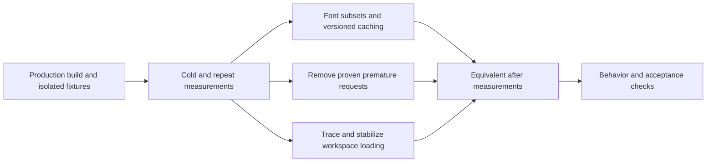

# Optimize initial page load — Plan

## Technical Design

<!-- Format: Include a concise solution description and change-relevant architecture or sequence diagram when useful. -->

Profile the production route request graph first; optimize the largest confirmed browser costs, then compare using the same harness. Prioritize coverage-preserving font subsets and versioned caching, followed by self-link prefetch removal and trace-attributed loading geometry. Treat global KaTeX CSS as a secondary measured optimization; retain existing conditional Mermaid import and server Markdown highlighting.

Do not install a new runtime dependency or introduce a new global state/cache system solely for this optimization. No database schema or API response contract change is planned.

## Components and Interfaces

<!-- Format: Use bullets. State each component responsibility and its inputs/outputs or interface contract. -->

- Production profiling harness, planned at scripts/profile-page-load.mjs: launch Chromium against an explicitly configured production server; accept URL, profile, repetition count and controlled session/fixture inputs; emit per-request metadata and aggregate JSON without credentials. Collect CDP network events and Resource Timing, capture failures/cache hits, and register buffered paint/layout observers before page code executes. Keep benchmark collection separate from destructive fixture setup.
- Font build tooling, planned at scripts/subset-fonts.py (or an equivalent reproducible existing tool selected during implementation): take the existing licensed font sources, partition Unicode ranges, emit WOFF2 assets plus matching font-face declarations; verify input/output cmap coverage and used style/axis metadata. Pin development tool versions and document the regeneration command; production serves committed generated assets without running font tooling.
- app/globals.css and app/login/login.css: retain family/style/weight/font-display contracts while referencing the generated range-specific font assets. Use disjoint CSS unicode-range mappings and retain coverage for all original mappings; preserve font metadata and OFL notices. Avoid preloading every range/style.
- next.config.ts: apply public long-lived caching only to immutable/versioned font asset paths. Existing private/no-store routes retain their semantics. Prefer content-hashed asset filenames, or Next-managed hashed output if it preserves range control and does not preload unneeded ranges.
- components/site-header-shell.tsx: inspect the brand self-link prefetch seen on /login and /. Suppress only proven unnecessary speculative fetches, retaining Link navigation, href, keyboard semantics and resolved authentication header behavior. Keep useful settings/course prefetches unless profiling justifies a narrower policy.
- components/course-list.tsx and app/studies.css: use layout-shift attribution to choose loading geometry/reserved space; preserve empty, populated, error/retry, featured-study and creation states. Do not assume font loading is the sole cause of the observed shift.
- app/providers.tsx: retain React Query and session safety checks. Change only if profiling demonstrates redundancy and tests preserve expiry, focus, broadcast and back-forward behavior; removing its initial session check is not a default optimization.
- Lesson route styling boundary, app/course/[id]/ch/[idx]/page.tsx and reader.css: if justified, load KaTeX CSS at a lesson boundary rather than globally; verify the installed Next.js CSS ordering/persistence rules and direct/client navigations before moving it.
- Existing e2e/login.spec.ts, home-workspace.spec.ts, header.spec.ts and lesson tests: reuse behavior fixtures and add focused loading/caching/typography checks without interpreting mocked delivery timings as real network evidence.

## Data Flow

<!-- Format: Use ordered steps or a diagram to show data transformations and boundaries. -->

1. Capture current git status/commit and production build conditions. Create a unique temporary database/account/session and empty/populated fixtures; keep all production data untouched. Warm server compilation/image-transform state consistently, then create fresh browser contexts for cold-browser samples.
2. Install network, paint and shift observation before navigation; fetch each route, await defined settlement, and record through a fixed window. Group document, scripts, styles, fonts, images, API data and RSC prefetches. Include browser-initiated requests such as icons and redirects, explaining any Resource Timing/CDP count differences.
3. Inspect font byte contribution and coverage. Generate ranges that leave common text small and load extra scripts only when used. Publish versioned WOFF2 assets with matching declarations; preserve originals as reproducible inputs or retain an equivalently complete source with its license.
4. Browser resolves rendered characters to the matching font ranges. Static version URLs permit reuse while new content hashes invalidate stale cache. Existing auth and course APIs keep current session/ownership rules.
5. Suppress confirmed self-prefetches and correct attributed loading geometry. Optional lesson CSS stays available when lesson content renders.
6. Repeat the identical profiling matrix, compare medians and individual CLS results, run behavior checks, and record evidence and deviations in this plan. Release the controlled session, temporary database/server and build output after verification.

## Decisions and Constraints

<!-- Format: Use `### Confirmed Decisions`, `### Assumptions`, `### Constraints`, `### Trade-offs`, and `### Open Questions`, each followed by bullets. -->

### Confirmed Decisions
- Work is scoped to issue #8 and the exploration findings, with separate spec, technical plan and execution tasks.
- Use existing image optimization, authentication checks and rendering patterns; preserve design and character support.
### Assumptions
- Current worktree may differ from exploration commit f9eacf1; rebaseline its actual production behavior before measuring savings.
- Desktop profile: Chromium pinned by the project Playwright lockfile, 1440x900, scale factor 1, no CPU/network throttling. Mobile profile: same pinned Chromium, 390x844, scale factor 2, mobile/touch emulation, CDP latency 150 ms, download 1.6 Mbit/s, upload 750 kbit/s, CPU slowdown 4x. This mobile profile differs from the exploration sample and requires a fresh baseline.
- Use at least three independent cold runs for each route/data/profile combination. Wait for document load, fonts and route data settlement, then observe a fixed additional 5 seconds; define timeout failures explicitly. Record server warmup and image-transform state separately. Repeat-cache runs enable cache and navigate away/back in the same context without forced reload.
### Constraints
- Read installed Next.js production, font, CSS, image and Link/prefetch guides before implementation; honor current APIs.
- Semble search precedes code exploration; preserve concurrent edits. At specification time unrelated dirty files included DESIGN.md, reader.css, components/socratic-session.tsx and e2e/chapter-reader.spec.ts; check again before build.
- No real Mailtrap/AI requests or production DB mutations. Existing mailtrap-transport.mjs disables its interception under NODE_ENV=production: do not assume the development OTP fixture can be reused unchanged. Use signed local sessions for profiling and a controlled local email HTTP stub or dedicated production-compatible test preload for auth behavior checks; verify no external delivery.
- Keep credentials out of measurements. Use temporary/ignored output paths. Next's custom distDir can generate next-env.d.ts/tsconfig changes; use a relative isolated build directory and restore only changes caused by the harness.
### Trade-offs
- Unicode splitting may add requests for multilingual text; measure common content and coverage cases separately rather than dropping supported glyphs.
- Long-lived caching helps repeat visits, not cold byte totals. Versioning is mandatory for mutable asset updates.
- Suppressing speculative requests can add navigation latency; target self-links first, preserving useful navigation prefetches.
- Lazy loading tiny shared code or deleting unused on-disk files is low priority unless the browser request graph establishes savings.
### Open Questions
- No blocking product decision remains for writing these artifacts. Fix the numerical target after fresh baseline and font coverage feasibility, before optimizing: retain 30% per desktop route if feasible. Record any revision and its evidence prominently; a material loss of design, coverage or required behavior needs user resolution rather than silently reducing scope.
- Determine the exact CLS contributors from trace attribution; current 0.276 is an observation, not a diagnosis.

## File Changes

<!-- Format: Use bullets. Name each affected file or boundary and the intended change. -->

- scripts/profile-page-load.mjs and isolated fixture helpers: repeatable production measurement and safe cleanup; document commands and JSON schema.
- scripts/subset-fonts.py or selected equivalent, pinned development-tool instructions, public/fonts/: coverage-preserving font generation, versioned WOFF2 outputs and license preservation.
- app/globals.css, app/login/login.css and next.config.ts: font declarations, limited immutable-font caching, and optional removal of lesson-only KaTeX import from the root.
- components/site-header-shell.tsx: measured self-link prefetch policy with unchanged navigation semantics.
- components/course-list.tsx, app/studies.css and only trace-required shared styles: stable loading geometry across data states.
- app/course/[id]/ch/[idx]/page.tsx or reader.css: conditional lesson-boundary KaTeX stylesheet relocation if measured and safe; accommodate concurrent reader edits.
- Existing focused component/browser tests plus a dedicated performance/asset verification test where needed: coverage, cache updates, delayed states and flow regressions.
- README.md: profiling/regeneration commands and environment prerequisites.
- specs/optimize-initial-page-load/plan.md: commands, results, target selection, before/after tables, limitations and report links. task.md records only verified completion. No production code changes during specification.

## Failure Handling

<!-- Format: Use bullets or a table with trigger, implementation response, and recovery. -->

- Missing browser/build/session fixture or failed request: fail the profiling run with a diagnostic; never silently omit failed requests from totals.
- Font cmap loss, broken range declaration, changed family/axis metadata or license omission: reject generated output and correct the generator; keep working assets until verification passes.
- Slow font/data requests: retain readable text, semantic loading indicators, fixed-state geometry and existing retry controls.
- Cache-version update: assert the URL changes and new body is served; reject indefinite caching of mutable public names.
- Auth/session regression: retain existing session checks and header identity resolution; fix the optimization before proceeding.
- Unmet byte/request/CLS target: inspect traces and repeat affected measurements; do not close acceptance tasks on attempted commands or a favorable single run.
- Concurrent edits or generated Next files: preserve unrelated work, review exact diffs, and restore only harness-owned generated changes.

## Implementation Steps

<!-- Format: Use ordered, small, independently checkable steps. Include dependencies when relevant. -->

1. Capture current worktree/build conditions, read relevant installed Next.js guides, and implement isolated production profiling/fixture support with explicit report schema, cache controls, safe credentials and cleanup. Verify it against one successful route and one failed-request case before broad sampling.
2. Using step 1, capture three-run cold baselines and repeat-visit samples for /login and empty/populated / on both fixed profiles, resource breakdowns and shift attribution; inspect character coverage and record the final numerical byte target before optimization. Check baseline completeness and preserve raw evidence.
3. Using step 2, implement reproducible font range/WOFF2 generation and matching CSS declarations. Verify cmap union, used styles/axes, license retention, readable fallbacks and representative multilingual text before replacing active assets.
4. Using step 3, serve only versioned font assets with long-lived caching and document regeneration. Verify cold font bytes, repeat reuse and changed-version fetching while private responses retain their policies.
5. Using step 2, remove measured self-link prefetch requests on /login and / without changing link destinations, accessible names or navigation. Verify the eliminated requests and working keyboard/client navigation.
6. Using step 2 shift attribution, stabilize workspace loading for empty/populated/error states, including delayed data/fonts. Verify all controlled CLS samples <= 0.1 and preserve responsive layout and creation/list actions.
7. After steps 3-6, reassess remaining initial cost and relocate globally imported KaTeX CSS to a lesson boundary only if measured savings justify it. Verify direct and linked lesson math/diagrams; if no change is justified record evidence and retain the existing import.
8. After steps 3-7, run the complete equivalent before/after profiling matrix, focused behavior/accessibility tests and required project commands. Fix failures and rerun affected checks; record all acceptance evidence and leave tasks open until passing.
9. After step 8 passes, review scope/whitespace, clean only owned temporary resources/generated mutations, update plan evidence and verify every acceptance criterion has passing current evidence. Summarize outcomes and limitations without deploying, committing or closing the issue.

## Verification Steps

<!-- Format: Use ordered or bulleted checks. Reference spec acceptance IDs where applicable. -->

1. AC-001, AC-007: Verify harness schema and request accounting against CDP and Resource Timing, including document, favicon if requested, redirects, failures, prefetches, cache hits, compressed/decoded sizes and resource categories. Record raw sample links and exact baseline/after commands. Use medians for byte/time summaries and individual runs for CLS; serialize observation conditions and tree state. Never include session credentials in output.
2. AC-002: Compare median cold transferred bytes against the recorded numerical target for /login and empty desktop /; also compare populated / and both mobile workspace fixtures without material regression. List the exact removed requests on each desktop route and verify at least one unnecessary request disappears per route. Distinguish deferred bytes from removed bytes and account for later navigation. If the 30% provisional target changes, document supporting baseline/coverage evidence before acceptance.
3. AC-003: Compare original/generated font cmap unions and used font metadata, ensure disjoint unicode-range declarations cover all retained characters, retain licenses, and verify actual rendered faces/glyphs for representative Latin accents, Greek/Cyrillic where supported, italic/bold, symbols and fallback-only characters. Inspect desktop/mobile screenshots, focus/keyboard behavior and content overflow; verify text remains readable with blocked font requests.
4. AC-004: With browser cache enabled, prove unchanged fonts use memory/disk cache without another body transfer and unchanged hashed build assets stay reusable; test a new generated font version URL fetches the updated body. Check Cache-Control for /login, authenticated / and protected/session APIs and ensure no public caching of private responses.
5. AC-005: Capture before/after layout-shift attribution with delayed /api/courses and font responses across empty/populated fixtures and both profiles. Require CLS <= 0.1 in every controlled final sample; verify loading/error recovery and keyboard access to Create study and saved studies. Do not mask changes by excluding hydration/data/font shifts from the observation window.
6. AC-006: Run focused existing login/header/workspace/onboarding and lesson tests, plus any added caching/loading cases. Exercise real local auth endpoints with controlled production-safe delivery, signed-out / redirect, successful and failed OTP login, sign-out and existing cross-tab cleanup, settings/course navigation, real study-request persistence without external AI calls, and direct/client lesson navigation with math and Mermaid content. Use isolated fixtures; API mocks alone do not establish persistence/auth correctness.
7. AC-007: After the last implementation change run npm run lint, npm run typecheck, npm test, focused browser coverage, and npm run build with valid controlled environment. Use the project's installed browser and required tools; record each command and actual result with an Evidence: prefix. Failed or unavailable required checks keep verification tasks open. Run msdd review "Optimize initial page load", git diff --check and final scope inspection; verify every AC has current passing evidence and clean only owned resources.

Evidence: Exploration reference only — production build at f9eacf1 passed and the desktop request counts/byte totals reproduced across three runs. Full regression, controlled mobile baseline, populated-workspace samples, target feasibility and shift attribution remain build tasks. No optimization or acceptance completion is claimed by specification.
