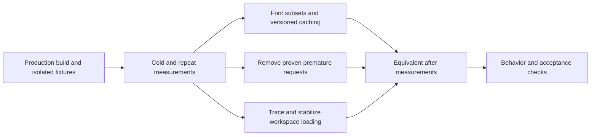

# Optimize initial page load — Plan

## Technical Design

<!-- Format: Include a concise solution description and change-relevant architecture or sequence diagram when useful. -->

Profile the production route request graph first; optimize the largest confirmed browser costs, then compare using the same harness. Prioritize coverage-preserving font subsets and versioned caching, followed by self-link prefetch removal and trace-attributed loading geometry. Treat global KaTeX CSS as a secondary measured optimization; retain existing conditional Mermaid import and server Markdown highlighting.

Do not install a new runtime dependency or introduce a new global state/cache system solely for this optimization. No database schema or API response contract change is planned.

## Components and Interfaces

<!-- Format: Use bullets. State each component responsibility and its inputs/outputs or interface contract. -->

- Production profiling harness, planned at scripts/profile-page-load.mjs: launch Chromium against an explicitly configured production server; accept URL, profile, repetition count and controlled session/fixture inputs; emit per-request metadata and aggregate JSON without credentials. Collect CDP network events and Resource Timing, capture failures/cache hits, and register buffered paint/layout observers before page code executes. Keep benchmark collection separate from destructive fixture setup.
- Font build tooling, planned at scripts/subset-fonts.py (or an equivalent reproducible existing tool selected during implementation): take the existing licensed font sources, partition Unicode ranges, emit WOFF2 assets plus matching font-face declarations; verify input/output cmap coverage and used style/axis metadata. Pin development tool versions and document the regeneration command; production serves committed generated assets without running font tooling.
- app/globals.css and app/login/login.css: retain family/style/weight/font-display contracts while referencing the generated range-specific font assets. Keep Latin words in one common range; include combining marks in each script face and place the common face last so clusters shape within one font. Other ranges are disjoint. Retain every original character mapping; preserve font metadata and OFL notices. Avoid preloading every range/style.
- next.config.ts: apply public long-lived caching only to immutable/versioned font asset paths. Existing private/no-store routes retain their semantics. Prefer content-hashed asset filenames, or Next-managed hashed output if it preserves range control and does not preload unneeded ranges.
- components/site-header-shell.tsx: inspect the brand self-link prefetch seen on /login and /. Suppress only proven unnecessary speculative fetches, retaining Link navigation, href, keyboard semantics and resolved authentication header behavior. Keep useful settings/course prefetches unless profiling justifies a narrower policy.
- app/page.tsx, lib/course-list.ts and components/course-list.tsx: reuse one ownership-filtered database query for the API and initial authorized page render. Pass a minimal serialized course summary as optional initialData so hydration starts in the final layout; retain background refetch/polling and a stable last-known layout on errors. app/studies.css remains available only if geometry still needs adjustment; preserve empty, populated, error/retry, featured-study and creation states. Do not assume font loading is the sole cause of the observed shift.
- app/providers.tsx: retain React Query and session safety checks. Change only if profiling demonstrates redundancy and tests preserve expiry, focus, broadcast and back-forward behavior; removing its initial session check is not a default optimization.
- Lesson route styling boundary, app/course/[id]/ch/[idx]/page.tsx and reader.css: if justified, load KaTeX CSS at a lesson boundary rather than globally; verify the installed Next.js CSS ordering/persistence rules and direct/client navigations before moving it.
- Existing e2e/login.spec.ts, home-workspace.spec.ts, header.spec.ts and lesson tests: reuse behavior fixtures and add focused loading/caching/typography checks without interpreting mocked delivery timings as real network evidence.

## Data Flow

<!-- Format: Use ordered steps or a diagram to show data transformations and boundaries. -->

1. Capture current git status/commit and production build conditions. Create a unique temporary database/account/session and empty/populated fixtures; keep all production data untouched. Warm server compilation/image-transform state consistently, then create fresh browser contexts for cold-browser samples.
2. Install network, paint and shift observation before navigation; fetch each route, await defined settlement, and record through a fixed window. Group document, scripts, styles, fonts, images, API data and RSC prefetches. Include browser-initiated requests such as icons and redirects, explaining any Resource Timing/CDP count differences.
3. Inspect font byte contribution and coverage. Generate ranges that leave common text small and load extra scripts only when used. Publish versioned WOFF2 assets with matching declarations; preserve originals as reproducible inputs or retain an equivalently complete source with its license.
4. Browser resolves rendered characters to the matching font ranges. Static version URLs permit reuse while new content hashes invalidate stale cache. Existing auth and course APIs keep current session/ownership rules.
5. Suppress confirmed self-prefetches and correct attributed loading geometry. Optional lesson CSS stays available when lesson content renders.
6. Repeat the identical profiling matrix, compare medians and individual CLS results, run behavior checks, and record evidence and deviations in this plan. Release the controlled session, temporary database/server and build output after verification.

## Decisions and Constraints

<!-- Format: Use `### Confirmed Decisions`, `### Assumptions`, `### Constraints`, `### Trade-offs`, and `### Open Questions`, each followed by bullets. -->

### Confirmed Decisions
- Work is scoped to issue #8 and the exploration findings, with separate spec, technical plan and execution tasks.
- Use existing image optimization, authentication checks and rendering patterns; preserve design and character support.
### Assumptions
- Current worktree may differ from exploration commit f9eacf1; rebaseline its actual production behavior before measuring savings.
- Desktop profile: Chromium pinned by the project Playwright lockfile, 1440x900, scale factor 1, no CPU/network throttling. Mobile profile: same pinned Chromium, 390x844, scale factor 2, mobile/touch emulation, CDP latency 150 ms, download 1.6 Mbit/s, upload 750 kbit/s, CPU slowdown 4x. This mobile profile differs from the exploration sample and requires a fresh baseline.
- Use at least three independent cold runs for each route/data/profile combination. Wait for document load, fonts and route data settlement, then observe a fixed additional 5 seconds; define timeout failures explicitly. Record server warmup and image-transform state separately. Repeat-cache runs enable cache and navigate away/back in the same context without forced reload.
### Constraints
- Read installed Next.js production, font, CSS, image and Link/prefetch guides before implementation; honor current APIs.
- Semble search precedes code exploration; preserve concurrent edits. At specification time unrelated dirty files included DESIGN.md, reader.css, components/socratic-session.tsx and e2e/chapter-reader.spec.ts; check again before build.
- No real Mailtrap/AI requests or production DB mutations. Existing mailtrap-transport.mjs disables its interception under NODE_ENV=production: do not assume the development OTP fixture can be reused unchanged. Use signed local sessions for profiling and a controlled local email HTTP stub or dedicated production-compatible test preload for auth behavior checks; verify no external delivery.
- Keep credentials out of measurements. Use temporary/ignored output paths. Next's custom distDir can generate next-env.d.ts/tsconfig changes; use a relative isolated build directory and restore only changes caused by the harness.
### Trade-offs
- Unicode splitting may add requests for multilingual text; measure common content and coverage cases separately rather than dropping supported glyphs.
- Long-lived caching helps repeat visits, not cold byte totals. Versioning is mandatory for mutable asset updates.
- Suppressing speculative requests can add navigation latency; target self-links first, preserving useful navigation prefetches.
- Lazy loading tiny shared code or deleting unused on-disk files is low priority unless the browser request graph establishes savings.
### Open Questions
- T2 resolved the numerical target at 30% for desktop /login and empty /. The final corrected-font matrix meets it; no target revision was needed.
- T2/T6 resolved CLS attribution: the studies panel changes columns for empty data and grows past the footer on populated mobile. Initial authorized summaries remove that hydration transition.

## File Changes

<!-- Format: Use bullets. Name each affected file or boundary and the intended change. -->

- scripts/profile-page-load.mjs and isolated fixture helpers: repeatable production measurement and safe cleanup; document commands and JSON schema.
- scripts/subset-fonts.py or selected equivalent, pinned development-tool instructions, public/fonts/: coverage-preserving font generation, versioned WOFF2 outputs and license preservation.
- app/globals.css, app/login/login.css and next.config.ts: font declarations, limited immutable-font caching, and optional removal of lesson-only KaTeX import from the root.
- components/site-header-shell.tsx: measured self-link prefetch policy with unchanged navigation semantics.
- app/page.tsx, lib/course-list.ts, app/api/courses/route.ts and components/course-list.tsx: shared ownership-filtered query, minimal serialized initial course summaries and stable background-error layout; retain the API response contract. Edit app/studies.css only if traces still require geometry changes.
- app/course/[id]/ch/[idx]/page.tsx or reader.css: conditional lesson-boundary KaTeX stylesheet relocation if measured and safe; accommodate concurrent reader edits.
- Existing focused component/browser tests plus a dedicated performance/asset verification test where needed: coverage, cache updates, delayed states and flow regressions.
- README.md and package.json scripts: profiling/regeneration/production verification commands and environment prerequisites. scripts/verify-page-load.mjs verifies real local auth, data, caching, typography, delayed layout and navigation.
- specs/optimize-initial-page-load/plan.md and measurements.json: commands, results, target selection, before/after aggregates, conditions, limitations and raw report paths. task.md records only verified completion. No production code changes during specification.

## Failure Handling

<!-- Format: Use bullets or a table with trigger, implementation response, and recovery. -->

- Missing browser/build/session fixture or failed request: fail the profiling run with a diagnostic; never silently omit failed requests from totals.
- Font cmap loss, broken range declaration, changed family/axis metadata or license omission: reject generated output and correct the generator; keep working assets until verification passes.
- Slow font/data requests: retain readable text, semantic loading indicators, fixed-state geometry and existing retry controls.
- Cache-version update: assert the URL changes and new body is served; reject indefinite caching of mutable public names.
- Auth/session regression: retain existing session checks and header identity resolution; fix the optimization before proceeding.
- Unmet byte/request/CLS target: inspect traces and repeat affected measurements; do not close acceptance tasks on attempted commands or a favorable single run.
- Concurrent edits or generated Next files: preserve unrelated work, review exact diffs, and restore only harness-owned generated changes.

## Implementation Steps

<!-- Format: Use ordered, small, independently checkable steps. Include dependencies when relevant. -->

1. Capture current worktree/build conditions, read relevant installed Next.js guides, and implement isolated production profiling/fixture support with explicit report schema, cache controls, safe credentials and cleanup. Verify it against one successful route and one failed-request case before broad sampling.
2. Using step 1, capture three-run cold baselines and repeat-visit samples for /login and empty/populated / on both fixed profiles, resource breakdowns and shift attribution; inspect character coverage and record the final numerical byte target before optimization. Check baseline completeness and preserve raw evidence.
3. Using step 2, implement reproducible font range/WOFF2 generation and matching CSS declarations. Verify cmap union, used styles/axes, license retention, readable fallbacks and representative multilingual text before replacing active assets.
4. Using step 3, serve only versioned font assets with long-lived caching and document regeneration. Verify cold font bytes, repeat reuse and changed-version fetching while private responses retain their policies.
5. Using step 2, remove measured self-link prefetch requests on /login and / without changing link destinations, accessible names or navigation. Verify the eliminated requests and working keyboard/client navigation.
6. Using step 2 shift attribution, stabilize workspace loading for empty/populated/error states, including delayed data/fonts. Verify all controlled CLS samples <= 0.1 and preserve responsive layout and creation/list actions.
7. After steps 3-6, reassess remaining initial cost and relocate globally imported KaTeX CSS to a lesson boundary only if measured savings justify it. Verify direct and linked lesson math/diagrams; if no change is justified record evidence and retain the existing import.
8. After steps 3-7, run the complete equivalent before/after profiling matrix, focused behavior/accessibility tests and required project commands. Fix failures and rerun affected checks; record all acceptance evidence and leave tasks open until passing.
9. After step 8 passes, review scope/whitespace, clean only owned temporary resources/generated mutations, update plan evidence and verify every acceptance criterion has passing current evidence. Summarize outcomes and limitations without deploying, committing or closing the issue.

## Verification Steps

<!-- Format: Use ordered or bulleted checks. Reference spec acceptance IDs where applicable. -->

1. AC-001, AC-007: Verify harness schema and request accounting against CDP and Resource Timing, including document, favicon if requested, redirects, failures, prefetches, cache hits, compressed/decoded sizes and resource categories. Record raw sample links and exact baseline/after commands. Use medians for byte/time summaries and individual runs for CLS; serialize observation conditions and tree state. Never include session credentials in output.
2. AC-002: Compare median cold transferred bytes against the recorded numerical target for /login and empty desktop /; also compare populated / and both mobile workspace fixtures without material regression. List the exact removed requests on each desktop route and verify at least one unnecessary request disappears per route. Distinguish deferred bytes from removed bytes and account for later navigation. If the 30% provisional target changes, document supporting baseline/coverage evidence before acceptance.
3. AC-003: Compare original/generated font cmap unions and used font metadata, ensure unicode-range declarations cover all characters, with overlap only for shared combining marks, retain licenses, and verify actual rendered faces/glyphs for representative Latin accents, Greek/Cyrillic where supported, italic/bold, symbols and fallback-only characters. Inspect desktop/mobile screenshots, focus/keyboard behavior and content overflow; verify text remains readable with blocked font requests.
4. AC-004: With browser cache enabled, prove unchanged fonts use memory/disk cache without another body transfer and unchanged hashed build assets stay reusable; test a new generated font version URL fetches the updated body. Check Cache-Control for /login, authenticated / and protected/session APIs and ensure no public caching of private responses.
5. AC-005: Capture before/after layout-shift attribution with delayed /api/courses and font responses across empty/populated fixtures and both profiles. Require CLS <= 0.1 in every controlled final sample; verify loading/error recovery and keyboard access to Create study and saved studies. Do not mask changes by excluding hydration/data/font shifts from the observation window.
6. AC-006: Run focused existing login/header/workspace/onboarding and lesson tests, plus any added caching/loading cases. Exercise real local auth endpoints with controlled production-safe delivery, signed-out / redirect, successful and failed OTP login, sign-out and existing cross-tab cleanup, settings/course navigation, real study-request persistence without external AI calls, and direct/client lesson navigation with math and Mermaid content. Use isolated fixtures; API mocks alone do not establish persistence/auth correctness.
7. AC-007: After the last implementation change run npm run lint, npm run typecheck, npm test, focused browser coverage, and npm run build with valid controlled environment. Use the project's installed browser and required tools; record each command and actual result with an Evidence: prefix. Failed or unavailable required checks keep verification tasks open. Run msdd review "Optimize initial page load", git diff --check and final scope inspection; verify every AC has current passing evidence and clean only owned resources.

Evidence: Exploration reference only — production build at f9eacf1 passed and the desktop request counts/byte totals reproduced across three runs. Full regression, controlled mobile baseline, populated-workspace samples, target feasibility and shift attribution remain build tasks. No optimization or acceptance completion is claimed by specification.

Evidence: T1 — Installed Next font/CSS/Link/production guidance read. Production build in .next-e2e-perf passed. Isolated performance-server.mjs seeds independent empty/populated sessions, intercepts external delivery with an explicit fail-closed production preload, and removes its temporary database on close. profile-page-load.mjs normal /login self-check passed (17 requests); aborting fonts produced valid=false with both failures retained. Focused ESLint passed. Generated Next config changes were removed by the harness.

Evidence: T2 — output/page-load-before.json retains 18 cold and 6 repeat samples; output/page-load-before-raw.json preserves initial classification. All content/assets succeeded; successful HTTP-200 RSC responses cancelled by Next are explicitly counted and retained as cancelledPrefetches, rather than failed page content. Non-cancellation failures remain invalid. Desktop request counts public/empty/populated: 17 / 21 / 30–31; median transferred bytes: 652124 / 659758 / 670432. Mobile: 17 / 20 / 30 requests and 620046 / 654327 / 665473 bytes. Mobile uses the plan's fixed scale-factor-2/throttled profile, not the scale-factor-1 exploration sample. Trace sources show .studies-section moves between grid columns on empty load; populated mobile list growth moves the footer out of view. CLS: desktop empty ~0.276, mobile populated ~0.381. The final desktop cold-byte reduction target is 30% for /login and empty /; populated/mobile must not regress. Character coverage inspection found 2091/1972 EB Garamond glyph mappings, 922 per Roboto style, 574 Pixelify mappings. Subsets preserve their union.

Evidence: T3 — scripts/subset-fonts.py uses pinned FontTools 4.46.0/Brotli 1.1.0. Every source cmap codepoint survives in disjoint ranges; glyph IDs/advance metrics, source family/style/license name records and variable axes are asserted after WOFF2 serialization (post-format-3 aliases can canonicalize names). All original font files/licenses remain. Common face sizes are 103736-byte EB Garamond, 56152-byte Roboto, 5896-byte Pixelify. Two regeneration runs produced identical manifest SHA-256. Injecting the generated declarations into the production landing and explicitly awaiting face loads yielded zero changed screenshot channels and identical geometry; accented Greek/Cyrillic normal/italic face loads succeeded. app/fonts/body.css and entrance.css now replace the original declarations with the verified faces. Initial screenshot check caught a swap transition; final settled comparison passed.

Evidence: T4 — Production rebuild passed with generated font imports. Warm /login fonts were served from browser cache with CDP networkBytes=0 and Cache-Control public,max-age=31536000,immutable. The cache-version test changed an actual WOFF2 head.fontRevision, generated a new content hash, fetched old/old/new URLs and observed transferred bytes 104036 / 0 / 103760. Temporary font versions were removed. /login, /api/courses and /api/auth/get-session retained no-store. Immutable policy matches only 12-hex versioned WOFF2 paths, not mutable sources or the manifest. README records profiling and pinned font-regeneration commands.

Evidence: T5 — Production rebuild passed. With brand prefetch=false, cold public/empty samples had 16/20 requests (baseline 17/21), 445235/354614 transferred bytes, no /login?_rsc or /?_rsc requests, and valid content. Keyboard focus/Enter on Newton retained the correct route for signed-out and signed-in fixtures. The brand link disables speculative fetches on other routes too; it keeps client navigation and avoids introducing a pathname client boundary solely for a small prefetch. Settings/course links retain their policies.

Evidence: T6 — Shared listUserCourses(userId) preserves the API query/response and ownership filter. app/page.tsx passes only serialized display summaries into optional CourseList initialData; full course content and user/session data do not cross this new boundary. Failed initial reads use the existing client retry path; background empty-state errors retain the creation column. npm test -- components/course-list.test.tsx app/courses-route.test.ts lib/auth.integration.test.ts passed 18 tests. Production delayed-data/font samples (1500ms), output/workspace-cls.json: desktop empty 0.000192, populated 0.001019; mobile empty 0.000534, populated 0.001010; all valid and without horizontal overflow. Screenshots: output/workspace-check/. No studies CSS change was needed.

Evidence: T7 — Moving KaTeX CSS from globals to the chapter page reduced workspace styles from 20767 transferred / 106224 decoded bytes to 16578 / 80876 (4189 / 25348 saved). Production build passed; real database-backed direct and client-linked lessons both showed visible display math, KaTeX_Main computed family and Mermaid SVG. The fixture initially used one-line $$ delimiters (inline math); corrected it to a true display block and both checks passed. Existing higher-specificity .prose-editorial overflow rules remain global, and installed Next guidance documents stylesheet persistence on navigation.

Evidence: T8 discovery / reopened T3 — Additional pixel comparisons against original full fonts exposed changes for Caffè and decomposed Latin accents despite intact cmap/metrics; splitting a Latin word/cluster across faces loses kerning/mark placement. The earlier ASCII-only landing comparison did not cover this. Revised generation keeps Latin and combining marks together, shares marks across script faces (common face last), and retains browser-default shaping plus all numeric variants used by current CSS. Unused discretionary stylistic sets are omitted; source fonts remain intact. The production verification script now compares mixed precomposed/decomposed Latin, Greek/Cyrillic accents, ligatures and digits against original regular/italic EB Garamond and Roboto screenshots. Earlier byte results are superseded until regeneration, visual verification and the complete after matrix pass.

Evidence: T3 reverified — Revised common sizes: EB Garamond regular 97868/italic 98064, Roboto regular 70608/italic 78336, Pixelify 11284 bytes. All source character mappings, glyph IDs/metrics, family/style/license records and axes remain verified. New regeneration produced identical manifest SHA-256. The added production pixel proof passed all four original-vs-subset cases, including decomposed Greek/Cyrillic marks; the entire production integration script passed again. The final required npm run lint (0 errors, one existing unrelated socratic-session warning), npm test (419 tests), and existing Playwright workspace/header/style/reader/onboarding suite (10 tests) also passed with the corrected assets. Earlier first-split after measurements are retained only as superseded investigation evidence.

Evidence: Final corrected-font matrix — node scripts/profile-page-load.mjs --output output/page-load-after.json passed all 18 cold and 6 repeat samples. Reproducible baseline command: node scripts/profile-page-load.mjs --build --output output/page-load-before.json; before body/assets were measured before optimization, and the raw report remains preserved. specs/optimize-initial-page-load/measurements.json retains aggregate conditions, browser/Node/CPU metadata, medians, encoded/decoded/transfer bytes, FCP/LCP/DCL/load timings and maximum observed CLS; full request rows and resource categories remain in ignored output/page-load-before.json and output/page-load-after.json. No cookies, secrets or OTPs are included.

Evidence: Desktop final cold medians (bytes; requests) — /login 652124→440454 (32.46%; 17→16), empty / 659758→359437 (45.52%; 21→20), populated / 670432→371121 (44.64%; 30→30). Mobile medians — /login 620046→408376 (34.14%; 17→16), empty / 654327→354000 (45.90%; 20→19), populated / 665473→365679 (45.05%; 30→29). The exact removed request is the brand self-link /login?_rsc or /?_rsc prefetch; populated desktop's total varies with other course prefetch scheduling, with no count increase. Maximum final workspace CLS: desktop empty 0.000382, populated 0.002183; mobile empty 0.000534, populated 0.001010. The original target is met without a target adjustment.

Evidence: Verification commands with corrected fonts — npm run test:performance -- --build passed all 11 production integration cases (including pixel proofs, delayed font/data layout, real OTP failure/success, persisted course ownership, direct/linked math/diagrams and cross-tab sign-out). npm test passed 419 tests across 58 files. npm run lint passed with zero errors and one existing unrelated useCallback dependency warning in components/socratic-session.tsx. npm run typecheck passed. npx playwright test e2e/home-workspace.spec.ts e2e/header.spec.ts e2e/style-uniformity.spec.ts e2e/chapter-reader.spec.ts e2e/onboarding.spec.ts passed 10 browser tests. Logs: output/performance-verification.log, unit-tests.log, lint.log, typecheck.log, browser-tests.log. Desktop empty/mobile populated screenshots in output/page-load-checks/ were visually inspected; style crawl also covers 320px, focus, controls and shared typography. Lab paint timings are not field performance claims; cancelled successful RSC responses are retained but partial byte information can be incomplete.

Evidence: T8 login regression discovery — Full existing login suite initially passed 9/10; its legacy 844x390 fit assertion failed. Production comparison at that viewport measured scrollHeight=440 with both original and optimized fonts, including after settlement, so this is pre-existing short-screen behavior rather than a typography regression. Existing login CSS explicitly permits normal document scrolling to preserve readable text/controls. Updated the legacy test to keep horizontal/normal-height fit checks, while scrolling submit/recovery controls into view on very short screens and checking their reachability; no product CSS was changed. Full login suite and final checks must pass before closing T8.

Evidence: T8 complete — Final corrected-font matrix passed all target comparisons with no invalid cold/repeat samples; all warm font rows were cached with networkBytes=0. Corrected production verification passed 11 checks. After the legacy short-screen test correction, npm test again passed 419 tests, npm run lint again passed (the same existing warning only), full npm run test:e2e:login passed 10/10, and final npm run build (through the isolated server helper) plus npm run typecheck passed. Existing workspace/header/style/reader/onboarding coverage remains 10/10 with the corrected fonts; only the independent legacy login expectation changed afterward. Logs and measurements.json retain current evidence.

Evidence: T9 — Final scope inspection found only the intended source, tests, tooling, generated font faces/assets, README/package scripts and MSDD artifacts. No original font/license or unrelated design/reader/socratic source was modified. git diff --check and explicit whitespace/newline checks for untracked text passed; next-env.d.ts/tsconfig.json match their original tracked state. All owned production server/browser helpers completed cleanup, temporary databases/outboxes and cache-version fixtures were removed, and the owned .next-e2e-perf build directory was deleted after verification. Reports/screenshots stay in ignored output/ for review; tracked measurements.json preserves aggregate evidence. No commit, push, deployment or issue mutation was performed.

Evidence: T10 / AC-001, AC-007 — Reviewed both 24-sample report schemas. CDP requestCount equals retained request-row count; timingCount and category counts equal Resource Timing rows; transferred/encoded/decoded totals equal per-resource sums. All FCP/LCP/CLS/DCL/load fields are numeric; all final/reviewed baseline samples are valid with no content failures/page errors. Successful cancelled RSCs remain explicit rows and counts. Reports retain conditions, commit/worktree, failures/cancellations, cache metadata and raw resource sizes without session-cookie values. Normal/aborted-font self-check evidence remains T1.

Evidence: T11 / AC-002 — Rechecked all six final median comparisons: every byte total decreases, neither desktop nor mobile request count increases, and desktop /login/empty / exceed the fixed 30% byte target with one fewer request. Raw request rows confirm /login?_rsc and /?_rsc self-prefetches disappear. Savings are not all removals: KaTeX CSS moves to lesson navigation, and non-Latin ranges load when needed. A separate real production check appended Café/Greek/Cyrillic to the loaded workspace: exactly two additional EB Garamond ranges transferred 31240 and 51760 bytes (30940/51460 encoded), recorded in measurements.json and output/multilingual-fonts.json. Both direct/linked lesson checks prove deferred math/diagram assets still render. No target revision was made.

Evidence: T17 (reconciled replacement of original T12) / AC-003 — Independently reread every emitted WOFF2: cmap unions equal all five original fonts, each character keeps original advance metrics, axes and family/style/license metadata match. Shared combining marks are the intentional overlap; default shaping/numeric variants are retained. Production pixel proofs match original fonts for precomposed/decomposed Latin, Greek/Cyrillic marks, ligatures and digits in regular/italic EB Garamond and Roboto; blocked-font controls remain readable. Existing style crawl and login suite verify approved families, responsive/zoom/keyboard behavior; screenshots were inspected. Original license/source files are unchanged.

Evidence: T13 / AC-004 — Reviewed all final repeat visits: fonts, hashed scripts and styles are cached with CDP networkBytes=0. The production old/old/revised-font test transfers a body for the initial and changed-hash versions but zero bytes on the unchanged repeat. Every successful document/API response in the final matrix retains no-store, including authenticated course/session requests. Mutable original font names and manifest are excluded from immutable policy.

Evidence: T14 / AC-005 — All 24 final cold/repeat samples and four current delayed-font/data samples remain under CLS 0.1. Shift observers start before document code and retain every non-input shift source; no hydration/data/font events were removed. Raw before traces attribute empty desktop movement to .studies-section switching columns and populated mobile movement to list growth/footer displacement; after initial-data rendering removes those transitions. Production error/retry and blocked-font checks pass, with accessible creation controls and saved-study navigation confirmed by production/browser coverage.

Evidence: T15 / AC-006 — Production checks use real local auth and course endpoints with a fail-closed external transport: signed-out redirect/401, wrong and correct OTPs, database-owned study persistence, cross-tab sign-out and back-navigation protection pass. Direct/client lessons render real Markdown math and Mermaid; settings/course/keyboard-logo navigation passes. Full existing login suite passed 10/10 (including two-learner privacy/resume/logout, mobile creation, delivery errors and header transitions); workspace/header/style/reader/onboarding suite passed 10/10. No real emails or AI calls were made.

Evidence: T16 / AC-007 final gate — Every acceptance ID has current passing evidence (T10/AC-001; T11/AC-002; T17/AC-003; T13/AC-004; T14/AC-005; T15/AC-006). Final lint, typecheck, 419 unit tests, 20 existing browser tests, 11 production integration checks and production build passed; the existing unrelated lint warning is documented. The separate multilingual measurement rebuilt the same production source and passed, with its temporary session/server closed. Removed the recreated owned performance build output afterward; generated Next files match tracked originals and no cache-version fixtures remain. All untracked text and changed-line whitespace checks pass, aggregate measurements remain available, and scope inspection preserves unrelated files. msdd review passes. No commit or deployment was performed.
