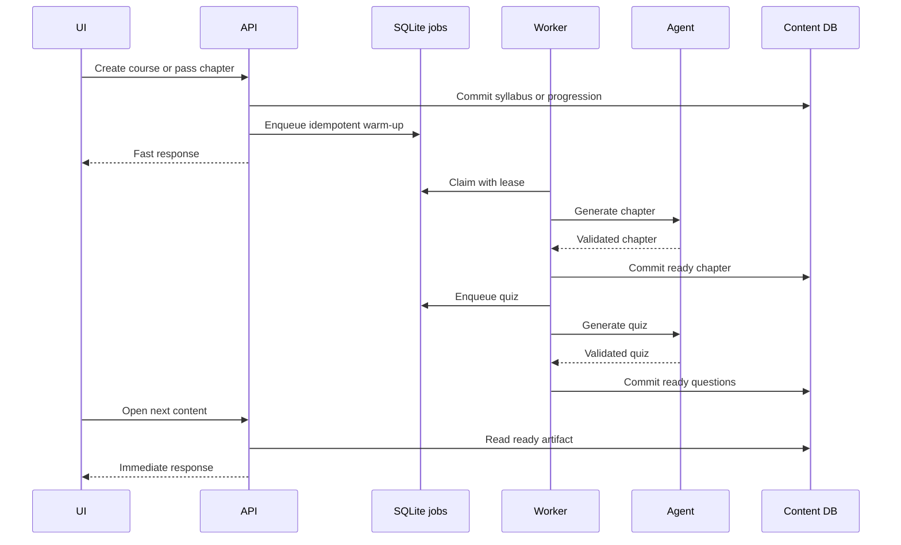
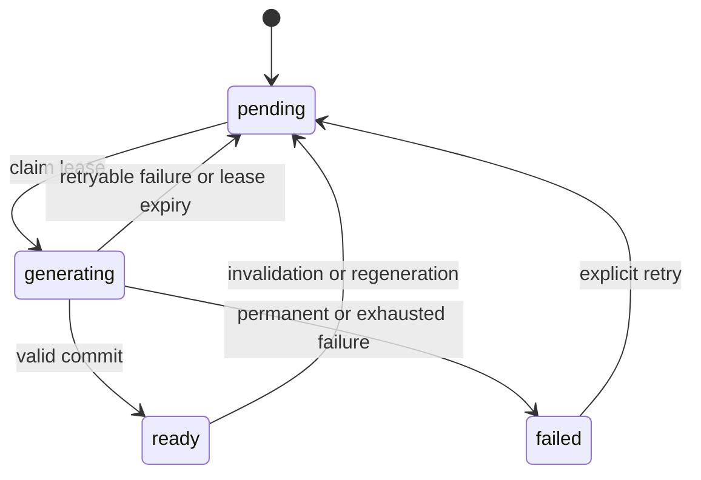

# Prefetch Generated Learning Content to Reduce LLM Wait Time

## Summary

Reduce 20–60 second learner waits by generating predictable content before navigation. Add persisted artifact state, SQLite-backed warm-up jobs, leases, retries, versioning, client prefetching, and observability. Course creation waits only for syllabus persistence; chapter 0 warms asynchronously. After a pass, only the next reachable chapter warms.

## Problem

`POST /api/courses` generates only the syllabus. `GET /api/chapters/:id` lazily generates chapter content, and `GET /api/chapters/:id/quiz` lazily generates questions. The first visit can block on an LLM CLI call. Existing content is persisted, but there is no job lifecycle or duplicate-call protection. Grading must remain on demand because it depends on answers and creates review items. Generating every chapter up front wastes calls and can use stale adaptive context.

## Goals and Non-Goals

### Goals

- Persist chapter and quiz generation state.
- Warm chapter 0 after course creation without delaying the response.
- Generate a quiz after its chapter content is ready.
- Warm only the next reachable chapter after a pass.
- Prevent duplicate LLM calls from requests and prefetches.
- Recover from failures, restarts, and expired leases.
- Add non-blocking React Query prefetching.
- Invalidate/version content after regeneration or difficulty feedback.
- Measure latency, cache hits, failures, duplicate suppression, and wasted work.

### Non-goals

- Do not generate every chapter or quiz at course creation.
- Do not pre-generate grading or learner-specific review questions.
- Do not change syllabus prompts, progression, or grading semantics.
- Do not add an external queue in this iteration.
- Do not expand look-ahead beyond one chapter without measurement.

## Users and Scenarios

### Actors

- Learner: studies, quizzes, passes chapters, and gives difficulty feedback.
- API: persists state, enqueues jobs, serves ready artifacts, and handles fallback.
- Worker: claims jobs, invokes existing agents, and commits artifacts.
- SQLite: stores content, jobs, leases, versions, and errors.
- React Query client: prefetches likely next data without controlling correctness.

### Scenarios

1. Course creation stores the syllabus, enqueues one chapter-0 job, and returns without waiting for chapter generation.
2. A worker generates chapter 0, stores it as ready, and enqueues its quiz.
3. The worker generates and validates ten balanced questions and stores them as ready.
4. Ready chapter/quiz requests return persisted data without invoking an agent.
5. A passed chapter unlocks and warms only the next reachable chapter.
6. Duplicate requests coalesce into one job and one agent invocation.
7. Transient failures retry; exhausted failures become visible and retryable.
8. Feedback or regeneration invalidates stale versions and starts replacement work.

## Requirements

- REQ-001 (P0): Course creation must enqueue an idempotent chapter-0 job after syllabus persistence and must not wait for chapter generation.
- REQ-002 (P0): Chapter and quiz artifacts must have persisted `pending`, `generating`, `ready`, or `failed` state, timestamps, attempts, errors, and lease metadata.
- REQ-003 (P0): An active job key must uniquely identify artifact type, target ID, and generation version.
- REQ-004 (P0): A worker must claim only unclaimed or expired jobs and record a lease.
- REQ-005 (P0): Successful chapter generation must atomically persist content, pretest, summary, timestamp, version, and ready state.
- REQ-006 (P0): Quiz generation must follow matching chapter readiness and atomically persist validated questions and ready state.
- REQ-007 (P0): A passed attempt must enqueue only the newly reachable next chapter.
- REQ-008 (P0): Ready GET requests must not invoke an agent or create duplicate work.
- REQ-009 (P1): Non-ready GET requests must use shared coordination and a documented processing response or lease-protected synchronous fallback.
- REQ-010 (P0): Retryable failures use bounded backoff; permanent/exhausted failures are recorded safely.
- REQ-011 (P0): Regeneration advances the version, invalidates dependent quizzes, and starts a fresh chapter-then-quiz pipeline.
- REQ-012 (P1): Difficulty feedback prevents old-depth content from being current.
- REQ-013 (P1): Chapter load prefetches its quiz and next reachable chapter without blocking.
- REQ-014 (P1): Quiz load prefetches only the next reachable chapter; failures are non-blocking.
- REQ-015 (P0): Grading, review items, and unlock decisions remain on demand and authoritative.
- REQ-016 (P1): Record enqueue, claim, completion, failure, retry, cache-hit, duplicate, latency, and waste metrics.
- REQ-017 (P0): Correctness holds across duplicate requests, restarts, expired leases, and simultaneous pass/enqueue events.
- REQ-018 (P1): Add unit, integration, and end-to-end tests for the above behavior.

## User/System Flows

1. Course creation: validate syllabus; commit course and chapters; enqueue chapter 0 after commit; return course ID. If enqueue fails, a later read repairs it.
2. Chapter job: claim lease; load current prompt context; run existing agent/schema; commit only if version is current; enqueue quiz on success; retry or fail safely otherwise.
3. Quiz job: claim the matching chapter version; run existing quiz validation/balancing; commit questions and ready state; retry or fail safely otherwise.
4. Pass: grade and commit attempt/review/unlock; if a next chapter opens, enqueue its job idempotently.
5. Read: return current ready data; otherwise coordinate a job or synchronous fallback; preserve locked and safe error responses.

## Technical Design

### Solution Description

Use a durable SQLite-backed warm-up pipeline. A single in-process worker polls jobs, claims leases, runs existing chapter/quiz generators, and commits artifacts transactionally. Chapter content precedes its quiz. Generation versions prevent stale adaptive results from replacing newer work. React Query prefetching hides remaining latency but is never authoritative.

### Current State

- Courses eagerly persist only the syllabus.
- Chapter and quiz GET routes generate missing artifacts during requests.
- Attempts perform grading, review-item creation, and unlock transitions.
- No durable generation job, lease, or worker coordinator exists.

### Proposed Design

- Add artifact status/version metadata and a `generation_jobs` table.
- Add coordinator methods for enqueue, claim, complete, fail, retry, and stale-lease recovery.
- Start one bounded worker from the server lifecycle.
- Enqueue after course creation and after a successful unlock.
- Enqueue quizzes only after chapter success.
- Make GET routes read ready artifacts first and use the coordinator for misses.
- Version/invalidate on feedback and regeneration.
- Add non-blocking client prefetches.

### Architecture / Components

- Generation coordinator shared by routes and worker.
- SQLite job store with unique active keys and lease indexes.
- In-process worker with bounded polling, concurrency, shutdown, and recovery.
- Existing chapter and quiz generators behind coordinator operations.
- API hooks after course creation, pass, feedback, and regeneration.
- React Query prefetch layer.
- Structured observability that excludes prompts, answers, and generated content.

### Data Model / API Changes

- Add artifact status/version metadata or a normalized artifact-generation table.
- Add `generation_jobs` with artifact type, target ID, version, status, attempts, next-run time, lease owner/expiry, timestamps, and error details.
- Add indexes for status, next-run, lease expiry, and target lookup.
- Preserve existing route URLs and payloads.
- Add only internal coordinator/worker interfaces; no public job-management API.

### Technical Decisions

- SQLite is the durable queue for this single-process deployment.
- Initial look-ahead is one chapter.
- Quizzes follow chapter generation.
- Versions protect adaptive correctness.
- Existing agents, schemas, retries, and quiz validation remain authoritative.
- Ready content remains intact until replacement succeeds.

### Trade-offs

- SQLite/in-process is simple and durable for one process, but needs a dedicated worker or external queue for multi-instance deployment.
- Warm-up reduces waits but can spend calls for learners who leave; reachable-only scheduling limits waste.
- Versioning adds state complexity but prevents stale content.
- Synchronous fallback preserves availability but can still expose a cold wait.

### Failure Handling

- Retry transient agent failures with bounded exponential backoff.
- Mark permanent/exhausted jobs failed with safe error data.
- Reclaim expired leases.
- Make duplicate enqueue a no-op.
- Discard stale results and never overwrite current ready content.
- Ignore prefetch failures for navigation.
- Let later reads repair missing jobs after restart.

### Testing Strategy

- Unit-test idempotency, state transitions, leases, retries, versions, and dependencies.
- Integration-test course creation, chapter/quiz success, pass/unlock, feedback, and regeneration transactions.
- Test concurrent requests and worker claims with stubbed agents.
- Test ready, pending, failed, locked, and fallback API states.
- Test React Query prefetch and ignored failures.
- Add an end-to-end course-to-next-chapter warm-up flow.

## Decisions and Constraints

### Confirmed Decisions

- Warm chapter 0 after creation and only the next chapter after a pass.
- Generate quizzes after chapter content.
- Keep grading and review creation on demand.
- Use SQLite jobs with an in-process worker.
- Use leases, unique keys, bounded retries, and versions.
- Add non-blocking React Query prefetching.

### Assumptions

- Target deployment is one long-lived Node process.
- SQLite remains authoritative.
- Existing agent/model selection remains unchanged.
- One worker is sufficient initially.
- A requested artifact may use a lease-protected synchronous fallback.

### Constraints

- Locked chapters must not warm before unlock.
- Prompts use current summaries, depth hint, and review context.
- Quiz output passes existing validation.
- Existing routes and progression remain compatible.
- Restarts and failures must not corrupt ready content.
- Look-ahead is capped at one chapter.

### Open Questions

- Multi-instance deployment may require a dedicated worker or external queue later.
- Look-ahead expansion requires measured latency and waste thresholds.
- A generation-progress UI is deferred.

## Edge Cases and Failure Handling

- Duplicate enqueue returns the active job without another agent call.
- Current leases reject duplicate claims.
- Expired leases become pending and reclaimable.
- Stale results are discarded by version check.
- Feedback/regeneration invalidates old dependent work.
- Locked requests retain the existing locked response.
- Missing agent or permanent failure uses the existing safe error shape.
- Worker restart is recovered by lease expiry.
- Quiz validation failures retry without deleting a valid current quiz.

## Acceptance Criteria

- AC-001: Course creation returns after syllabus persistence with a slow agent stub.
- AC-002: Repeated enqueue creates one active chapter-0 job.
- AC-003: Chapter success stores content/version and creates one quiz job.
- AC-004: Quiz success stores a valid balanced quiz.
- AC-005: A pass warms only the newly reachable chapter.
- AC-006: Ready reads do not invoke an agent.
- AC-007: Concurrent reads invoke the agent at most once per lease.
- AC-008: Expired leases recover and retryable failures back off.
- AC-009: Regeneration creates a new versioned chapter/quiz pair.
- AC-010: Feedback prevents stale-depth content from being current.
- AC-011: UI prefetches defined next artifacts without blocking navigation.
- AC-012: Grading remains answer-dependent and review behavior is unchanged.
- AC-013: Required metrics/logs are emitted without sensitive content.
- AC-014: Automated tests cover all P0 requirements and the end-to-end path.

## Explanation and Output Artifacts

- Audience: maintainers and implementers of Newton.
- Writing profile: 80% ASD-STE100 controlled language with short, testable statements.
- Primary artifact: this Markdown specification for the warm-up pipeline and its acceptance evidence.
- Supporting artifacts: Mermaid sequence/state diagrams here and the ordered task list in `task.md`.
- Accessibility: diagrams have nearby prose equivalents; requirements do not depend on diagram rendering.

## Implementation Plan

1. Add schema and migration for artifact generation status/version and `generation_jobs`.
2. Implement the generation coordinator with idempotency, leases, retries, stale-job recovery, and version checks.
3. Adapt chapter and quiz generation to coordinator operations.
4. Implement and start the in-process worker.
5. Enqueue chapter 0 after course creation and quiz work after chapter success.
6. Update chapter and quiz GET routes for ready reads, coordinated misses, and fallback behavior.
7. Enqueue the newly unlocked chapter after a successful attempt.
8. Version and invalidate feedback/regeneration flows and dependent quizzes.
9. Add React Query prefetching for the current quiz and next reachable chapter.
10. Add structured generation/cache metrics and redacted logs.
11. Add unit and integration tests.
12. Add end-to-end coverage for course creation through next-chapter warm-up.
13. Run typecheck, lint, unit, e2e, and migration checks; record evidence and deviations.

## Verification and Implementation Notes

- Run `npm run typecheck`, `npm run lint`, `npm test`, and `npm run test:e2e` after implementation.
- Verify clean and existing-database migrations.
- Verify worker startup, shutdown, lease recovery, and retries with stubbed agents.
- Verify logs do not contain prompts, answers, or generated content.
- Record deviations from the single-process SQLite assumption before build completion.
- Evidence: Added chapter content/quiz generation status, version, error, and update-time fields, plus the durable `generation_jobs` table with unique target/version, status/next-run, and lease-expiry indexes.
- Evidence: `npm run db:generate` created `drizzle/0003_skinny_mephistopheles.sql`.
- Evidence: `npm run db:migrate` applied all migrations successfully.
- Evidence: `npm run typecheck` completed successfully.
- Evidence: Added `lib/generation.ts` with idempotent target/version enqueue, leased claims, bounded retry scheduling, expired-lease recovery, owned-job completion/failure, and current-generation checks.
- Evidence: `npm run typecheck` completed successfully after coordinator implementation.
- Evidence: Extracted reusable chapter generation into `lib/chapter.ts`; it preserves existing prompt context and commits only the current content version.
- Evidence: Made quiz generation version-aware and atomically mark quiz metadata ready with validated question persistence.
- Evidence: Chapter API generation now delegates to the shared chapter operation; `npm run typecheck` completed successfully.
- Evidence: Added `lib/generation-worker.ts` with bounded polling, lease claims, stale-job handling, shared chapter/quiz execution, retry/failure recording, and graceful stop support.
- Evidence: Added root `instrumentation.ts` to start the worker once for the Node.js Next server runtime.
- Evidence: `npm run typecheck` completed successfully after worker and instrumentation changes.
- Evidence: Course creation now enqueues chapter 0 after the course/chapter transaction commits.
- Evidence: Successful chapter jobs now enqueue a quiz job for the same generation version; `npm run typecheck` completed successfully.
- Evidence: Chapter and quiz GET routes now serve ready persisted artifacts, coordinate misses through idempotent jobs and request-owned leases, and return retryable `202` processing responses when another owner is generating.
- Evidence: `npm run typecheck` completed successfully after coordinated GET fallback changes.
- Evidence: Successful attempt processing now enqueues the newly unlocked chapter after the progression transaction commits, using the chapter's current content version.
- Evidence: `npm run typecheck` completed successfully after pass/unlock warm-up integration.
- Evidence: Added question generation versions so regenerated quizzes do not replace or delete questions referenced by historical attempts.
- Evidence: Difficulty feedback and explicit regeneration now advance chapter content versions, invalidate dependent quiz metadata, and enqueue replacement chapter work.
- Evidence: Quiz reads filter to the current chapter version while preserving legacy version-1 content; `npm run db:generate`, `npm run db:migrate`, and `npm run typecheck` completed successfully.
- Evidence: Chapter and quiz screens now prefetch the current quiz and next open chapter through React Query, retry transient `202` generation responses, and ignore prefetch failures for navigation.
- Evidence: `npm run typecheck` completed successfully after client prefetch changes.
- Evidence: Added redacted structured generation events for enqueue, duplicate, claim, completion, failure, recovery, stale artifacts, and cache hits; worker events include duration and retryability.
- Evidence: `npm run typecheck` completed successfully after observability changes.
- Evidence: Added `lib/generation.test.ts` covering duplicate coalescing, owned completion, retry backoff, exhaustion, and expired-lease recovery.
- Evidence: Updated the quiz route fixture for ready chapter content and generation-version behavior.
- Evidence: `npm test -- --maxWorkers=1` passed 12 files and 27 tests; `npm run lint` and `npm run typecheck` passed.
- Note: Parallel `npm test` can exceed the existing 5-second timeout in `lib/markdown.test.ts`; the test passes serially without code changes.
- Evidence: Added `e2e/generation-prefetch.spec.ts` with mocked API responses; it verifies current-quiz and next-reachable-chapter prefetching in the browser.
- Evidence: `npm run test:e2e -- --grep "prefetches the current quiz"` passed.
- Evidence: Final verification passed: `npm run db:migrate`, `npm run typecheck`, `npm run lint`, `npm test -- --maxWorkers=1` (12 files, 27 tests), and the feature-specific Playwright test.
- Note: The first parallel verification attempt raced `eslint` against Playwright creation of `test-results`; a standalone `npm run lint` passed.
- Evidence: Updated the stale onboarding E2E assertions to current product copy; the complete `npm run test:e2e` now passes both browser tests.
- Evidence: Added SQLite `busy_timeout = 5000` for short transaction contention and increased the existing Markdown test timeout to 10 seconds for cold rendering.
- Evidence: Sequential `npm test -- --maxWorkers=1`, `npm run lint`, `npm run typecheck`, and `npm run test:e2e` all passed.
- Evidence: Added a worker lifecycle test; `npm test -- --maxWorkers=1 --run lib/generation.test.ts` passed 4 coordinator/worker tests.
- Evidence: Added an observability redaction test that asserts emitted events contain no prompt, answer, or generated-content fields; the focused generation suite now passes 5 tests.
- Evidence: No deviation from the single-process SQLite worker assumption was required.
- Evidence: `DATABASE_URL=file:./data/clean-migration-check.db npm run db:migrate` passed on a clean database, and the existing database migration also passed.
