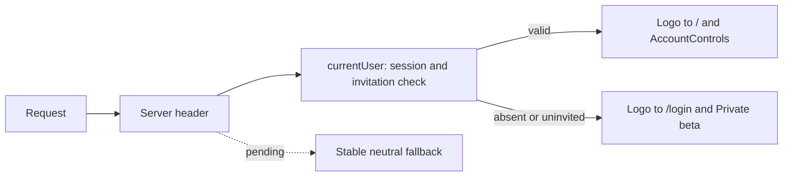

# Stable authentication header navigation — Plan

## Technical Design

<!-- Format: Include a concise solution description and change-relevant architecture or sequence diagram when useful. -->

Resolve authentication on the server close to SiteHeader using the existing currentUser() helper, which checks both session validity and invitation access. Render the public badge or authenticated AccountControls from that result, and select the logo destination from the same result. Remove the pathname-based authentication decision from AccountControls.

Keep RootLayout synchronous. Wrap the asynchronous header in a local Suspense boundary with a neutral header fallback: same header/brand classes and logo dimensions, a /login logo destination while identity is unresolved, and no badge or account actions until resolved. Reserve existing header height. Do not put a top-level session await in RootLayout that gates all children. Normal client navigation retains the already resolved shared header. Login/logout already replace the document; existing Providers handles cross-tab changes and expiry checks.

Retain server authorization in pages and APIs. This header determines presentation only; it is not an access boundary.

## Components and Interfaces

<!-- Format: Use bullets. State each component responsibility and its inputs/outputs or interface contract. -->

- components/site-header.tsx: Async server SiteHeader resolves currentUser once per render; maps the result to a boolean locally, renders public badge or AccountControls, and chooses href /login or /. Keep the existing optional status override for the right-hand content. Use the pure HeaderShell and SiteHeaderFallback from components/site-header-shell.tsx as a neutral synchronous fallback that shares header/brand markup and dimensions without invoking session lookup.
- components/account-controls.tsx: Client-only interactive authenticated controls with existing query cache cleanup, logout request, broadcast, busy/error states. Remove usePathname and the public badge branch. The parent mounts this component only after validating a user; do not pass a session object or token.
- app/layout.tsx: Render SiteHeader under a local React Suspense boundary with its neutral header fallback, inside the existing Providers wrapper. Leave children/footer and provider behavior intact.
- lib/access.ts: Existing currentUser() contract returns an invited authenticated user or null. Reuse unchanged. requirePageUser() and authorize() continue to enforce access.
- app/providers.tsx and components/login-form.tsx: Existing document replacement, cache cleanup, and cross-tab contracts remain unchanged.
- e2e/login.spec.ts: Extend existing empty-session login coverage and controlled OTP fixture with focused header transition tests. Prefer existing helpers rather than new authentication setup/configuration.

## Data Flow

<!-- Format: Use ordered steps or a diagram to show data transformations and boundaries. -->

1. On a document request, RootLayout can render its shell/children while the local header boundary waits for currentUser(). Its neutral fallback cannot show account actions.
2. currentUser validates the session against request headers and invitation access. SiteHeader derives signedIn = Boolean(user); the user record remains server-side.
3. SiteHeader renders the logo destination and public/authenticated content atomically from signedIn. AccountControls receives no session data.
4. On client navigation between authenticated pages, the shared header remains resolved; it does not infer identity from usePathname.
5. On login/logout/document refresh, the new request resolves header identity again. Providers retains its existing focus/timer/broadcast and back-forward-cache handling.
6. Regression observation starts before document rendering and continues through navigation settlement, including redirects or reloads; recorded evidence includes rendered header states and timestamps, not credentials.

## Decisions and Constraints

<!-- Format: Use `### Confirmed Decisions`, `### Assumptions`, `### Constraints`, `### Trade-offs`, and `### Open Questions`, each followed by bullets. -->

### Confirmed Decisions
- The user authorizes a local commit of the completed issue #5 fix after successful validation. Do not push or close the GitHub issue as part of this task.
- Implement authentication-aware presentation using the existing currentUser helper and two logo destinations.
- Do not add client session polling or an auth context for this fix.
### Assumptions
- SiteHeader is currently rendered only by RootLayout; AccountControls only by SiteHeader, confirmed by repository search.
- Existing full-document login/logout and Providers refresh paths remain in place.
### Constraints
- Read installed Next.js guides for usePathname, redirects, authentication/layouts, and Suspense before implementation. Exploration confirmed layouts persist across client navigation and a top-level layout await can delay streaming.
- Preserve unrelated dirty files, especially app/settings/page.tsx, app/settings/settings.css, and e2e/profile.spec.ts.
- Use the controlled test database/outbox and test-only credentials; never access production sessions or send real email.
- Existing shared layout identity is refreshed by current mechanisms, not on every navigation. This change does not promise new instant session-expiry detection.
### Trade-offs
- Server lookup adds header-specific validation work and may briefly show a neutral fallback on a new document; it removes incorrect authenticated markup. Avoid global memoization or a new caching layer; optimize repeated request work only if implementation evidence requires it.
- A logo-only href fix would remove the reported round trip but leave incorrect signed-out rendering on direct protected visits; therefore it is insufficient.
- Neutral fallback links to the public entrance until identity resolves. Authenticated users normally interact with the resolved header; existing /login redirect handles earlier activation.
### Open Questions
- No unresolved architecture decisions. Record any streaming or test-harness discoveries here before changing scope.

## File Changes

<!-- Format: Use bullets. Name each affected file or boundary and the intended change. -->

- components/site-header.tsx: Add server session resolution, public badge rendering, and identity-aware logo destination.
- components/site-header-shell.tsx: Share pure HeaderShell markup and neutral SiteHeaderFallback independently of session lookup, allowing deterministic rendering of the real fallback in browser geometry checks.
- components/account-controls.tsx: Remove pathname-based identity logic; preserve existing authenticated control behavior.
- app/layout.tsx: Add the local Suspense boundary without a layout-level session await.
- playwright.login.config.ts: Add header@example.com to controlled test invitations so the new login case does not share email cooldowns with existing learner tests.
- components/site-header.test.tsx: Add controlled session-resolution streaming checks, private-data serialization/status override checks, and validation failure propagation.
- e2e/login.spec.ts: Add transient-state observation and normal/delayed signed-out and signed-in navigation regressions using existing sign-in helpers.
- specs/stable-authentication-header-navigation/spec.md, plan.md, task.md: Record implementation evidence, deviations, and completed execution tasks during build.
- No database schema, API contract, authentication configuration, dependency, or production CSS change is expected. If existing header geometry cannot support a stable neutral fallback, document evidence before a minimal style adjustment.

## Failure Handling

<!-- Format: Use bullets or a table with trigger, implementation response, and recovery. -->

- Pending currentUser: render only the stable neutral fallback; never optimistically mount AccountControls.
- currentUser returns null, including invitation rejection: resolve to Private beta and /login.
- currentUser throws: propagate to existing Next.js error handling; never catch and substitute authenticated actions. Do not add a new error UI in this fix.
- Sign-out non-OK/network failure: retain existing error text, busy reset, and retry path unchanged.
- Session changes during a mounted page: retain Providers broadcast/focus/timer/document replacement and existing page/API checks. Layout session state is presentation, not authorization.
- Test delays: delay real document/RSC navigation responses deterministically (for example 400 ms), not auth identity responses or fake successful sessions. Remove handlers and close contexts after each case.
- Test-generated Next files: inspect and revert only test-induced generated config/type path changes; preserve all pre-existing user modifications.

## Implementation Steps

<!-- Format: Use ordered, small, independently checkable steps. Include dependencies when relevant. -->

1. Update components/site-header.tsx and components/account-controls.tsx to render public/authenticated content and logo destinations from currentUser(), remove usePathname identity inference, and preserve logout/status behavior. Check types and inspect that no user/session data crosses the client boundary.
2. Add the stable neutral header fallback and local Suspense integration in app/layout.tsx. Depend on step 1; verify that pending authentication cannot mount account actions and the root layout does not await session lookup.
3. Extend e2e/login.spec.ts with observation installed before rendering/navigation, signed-out logo clicks and direct / redirects, normal and delayed responses, and resolved href checks. Depend on steps 1-2; prove the observation catches transient insertions rather than only checking final state.
4. Extend e2e/login.spec.ts for signed-in Settings-to-home and home self-navigation, keyboard logo activation, and post-logout logo behavior, reusing controlled sign-in helpers. Depend on steps 1-3; retain existing multi-tab and back-navigation assertions.
5. Run the mapped verification steps and required project checks in a validate/fix/revalidate loop. Depend on steps 1-4. For each task, run its focused checks against the current changes, record command, result, and relevant acceptance IDs with an Evidence: prefix in this plan, and only then mark the task complete. If a check fails, leave the task open, diagnose and fix the cause, and rerun the failed check plus checks affected by the fix. Reopen earlier completed tasks when new changes invalidate their evidence. After the final code change, rerun the complete required validation gate before final task closure; an attempted command or documented failure is not a passing check.

## Verification Steps

<!-- Format: Use ordered or bulleted checks. Reference spec acceptance IDs where applicable. -->

1. AC-001 and AC-002: Run focused signed-out browser cases with empty storage normally and with a deterministic 400 ms delay on real document/RSC responses. Install document-start observation and capture actual header DOM insertions/changes (including added/removed nodes); ignore script payload text. Persist evidence across document replacement via a Playwright binding or equivalent. Require no Settings/Sign out header nodes throughout, correct public href, final /login, and Private beta. Validate that the observer would detect the pre-fix transient actions; a final toHaveCount(0) alone is insufficient.
2. AC-003: Use the controlled OTP sign-in fixture; await the resolved authenticated header on /settings, then observe the full logo transition to / and home self-navigation with normal and delayed responses. Assert href /, workspace destination, and no intermediate loss/replacement of account actions. Do not start the observation during initial neutral fallback.
3. AC-004: Run existing successful login/logout, cross-tab sign-out and back-navigation coverage plus the post-logout logo regression. Confirm cache/session cleanup and public header after document replacement.
4. AC-005: Check keyboard focus and Enter activation of the named Newton link. Hold a header-bearing document response sufficiently to inspect the pending shell where streaming permits; verify neutral fallback has no controls and retains existing header geometry. If the development server buffers the fallback, use the production build or a focused render check and record the limitation; do not claim observed streaming without evidence.
5. AC-006: Retain signed-out API 401 and protected-page redirect assertions. Inspect server/client component boundaries to confirm only presentation state/markup crosses them and that existing currentUser/requirePageUser/authorize semantics are unchanged.
6. Commands: Run npm test -- components/site-header.test.tsx for pending/resolved/error rendering; run npm run typecheck and npm run lint; run focused login tests via npm run test:e2e:login -- --grep "header|logo" (name new cases accordingly), then the existing two-learner login/logout test via its title grep. Run npm run build with valid local test configuration to validate async Server Component/Suspense integration. Investigate failures and distinguish pre-existing failures with evidence; broaden tests only if changes/failures justify it.
7. Record before/after browser evidence, normal/delayed case results, command outcomes, environment, and deviations here during implementation. Check git diff/status for scope and cleanup. Keep completion status in the Evidence: entries below and task.md; no task is complete until its mapped checks pass.

8. Final validation gate: After the last implementation/test change, run all commands in verification step 6 and all AC-001 through AC-006 checks; record actual passing outcomes with Evidence: prefixes. Run msdd review "Stable authentication header navigation" and git diff --check. If any required check fails or cannot run, keep the affected verification/finalization tasks open, fix the implementation or harness, and repeat the necessary checks. A documented unrelated failure is a blocker to this gate unless the user explicitly accepts a narrower gate. Reconcile task.md with msdd build "Stable authentication header navigation" whenever the plan changes; check that every acceptance ID retains coverage and no task was closed on stale evidence. Inspect git diff/status to confirm unrelated changes remain untouched.
9. Commit the validated issue #5 changes locally only after every preceding implementation and verification task passes. Stage explicit feature paths/hunks (including these MSDD artifacts), inspect git diff --cached and git diff --cached --check, and exclude all pre-existing unrelated changes. Include the final completed task checklist in the commit: mark this commit task complete immediately before committing after all preconditions pass, and reopen it if the commit fails. Create a descriptive commit such as "fix: prevent account actions flashing during logo navigation". Verify git show --stat HEAD and git status --short confirm that the intended changes were committed and unrelated work remains uncommitted; if this verification fails, reopen the task and resolve it without discarding other work. Report the commit hash and validation results in the final response; do not push or close the GitHub issue.

Evidence: T1 — npm run typecheck passed. Diff inspection confirms currentUser remains server-side, AccountControls receives no session props, optional status override and logout behavior are preserved (AC-006).

Evidence: T2 — npm run typecheck passed. HeaderShell supplies identical classes/logo dimensions to fallback and resolved states; existing min-height CSS reserves header height. RootLayout remains synchronous and its local Suspense boundary only wraps SiteHeader. Fallback contains no actions or claimed authentication state; delayed browser/render verification follows under AC-005.

Evidence: T3 / AC-001, AC-002 — focused signed-out tests (0/400 ms) and the observer self-check pass (3 tests). Temporarily restoring the three original header/layout files made both navigation tests fail specifically on captured Settings/Sign out insertions on /; restored the implementation and reran green. The observer also detects actions added and removed synchronously before a paint.

Evidence: T4 fixture adjustment — existing sign-in emails have a 60-second resend cooldown. Added a dedicated invited header@example.com fixture in the test configuration rather than weakening rate limits or sharing mutable auth state across tests. No production auth configuration changed.

Evidence: T4 / AC-003, AC-004 — signed-in browser regression passed. A controlled invited learner retained both controls while navigating Settings to home and clicking the home logo, at 0/400 ms delay. Keyboard Enter activation, successful logout, public badge/href, and a post-logout logo click passed. Existing multi-tab/back-navigation test remains unchanged and is included in the final gate.

Evidence: AC-005 verification refinement — added a controlled React server-stream test because network delay cannot force server-side session lookup to stay pending. A sibling page shell is necessary to flush the shell in the standalone React renderer; the initial root-only test timed out, then passed after modeling the real layout siblings. A browser check renders the actual exported neutral fallback under real page CSS at desktop and mobile widths, independent of whether the server emits a pending boundary on a fast response. This measures geometry deterministically without claiming network interception delays session lookup.

Evidence: Validation loop caught two failures before closure: combined browser/build execution made the long learner test exceed its timeout while profile data was loading; production build itself passed. The initial browser geometry test incorrectly assumed /login always emits fallback markup; fast server validation can omit it. Extracted the pure shared shell/fallback into components/site-header-shell.tsx and render that actual component in the browser geometry test instead. This is a testability split, not a behavior change. Rerun the complete gate sequentially after this adjustment.

Evidence: T2 revalidation — npm run typecheck and all 3 components/site-header.test.tsx tests pass after splitting the pure shell. The pending stream has logo and no account actions; resolution to public, authenticated rendering/status override, private-data exclusion, and rejected validation checks pass.

Evidence: AC-005 geometry check now passes at widths 1440, 390, and 320 using the real fallback component and real page CSS. Playwright uses a special JSX transform for imported components; the pure shell declares the React JSX runtime explicitly so renderToStaticMarkup receives React elements. This changes no production rendering behavior. The earlier long learner timeout does not reproduce without concurrent build load: it passed in 12.5 seconds on the sequential browser rerun, including cross-tab logout and back navigation.

Evidence: T4 final revalidation — npm run test:e2e:login -- --grep "header|logo|two learners" passed all 6 tests in 21.5 seconds after the final code/test change (Linux, Node 22.20.0, Next 16.3.8, Playwright Desktop Chrome, isolated login-e2e database and controlled mail transport). Includes signed-out normal/400 ms, signed-in normal/400 ms, observer sensitivity, keyboard activation, post-logout logo, multi-tab/back-navigation, API 401, and neutral geometry at 1440/390/320 pixels.

Evidence: Final gate after the last source/test change — all 6 focused browser tests passed (21.5 s); all 3 focused header rendering tests passed (25 ms); npm run typecheck passed; npm run lint exited 0 with the pre-existing components/socratic-session.tsx:32 useCallback dependency warning; production npm run build passed (887 ms compilation, 3.6 s type check) using the isolated test database, test-only configuration, and an HTTPS example origin. No required check is failing or skipped. msdd review and git diff --check passed. Generated next-env.d.ts paths were restored; tsconfig.json and next-env.d.ts have no diff.

Evidence: T13 — Validate/fix/revalidate loop completed with the final passing gate above. Failed browser harness assumptions were corrected, affected tasks reopened, then all required checks rerun before closure.

Evidence: T6 — AC-001/AC-002: both signed-out navigation cases pass at 0/400 ms; initial/direct-entry observation survives redirects and records no unintended actions. The observer sensitivity check passes and original-code regression runs failed on captured action insertions.

Evidence: T7 — AC-003: signed-in Settings-to-home and home self-navigation pass with 0/400 ms delay; resolved logo href is / and both actions remain present.

Evidence: T8 — AC-004: dedicated post-logout logo checks and unchanged two-learner cross-tab/back-navigation coverage pass in the final 6-test run.

Evidence: T9 — AC-005: keyboard Enter activation passes; the deferred-session React stream exposes a neutral header and resolves to the public badge. Browser geometry of the actual fallback equals the public header at widths 1440/390/320. Fast /login responses do not reliably emit fallback HTML; the controlled render check is the documented deterministic pending-state evidence.

Evidence: T10 — AC-006: signed-out / redirects and /api/courses 401 pass. Diff inspection confirms lib/access.ts/page/API authorization, Providers, login replacement, and logout implementation are unchanged; only server-owned presence determines whether AccountControls is rendered, with no user/session props.

Evidence: T5 — Required command verification passed as recorded in the final gate: focused unit/browser tests, typecheck, lint, production build, MSDD review, and whitespace check.

Evidence: T11 — Before/after observations, controlled environment, initial failures, harness corrections, final command outcomes, and scope are recorded in this plan. Source changes are limited to the header/layout, controlled header fixture, and focused tests; pre-existing user changes remain untouched.

Evidence: T14 — All AC-001 through AC-006 and required command checks passed after the final code/test change. msdd review and git diff --check passed; no unresolved validation failure remains. All pre-existing unrelated modifications remain unstaged.

Evidence: Commit preflight caught a trailing blank line in the newly staged header shell (untracked files were not included by earlier unstaged diff checks). Removed the extra EOF newline; this whitespace-only edit does not invalidate functional test/build evidence. Staged whitespace and scope checks are required again before committing.

Evidence: T15 preconditions — all preceding tasks are complete; staged diff contains exactly the 10 intended header/layout/test/config/MSDD files, with no unrelated user changes. Staged whitespace check passes. Final task is marked complete for inclusion in the local commit and will be reopened if commit or post-commit verification fails.
