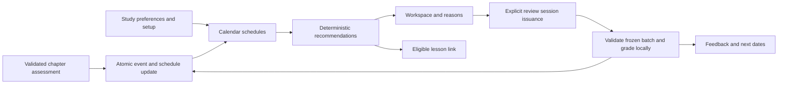

# Today's study — Plan

## Technical Design

<!-- Format: Include a concise solution description and change-relevant architecture or sequence diagram when useful. -->

Add a deterministic calendar-review subsystem alongside existing chapter-index review_items. Use saved, valid MCQs rather than generating content. Keep server-side date calculation, selection, authorization, issuance, and grading separate from the React presentation. Do not change chapter progress from standalone review.

Evidence inspected: lib/review.ts schedules by chapter offset; lib/quiz.ts selects up to two missed source questions; app/api/chapters/[id]/attempts/route.ts accepts a nonempty subset and lacks replay identity; components/course-list.tsx selects a featured course; app/api/chapters/[id]/revisit/route.ts deletes source questions. Existing verified-assessment-progression artifacts are draft, untracked, and outside ownership of this change. Installed Next.js route-handler and caching guides were consulted; re-read relevant guides before application edits.

## Components and Interfaces

<!-- Format: Use bullets. State each component responsibility and its inputs/outputs or interface contract. -->

- lib/assessment-sessions.ts and assessment_sessions: per-learner/chapter immutable question snapshots, one open delivery, canonical option-text submissions and committed JSON results. Chapter quiz GET reuses a current issued delivery; POST rejects incomplete/foreign/stale submissions and consumes under an immediate transaction. Cached question versions, type, owner and source course readiness must match. Study invalidation also invalidates chapter deliveries referencing reset sources. Replay results are linked through the session, preserving existing historical attempt rows.
- lib/study-policy.ts: pure typed date, observation reduction, selection, reason-template and ranking functions, with injected now and zone. Resolve concept identity as courseId + chapterId + trimmed/case-normalized conceptTag; do not equate tags across chapters. Blank tags are ineligible. Persist display tags separately.
- lib/study-calendar.ts: IANA validation via Intl, local YYYY-MM-DD conversion and calendar-day addition. Use UTC arithmetic on parsed date-only components for day addition, not elapsed-day arithmetic on zoned instants. Client does not choose the grading clock.
- Add study_preferences(userId PK/FK, timeZone, initializedAt, policyVersion); explicit PUT /api/study/preferences {timeZone} validates and initializes schedules idempotently. GET /api/study/today remains read-only and returns setupRequired if absent.
- Add concept_review_schedules(id, userId, courseId, chapterId, normalizedTag, displayTag, sourceQuestionId nullable, sourceContentVersion, suspended, dueDate, intervalStage 0..4, lastObservedAt nullable, lastObservedDate nullable, lastOutcome nullable, lastMissDate nullable, revision). Unique(userId,chapterId,normalizedTag), index(userId,dueDate); references and authorization bind course ownership. Stage 0 means a 1-day interval; correct due review advances to 1/2/3/4 with 3/7/14/30 days. A first correct chapter observation initializes stage 0. A later correct chapter observation does not advance a stage or push a pending review later; misses reset stage/date. A same-local-date miss overrides correct scheduling.
- Add study_review_events(id, userId, scheduleId, sourceKind chapter|review, sourceEventId, outcome, observedAt, localDate, policyVersion), unique(scheduleId,sourceKind,sourceEventId). sourceEventId is the immutable accepted chapter-attempt identity or consumed review-session identity. Aggregate same-concept questions with any-miss-wins. Do not synthesize events during backfill.
- Add study_review_sessions(id, userId, status open|consumed|invalidated, privateSnapshot JSON, canonicalSubmission JSON nullable, result JSON nullable, createdAt, consumedAt). Unique partial index for one open session per user. Snapshot freezes schedule IDs/revisions, question text/options/key/rubric, course/chapter/source versions and reason codes. Do not use a question FK whose deletion would destroy committed snapshots.
- lib/study-store.ts: bounded ownership-filtered selection, transactional setup/observation ingestion, issue/reuse/invalidate/consume/replay. Read today returns {today,timeZone,setupRequired,dueCount,unavailableCount,items,nextLesson,nextDueDate}; public items contain identifiers, titles, dueDate and a reason string produced from saved factual parameters, never keys. Scan eligibility before applying the five-item cap. GET calls neither setup nor generation.
- POST /api/study/reviews issues/reuses a batch, or returns no_due_reviews when none is eligible. GET /api/study/reviews/[id] returns owned public frozen questions/status, or committed results for consumed sessions. POST /api/study/reviews/[id]/submit accepts {answers:[{questionId,selectedOptionIndex}]}; bounded integer indices refer to the frozen options. Use exact unique ID coverage; do not accept client scores, keys, dates, or user IDs. 400 invalid, 401 unauthenticated, 404 foreign/missing, 409 stale/conflicting replay, 500 retryable persistence failure. Return no-store for all private responses.
- Validated chapter-attempt integration: call applyChapterStudyObservations(tx, acceptedAttempt, now) within the existing accepted-attempt transaction after exact server-issued coverage validation. Source membership uses issued question metadata, including embedded legacy reviews, not caller claims. Requires prerequisite contract; do not attach this hook to today’s unsafe subset acceptance route.
- components/todays-study.tsx and components/study-review.tsx: setup, reasons, bounded batch, complete answer collection, stable replay, feedback and next lesson; /study/review/[id] page uses requirePageUser. No independent client grading or schema duplication; share safe public contracts.
- React Query keys include authenticated identity where available and study namespace. Invalidate today after attempts, review, source changes and settings; clear on logout. Refetch on focus and server-provided next local rollover instant, with a visibility check on return. Reasons come from pure templates and server facts, never LLM text.

## Data Flow

<!-- Format: Use ordered steps or a diagram to show data transformations and boundaries. -->

1. Validate preferences and authorize user. In one explicit setup transaction create preferences plus initial schedules. Pending legacy review_items take priority; other valid MCQ groups from passed chapters initialize dueDate=today, stage=0, no previous outcome. Open-chapter misses can be seeded. Ignore locked sources, invalid tags/options/keys and unsupported question types. Report unavailable concepts without repeated setup writes on GET.
2. A read-only ownership-joined query computes dueDate <= today, executable concepts, earliest future date, and deterministic top five. Tie-break by dueDate ascending, lastOutcome incorrect first, then scheduleId. Choose source question deterministically from valid current-version questions for that concept, preferring the saved source when still valid; existing chapter preparation states are respected.
3. Compute next lesson by existing featured-course ordering (started first, startedAt/createdAt descending, courseId tie-break), then lowest eligible chapter index; prerequisites must all pass. Ready courses only. Reading recommendations cannot enqueue generation.
4. Start action transactionally reuses one current open review or snapshots a new one. GET never consumes evidence. Resume can offer explicit restart that invalidates an abandoned open session without schedule effects; it does not grade unanswered questions.
5. Submission transaction verifies ownership, exact membership/options, source versions, schedule revisions and eligibility, then grades from private keys, inserts events, reduces each schedule, and consumes session with canonical input/result. Check consumed replay before current revision checks. Identical replay returns result without applying events. Competing chapter results cause review revision conflict and explicit refresh.
6. Correct standalone due review advances one stage on a later local date; miss resets to stage 0/due tomorrow. Correct observation on a date already observed cannot advance. If lastMissDate=today, preserve reset even after a later success. Chapter correct observations initialize missing schedules but do not postpone existing due reviews. Capture chronological server timestamps and serialize writes so same-day ordering is reproducible.
7. A validated chapter attempt applies observation events in its own transaction. Both duplicate source events and source replay are idempotent. Until preferences exist, no calendar event writes occur; initial setup later performs the stated conservative backfill.
8. Revisit/regeneration invalidates affected open sessions and suspends affected schedules until a current valid source is assessed again. Retain existing due dates/stages on a suspended schedule; a later valid observation may reactivate it without inventing historical evidence. Course deletion cascades owned schedules/events and invalidates sessions containing that course. Committed snapshots can be retained only for surviving owned courses; remove sessions containing deleted-course content as part of course deletion.
9. Return public results, refetch recommendations and allow optional next lesson. No chapter completion mutation occurs in standalone review.

## Decisions and Constraints

<!-- Format: Use `### Confirmed Decisions`, `### Assumptions`, `### Constraints`, `### Trade-offs`, and `### Open Questions`, each followed by bullets. -->

### Confirmed Decisions
- Calendar-based review, explained recommendations, privacy, and existing progress preservation are required.
- User confirmed reviews plus one next lesson and inclusion of passed concepts on the 1/3/7/14/30-day schedule. Lead with review when due and make lesson continuation optional. Cap each review batch at five concepts; describe intervals as scheduling rules, not retention estimates.
### Assumptions
- The implementation avoids introducing a scheduler service, daily background job, AI call, notification provider, or date library unless installed platform capabilities prove insufficient.
### Constraints
- User authorized implementing the runtime prerequisite here: private immutable chapter assessment sessions, full issued-question coverage, source freshness, atomic consume/replay, and client identity/recovery. Preserve equal-weight 80% scoring. Do not implement Lean or modify the separate proof draft.
- Keep legacy review_items and chapter-based quiz behavior unchanged. Calendar schedules are a separate responsibility, not a migration of existing review grading.
- Read applicable AGENTS.md and installed Next.js docs before code changes. Current route docs specify async params and request-time private handlers; do not enable shared caching or Cache Components for study data.
- Use DESIGN.md as the approved source of truth, including its white background. Physical scene: a learner returning to a familiar desktop or phone workspace for a quiet short session; retain its established light, restrained interface.
### Trade-offs
- Source-question reuse is cheap and provider-independent but can measure familiarity; disclose repetition and avoid transfer/mastery claims.
- Stable chapter-scoped normalized tags avoid a new concept-authoring system; wording changes create new identities, so suspend stale sources rather than fuzzy-merge them.
- Explicit setup makes GET side-effect-free and fixes a shared calendar zone across devices, with a small one-time setup step.
### Open Questions
- No remaining product-scope questions; both recommended choices were confirmed.
- No outstanding product choices. Runtime session implementation is owned by this build.

## File Changes

<!-- Format: Use bullets. Name each affected file or boundary and the intended change. -->

- New lib/study-policy.ts, lib/study-calendar.ts, lib/study-contracts.ts, lib/study-store.ts, lib/study-client.ts, lib/study-response.ts, lib/study-invalidation.ts and focused tests: pure rules, safe DTOs and transactional persistence.
- lib/db/schema.ts; additive drizzle migration, journal and snapshots generated by the project tool: preferences, schedules, events, sessions and indexes. lib/db/migrations.test.ts and a dedicated historical fixture test verify preservation.
- New app/api/study/today/route.ts, preferences/route.ts, reviews/route.ts, reviews/[id]/route.ts, reviews/[id]/submit/route.ts plus app/study-route.test.ts: authorized uncached contracts and concurrency cases.
- app/page.tsx, components/course-list.tsx, new components/todays-study.tsx, app/studies.css: replace the existing featured resume strip with explained Today’s study while preserving saved lists/creation and their ordering.
- New app/study/review/[id]/page.tsx, scoped review CSS and components/study-review.tsx: private review/resume/results, using existing header, controls, Markdown rendering, focus and layout conventions. Do not call revisit/reset.
- components/profile-form.tsx and settings surface only if needed to expose the saved review-zone change control; keep About me API behavior intact or use a separate study-preferences control.
- app/api/chapters/[id]/attempts/route.ts: only the validated accepted-attempt calendar hook after prerequisite delivery; preserve chapter results/progression policy.
- lib/generation.ts and actual course edit/delete, chapter regeneration/revisit boundaries: study-session invalidation, schedule suspension and deletion lifecycle. Confirm exact mutation sites before edits.
- Existing attempt/revisit/regeneration client success paths: invalidate the study query namespace without changing quiz behavior.
- components/course-list.test.tsx, new study component/policy/store/route tests; new e2e/todays-study.spec.ts and isolated login fixture coverage for persisted two-user flows; existing home-workspace tests for layout/navigation compatibility.
- README.md: interval rules, saved time zone, setup/backfill, repeated-question limitation, deployment/migration and required assessment dependency. No credentials or raw responses in logs.

## Failure Handling

<!-- Format: Use bullets or a table with trigger, implementation response, and recovery. -->

- Pure validation before database mutation; all submission effects use one synchronous SQLite transaction. Inject failures between event/schedule/session writes and require full rollback.
- Two connection races must exercise unique open-session and event constraints. Catch unique-issue races and reload the winning session; no application-only locks.
- Restore a timed-out submission through its saved session identity. Disable duplicate clicks for usability, but enforce correctness on the server.
- Source and schedule revision mismatch: 409 with explicit Refresh review action; retain answers until the learner chooses refresh. Refresh creates a new batch rather than remapping old answers silently.
- Session crossing midnight keeps its frozen membership, while successful scheduling uses submission-day server time in the saved zone. Zone change invalidates open sessions and refreshes recommendations without rewriting due dates.
- GET failure is localized to the Today’s study strip. Existing courses/creation remain functional. Setup failure preserves zone input and rolls back partial seeds.
- Invalid or unavailable questions are filtered before LIMIT; count unavailable concepts and link to source courses without automatically regenerating. Pure MCQ grading works with all providers offline.
- Do not log learner answers, prompts, keys, or raw private snapshots. Operational diagnostics may record opaque session ID, reason code and duration.

## Implementation Steps

<!-- Format: Use ordered, small, independently checkable steps. Include dependencies when relevant. -->

1. Inspect actual assessment delivery and establish the release prerequisite without editing the separate draft. Record its status and read the installed Next.js guides before any application changes (AC-7, AC-11).
2. Implement and verify the authorized runtime assessment prerequisite: additive private session table, immutable question snapshots, exact answer coverage and option validation, source freshness, atomic replay-safe MCQ grading, client identity and stale recovery, and reset invalidation. Preserve historical rows and current score policy; reject old clients with reload guidance (AC-5, AC-7, AC-9, AC-11).
2. Define safe public contracts, normalized concept identity, interval/date policy and deterministic recommendation reducer. Verify fixed-clock scheduling, ordering, same-day precedence, DST and zone-change tables (AC-1, AC-2, AC-3).
3. Add additive schema/migration and explicit idempotent preference/setup service. Verify historical fixture preservation, pending misses, passed concepts, invalid-source reporting and duplicate setup (AC-6, AC-9).
4. Implement observation/event persistence with transaction parameters and revisioning. After the assessment prerequisite is delivered, attach the accepted chapter hook and verify same-transaction rollback, replay, aggregation and legacy review compatibility (AC-2, AC-7, AC-11).
5. Implement read-only recommendations and private preferences routes with factual reason payloads, eligible next lesson, due/unavailable counts and time-zone updates. Verify ownership, read-only behavior and zero provider calls (AC-1, AC-3, AC-8, AC-9).
6. Implement private immutable review issuance/resume, exact complete answer validation, local grading, atomic consumption/replay and public results. Verify invalid inputs, key secrecy, file-backed concurrent tabs and rollback (AC-4, AC-5, AC-9).
7. Integrate source reset/regeneration/edit/delete invalidation and suspension, including cross-course batches and saved results cleanup. Verify stale rejection, unaffected work and safe reactivation (AC-5, AC-8).
8. Implement the Today’s study workspace strip and inline zone setup/change control using approved shared layout primitives; retain course list and creation. Verify loading, reason copy, no-review fallback, focus/rollover refetch and small screens (AC-1, AC-3, AC-8, AC-10).
9. Implement the standalone review page with labelled MCQs, complete-submit validation, retry/resume, result dates and optional next lesson. Verify completed-course review, explicit leave/restart and no progress writes (AC-4, AC-5, AC-10).
10. Wire study-query invalidation after accepted assessments, reviews, source mutations, zone updates and logout. Verify tab focus, midnight and saved-zone behavior across devices (AC-3, AC-7, AC-9, AC-10).
11. Run focused policy, migration, route, two-user and persisted browser scenarios; document scheduling limits and rollout. Run lint, typecheck, full unit suite, production build and focused isolated Playwright checks. Record actual evidence and unresolved prerequisite blockers before marking tasks complete (AC-1 through AC-11).

## Verification Steps

<!-- Format: Use ordered or bulleted checks. Reference spec acceptance IDs where applicable. -->

1. AC-1: Pure/service and route fixtures test five-item cap, deterministic ties, all-course selection, valid-before-limit filtering, exact reason facts, future exclusion and eligible lesson fallback across ready courses.
2. AC-2: Table tests cover initial stage, repeated 30-day interval, miss reset, any-miss aggregation, chapter successes not postponing reviews, duplicate event IDs, same-day success and miss ordering. Verify transaction-backed persistence.
3. AC-3: Inject a clock around local midnight, DST changes in America/New_York, Asia/Kolkata, UTC, leap day, month/year boundaries, invalid zones and zone changes. Verify existing date labels do not shift and an overnight batch uses submission-day scheduling. Browser checks exercise rollover/refocus with controlled clock.
4. AC-4: Snapshot chapter/course/attempt tables around both outcomes from a completed course. Assert unchanged progress/completedAt/attempt history and persisted standalone results after reload.
5. AC-5: Route tests cover exact coverage, duplicates, unknown IDs, numeric options and out-of-range indices, answer-key secrecy, source staleness and revision conflict. File-backed SQLite two-connection tests race issuance, same/different submission and chapter-versus-review updates. Inject write failures; assert one result/event or complete rollback.
6. AC-6: Apply migration to legacy fixtures, initialize twice, compare all existing rows, ownership, scores and completion. Verify rollout-date seeds without synthetic observedAt/events, pending miss priority and invalid-source visibility.
7. AC-7: Against the actual prerequisite implementation, verify complete accepted chapter attempts alone feed schedules; incomplete/duplicate/foreign/stale/replayed inputs do not. A failed schedule update rolls back the attempt, and a retry records once. Report this criterion blocked until prerequisite exists; a mock does not prove integration.
8. AC-8: Service/component tests cover no courses, only future reviews, completed-only courses, preparing/failed courses, absent valid MCQs, source regeneration/reset/delete, abandoned session, and provider outage. Verify unavailable items do not starve valid candidates or trigger generation.
9. AC-9: Extend isolated authenticated fixture tests to two users and fresh sessions. Foreign resource IDs return 404, unauthenticated calls 401, state-changing routes enforce origin checks, private responses no-store, and public snapshots lack keys/rubrics before submit. Inspect course-deletion cleanup and client sign-out cache clearing.
10. AC-10: Add e2e/todays-study.spec.ts with real fixture DB/routes and mocked external AI/mail only. At desktop, 390px and 320px verify full setup/review/result/reload/continue flow, completed-course invariance, stale recovery, future-only fallback, keyboard focus, radio labels, live status, long titles and no page overflow. Store screenshots/results in test-results. Reuse the existing isolated login Playwright configuration rather than a learner database.
11. AC-11: Spy provider adapters for zero calls in today/setup/review; run existing course-list, quiz, attempts, revisit, generation, auth, export and schema tests. Run npm run lint, npm run typecheck, npm test, npm run build and the focused e2e spec using the isolated configuration. Run e2e/style-uniformity.spec.ts only if shared chrome/tokens change.
12. AC-1 through AC-11: Maintain per-task Evidence entries with commands, outcomes and artifacts; verify no production learning data was used. Structural msdd review validates artifact completeness only, not feature behavior or learning effectiveness. Document deviations and keep blocked acceptance criteria unchecked.

Evidence: Build prerequisite audit (2026-10-31): chapter quiz GET returns question rendering fields without an issued assessment ID; attempt POST accepts any nonempty array and averages submitted answers only, with no durable replay identity or exact issued-set/source-version validation. app/attempts-route.test.ts explicitly verifies that a one-answer retry passes after a two-question attempt. The separate verified-assessment-progression artifacts remain draft and were not modified.

Evidence: Ran `npx vitest run app/attempts-route.test.ts app/quiz-route.test.ts`: 2 files and 19 tests passed against isolated in-memory SQLite fixtures. These passing tests confirm current behavior, including the subset-passing retry; they do not establish the required assessment contract. Read installed Next.js route-handler and server/client-component guides.

Evidence: Prerequisite investigation task completed; production implementation is blocked by the plan’s explicit pre-production assessment prerequisite. AC-7 remains unmet. Continuing requires user direction to include a bounded runtime assessment fix (issued immutable MCQ sessions, exact full coverage/freshness checks, atomic consumption and replay) or to wait for that prerequisite separately. This does not authorize implementing the separate Lean verification pilot. No production files or learner data changed in this build attempt.

Evidence: User authorized the recommended bounded runtime prerequisite on 2026-10-31. The prior scope blocker is resolved. No Lean work is authorized or required.

Evidence: Runtime prerequisite implemented using assessment_sessions and lib/assessment-sessions.ts. Exact issued coverage, validated option text (including numeric option text), immutable keys, current source checks, immediate-transaction consumption/replay, reset invalidation and client reload recovery are in place. Focused route tests: 21 passed; quiz component tests: 41 passed. Typecheck and focused ESLint passed before the final replay-only cache-warming guard; full checks will run at completion. New submissions support MCQs only; historical free-text displays remain unchanged.

Evidence: T2 implemented pure calendar, interval, same-day miss precedence, normalized identity, deterministic review ordering/reasons and prerequisite-aware next-lesson selection. `npx vitest run lib/study-policy.test.ts`: 5 passed, including DST, leap/year boundaries and cross-course fallback.

Evidence: T3 added additive calendar tables (migration 0014) and explicit idempotent setup. Four isolated store tests cover history preservation/no synthetic events, ownership, invalid zone rollback, open-chapter misses and invalid-question filtering. No application database migration was run.

Evidence: T4 integrated conservative grouped concept observations into the accepted assessment transaction. Twenty attempt-route and four setup tests passed, including once-only calendar evidence on replay and injected schedule-write failure rolling the attempt back.

Evidence: T5 added private today/preferences routes and factual read-only recommendations. Six store and three route tests passed, covering five-item bounds, overdue reasons, completed courses, invalid-source counts, ownership, private delivery and no setup writes on reads.

Evidence: T6 added immutable review issuance/resume and local exact-coverage grading with once-only replay. Nine store tests passed including completed-course preservation, invalid/stale submissions and injected transactional failure. Independent-process file-backed issuance/submission race test passed.

Evidence: T7 uses lib/study-invalidation.ts at regeneration, reset and syllabus edit boundaries. Migration 0014 includes a chapter-delete trigger that removes cross-course review snapshots containing deleted content. Eleven study-store tests plus eight existing generation/reread tests passed, including suspension, stale rejection, zone-change invalidation and deletion cleanup. There is no course-delete HTTP route in this checkout; database deletion is covered without adding a new product capability.

Evidence: T8 integrates TodaysStudy into CourseList via an optional today slot, preserving standalone CourseList compatibility and hiding the strip for truly empty workspaces. Four new component tests and two existing course-list tests passed. The UI uses scoped styles, explicit time-zone setup/change, reasons, bounded review, optional continuation and localized retry. Shared study-client.ts contains the public HTTP decoder. Browser viewport checks remain in the final verification task.

Evidence: T9 added authenticated /study/review/[id] and the standalone review component. Two component tests passed for full-answer validation, retained selections on transport failure, saved feedback/dates and result focus. Full lint passed with one pre-existing Socratic warning and one new effect dependency warning, which is addressed in T10.

Evidence: T10 wires study invalidation after assessment, review, regeneration, reset and zone updates. Existing AccountControls/Providers already cancel and clear the whole cache on logout/account changes. Today refetches on focus, visibility return and saved-zone local rollover. Twenty-seven focused workspace/course/chapter component tests passed; typecheck passed.

Evidence: Actual design adds an explicit suspended flag, shared client/response helpers, and private /study route cache headers. Calendar events identify immutable attempts; session-owned committed results provide the runtime replay linkage without modifying historical attempts. Initial backfill date means each learner’s explicit setup date in the saved zone, clarified in spec.md. Migrations 0013/0014 are additive; 0014 includes the source-delete cleanup trigger.

Evidence: Final review clarified lastOutcome as the actual latest observation, while lastMissDate independently enforces same-day miss scheduling precedence. This keeps “missed this last time” recommendation text factual after a later correct same-day answer.

Evidence: Final automated verification: `npm test` passed 65 files / 456 tests. The suite includes injected persistence rollback, exact answer coverage/replay, once-only accepted chapter observations, migration preservation, same-day precedence, DST/leap/year arithmetic, overnight submission dates, source suspension/reactivation, mixed-course deletion cleanup, and independent-process file-backed issuance/submit/chapter-versus-review races. Provider spies confirm zero AI calls in setup, recommendations and standalone review.

Evidence: `npx playwright test e2e/todays-study.spec.ts` passed all six scenarios (39.8s), using the isolated login database, real application routes and persistence, and controlled external transports. Scenarios cover 1440/390/320px complete review/result/reload/continue flows, keyboard radio operation, missing-answer announcements, completed-course preservation, future-only fallback, signed-out 401 and second-signed-in-user 404, cross-origin rejection, explicit stale refresh, controlled client rollover/refocus, and long unbroken concept/course names without horizontal overflow. Screenshots: test-results/todays-study-{1440,390,320}.png and corresponding result screenshots. Server calendar arithmetic is fixed-clock unit tested; the browser rollover test controls the client timer boundary, not the server's wall clock.

Evidence: `npx playwright test --config playwright.login.config.ts --grep 'two learners'` passed the real two-user profile/study/export-isolation/complete-assessment/reload/sign-out/account-switch flow. Existing login fixtures were updated to submit all issued questions and scope their header locator. An exploratory full login suite initially reported a landing-page vertical-overflow assertion, ambiguous existing Profile settings locator and Chromium screenshot-capture error. The locator was corrected and the affected two-user flow passed. The untouched landing-page viewport and screenshot-capture checks were not established green; this is a verification limitation outside Today’s study acceptance, not a claim that the full login suite passed.

Evidence: Lint passed with only the existing components/socratic-session.tsx exhaustive-deps warning; typecheck passed. Final production build passed with `NEXT_DIST_DIR=.next-e2e-study-build npm run build`, including the readiness guard and narrow-name wrapping. Temporary build-directory includes were removed from tsconfig after verification; generated Next type references use the normal development directory. Shared fonts/chrome/tokens were not changed, so the conditional style-uniformity crawl was not required. User data was not migrated or modified; browser writes used data/login-e2e.db and unit/process races used isolated fixtures.

Evidence: Final independent-process conflict check also passed: different answers racing to consume the same issued chapter assessment produce exactly one 200 and one 409, one additional attempt, and one observation per concept. `git diff --check` passed. Final lint/typecheck passed, with only the pre-existing Socratic dependency warning.

Evidence: T11: Verification completed: 456 full-suite tests, six feature browser scenarios, targeted two-user login flow, final production build, lint/typecheck and diff checks passed; README records rollout and limitations. Expanded login viewport/screenshot limitations are explicitly recorded above.

Evidence: T12: AC-1 verified by pure policy tests, read-only store/route tests, cross-course identity/selection and browser bounds/reasons/eligible continuation assertions.

Evidence: T13: AC-2 verified by policy interval/cap/reset/same-day precedence tables and transaction-backed actual-observation tests.

Evidence: T14: AC-3 verified by fixed-clock calendar tests, saved-zone invalidation/preserved labels, overnight batch submission date, and browser controlled timer/focus refresh.

Evidence: T15: AC-4 verified by completed-course table projections for both outcomes and real browser saved-result reload/unchanged completion checks.

Evidence: T16: AC-5 verified by route/store invalid-coverage and stale/replay tests, injected rollback, and independent-process file-backed issue, identical/different submit and chapter-versus-review races.

Evidence: T17: AC-6 verified by upgrading a pre-0013 populated fixture without rewriting history, idempotent setup without synthetic events, pending misses and unsupported-source filtering.

Evidence: T18: AC-7 verified against real runtime attempt POST: exact issued coverage, once-only calendar hook inside the transaction, replay, and injected schedule failure rolling back the entire attempt. The prerequisite is implemented; its scope blocker is resolved.

Evidence: T19: AC-8 verified by empty/future/completed/preparing/unavailable/provider-free cases, abandoned batch replacement, suspension/reactivation, stale content and mixed-course deletion tests.

Evidence: T20: AC-9 verified by actual signed-out 401, second-user read/write 404, cross-origin 403, private no-store and pre-submit key exclusion, plus the targeted sign-out/account-switch flow and deletion cleanup.

Evidence: T21: AC-10 verified by six real persistence browser scenarios at desktop/390/320px, keyboard radio selection and alert/result focus, long-name wrapping, stale recovery and controlled refresh. Relevant screenshots visually inspected.

Evidence: T22: AC-11 verified by zero-AI spies, full unit/regression suite, targeted persisted two-user flow, final build/typecheck/lint, and feature browser suite. Shared chrome/tokens were not changed; conditional style crawl not required.

Evidence: T23: AC-1 through AC-11 evidence reconciled with actual tests and artifacts. All learner writes used isolated fixtures; production data was not changed. Expanded-login limitations remain explicit. Structural review is separate from behavioral evidence and no teaching-effectiveness claims are made.
