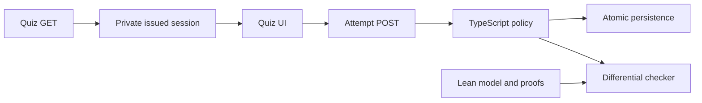

# Verified assessment progression — Plan

## Technical Design

<!-- Format: Include a concise solution description and change-relevant architecture or sequence diagram when useful. -->

Proposed design: retain Next.js/TypeScript production execution. Extract a pure policy, persist immutable issued assessment sessions, and add a Lean executable reference model with named proofs. Model canonical IDs, MCQ correctness booleans/counts, validation decisions, and chapter transitions. Text decoding, answer-key truth, auth, actual transactions, review scheduling, and compiled execution remain tested/trusted boundaries.

The oracle accepts strict canonical JSONL; typed-model proofs do not prove its JSON decoder.

## Components and Interfaces

<!-- Format: Use bullets. State each component responsibility and its inputs/outputs or interface contract. -->

- lib/assessment-policy.ts: pure unique exact-ID coverage, integer MCQ threshold (total > 0 and 5*correct >= 4*total), and sequential progression reducer; reporting score remains correct/total. Reject malformed chapter graphs/indices.
- lib/assessment-sessions.ts: transactional issue/reuse, immutable question/key/options/rubric/tag/source-version/review snapshot, invalidation, consume, and replay. Bind to authenticated learner/chapter.
- GET success adds assessmentId to existing public questions; preparation responses remain supported. Issue exactly ten valid current base MCQs and up to two eligible reviews; reject ambiguous normalized options/keys.
- POST requires {assessmentId, answers:[{questionId,response}]}. Decode response against issued option text, preserving numeric text; no legacy index fallback for the new contract. Normalize to canonical option indices for replay. Preserve successful result shape. Invalid -> 400; stale/different replay -> 409; ownership follows existing authorization behavior.
- Add assessment_sessions with learner/chapter, source versions, private snapshot, open/consumed/invalidated status, canonical submission and committed result. Unique partial index permits one open session per learner/chapter. Add nullable unique attempts.assessmentId foreign key, preserving historical rows.
- verification/assessment: pinned stable Lean/Lake project and dependencies, typed model, proofs, JSONL oracle, theorem manifest; audit transitive axioms against propext/Classical.choice/Quot.sound and run lean4checker --fresh. Reject sorry/custom/native axioms.
- scripts/verify-assessment-model.ts: deterministic seed and bounded/adversarial corpus, strict executable/JSON/output-count checks, reproducible counterexamples and case counts. Missing tools or zero comparisons fail.

## Data Flow

<!-- Format: Use ordered steps or a diagram to show data transformations and boundaries. -->

1. Authorize GET and prepare/select current questions, then transactionally issue/reuse one open session. Freeze review selection across reloads.
2. Client submits the saved assessmentId and complete displayed answer set.
3. POST authorizes, decodes, then inside one SQLite write transaction rechecks session freshness/unlocked state, handles replay, computes policy, allocates attemptNo, and writes attempt/answers/review updates/progression/session result together.
4. Open next chapter only from locked to open when prerequisites pass; preserve passed states and completion. Review scheduling retains existing semantics and is integration-tested.
5. After commit, warming uses existing enqueue/recovery behavior; failures cannot overwrite the committed result. Identical replay performs no additional side effects.
6. Fresh retry after failure follows existing generation flow before issuing a replacement session. Source invalidation/revisit/deletion invalidates all affected open sessions, including other chapters referencing deleted review questions.
7. Compare TypeScript and Lean canonical decisions/state projections; separately test actual adapters and persistence.

## Decisions and Constraints

<!-- Format: Use `### Confirmed Decisions`, `### Assumptions`, `### Constraints`, `### Trade-offs`, and `### Open Questions`, each followed by bullets. -->

### Confirmed Decisions
- Start with assessment validity and progression; preserve historical data.
### Assumptions
- Draft assumes recommended TypeScript/reference-model execution and equal review weighting, pending user responses.
### Constraints
- Read relevant installed Next.js documentation before implementation.
- Pin an available stable Lean release and matching recheck tooling during setup; no unverified release number is prescribed.
- Bound JS numbers explicitly; ID/text mapping, JSON decoder, runtime/compiler, authentication and SQLite remain outside model proofs.
- Review theorem statements and definitions independently from AI-generated proof changes.
### Trade-offs
- Persisted sessions add schema/recovery work but define exact coverage and replay.
- Differential tests preserve the app stack but do not prove TypeScript equivalence.
### Open Questions
- Confirm execution boundary and review-question score policy before finalizing/building.

## File Changes

<!-- Format: Use bullets. Name each affected file or boundary and the intended change. -->

- New lib/assessment-policy.ts and tests; new lib/assessment-sessions.ts and tests.
- lib/db/schema.ts, new drizzle migration and generated metadata: additive session storage and nullable attempt linkage.
- app/api/chapters/[id]/quiz/route.ts and attempts/route.ts: issued identities and atomic consumption.
- lib/generation.ts invalidation, chapter revisit, course edit/delete boundaries: invalidate open sessions and cross-review references safely.
- lib/gating.ts and lib/quiz.ts: shared deterministic policy/option decoding while preserving historical display helpers.
- components/quiz-page.tsx and tests: identity, explicit stale recovery, identical retry.
- app/quiz-route.test.ts, app/attempts-route.test.ts, authenticated isolation and focused Playwright fixtures: full-session contracts replace subset-passing expectations.
- verification/assessment/**, proof-gate entry point and scripts/verify-assessment-model.ts: pinned formal model, audit/recheck, oracle and comparisons.
- package.json, lockfile if needed, scripts/ralph.ts and tests: required verification gates without launching paid runs.
- README.md: setup, checks, guarantees and assumptions.

## Failure Handling

<!-- Format: Use bullets or a table with trigger, implementation response, and recovery. -->

- Validate exact coverage before persistence; duplicate submissions get 400 rather than database exceptions.
- Recheck mutable assumptions inside transaction. Concurrent issuance reloads the unique winning session.
- Identical replay returns stored result; different replay conflicts. Allocate attempt sequence within transaction.
- Inject failures to establish rollback of all learning effects and session consumption.
- Old clients get reload guidance; never infer a session from submitted IDs.
- Failed model tools, malformed oracle outputs, incomplete proofs, missing rechecker or skipped/zero comparisons block acceptance.
- Stale recovery clears inputs only after explicit reload; transport failures retain them for retry.

## Implementation Steps

<!-- Format: Use ordered, small, independently checkable steps. Include dependencies when relevant. -->

1. Resolve the two pending decisions, read installed Next.js guides, define canonical contracts and theorem statements, and map acceptance IDs to evidence boundaries.
2. Add migration, private session issuance/reuse and source/review invalidation; verify legacy fixture preservation (AC-1, AC-5, AC-7).
3. Implement pure coverage, option decoding, integer scoring and progression; verify malformed inputs and status preservation (AC-2, AC-3, AC-4).
4. Integrate GET/POST atomic consumption, replay, review updates and post-commit enqueue handling; verify route/concurrency regressions (AC-1-AC-7).
5. Update client identity/recovery and run isolated desktop/mobile persisted quiz flows (AC-5, AC-7).
6. Add pinned Lean model, named proofs, oracle, transitive axiom audit and independent rechecker; verify deliberate bad-proof fixtures (AC-8).
7. Implement deterministic differential/adversarial and mutation checks; require proof/model gates in npm and Ralph (AC-9).
8. Document exact guarantees and run final regression, migration, browser, proof and comparison checks; record Evidence: results (AC-1-AC-10).

## Verification Steps

<!-- Format: Use ordered or bulleted checks. Reference spec acceptance IDs where applicable. -->

1. AC-1/AC-5: In-memory migrated SQLite route tests establish stable identity, frozen ten/twelve-question membership, stale rejection and key secrecy.
2. AC-2/AC-3: Reject missing identity/subsets/duplicates/extras/foreign/options with zero learning effects; enumerate correct counts at totals 10/11/12 and numeric text/normalization cases.
3. AC-4: Test failed/pass progression, missing prerequisites, duplicate indices, passed successor, empty course and unrelated course preservation; explicit reset is excluded from submission theorem.
4. AC-5/AC-6: Two-connection file-backed SQLite tests race issue/submit/replay; inject persistence and post-commit enqueue failures; assert exactly one attempt and review application, complete rollback on persistence failure, and cross-review invalidation.
5. AC-7: Migrate isolated historical records and compare ownership/counts/scores; run authenticated two-user and desktop/mobile complete/retry/stale-tab browser flows without real AI/mail.
6. AC-8: Build pinned Lean, audit named theorem dependencies transitively and independently recheck stored proofs. Named results cover unique exact coverage, positive-total inclusive integer threshold, allowed transitions, and unchanged state on modeled rejection. Deliberate sorry/custom-axiom fixtures must fail; inspect statements and preconditions.
7. AC-9: Exhaust small canonical inputs and seed larger/adversarial inputs; compare strict decisions/state projections and publish seed/count. Temporary mutations to threshold, subset acceptance, prerequisite checking and passed-status preservation must be detected and cleaned up. Missing tool/output/zero cases fail.
8. AC-9: Fake-command Ralph tests prove proof/model failures block acceptance/commit; run gates directly without starting paid agents.
9. AC-1-AC-10: Run lint, typecheck, full Vitest, production build, proof/model gates and focused browser/isolation checks. Record blockers against affected criteria rather than claiming success.
10. AC-10: Review maintainer documentation for explicit proved-model, sampled-agreement, tested-adapter and runtime-trust categories; no whole-app or teaching-correctness claims.
